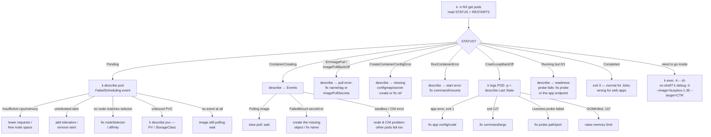

# T3.24 Debugging in Kubernetes

> Competency: "Debugging in Kubernetes" (CKAD-3.5) | Domain/weight: CKAD, Application Observability and Maintenance (15%) | Est. time: 3 h | Prerequisites: T3.22, T3.23, T3.12

Shell setup (from [conventions](../00-conventions.md); put it at the top of every session):

```bash
alias k=kubectl
export do="--dry-run=client -o yaml"
export now="--force --grace-period=0"
source <(kubectl completion bash); complete -o default -F __start_kubectl k
```

Lab environment for this lesson: **kind** (cluster `lab`, context `kind-lab`, 1 control plane + 2 workers, node names `lab-control-plane`, `lab-worker`, `lab-worker2`). Namespace: `lab-t324`. Files go in `~/lab/t324/`.

Prerequisites you should have read: [T3.22 Utilize container logs](../part3-ckad/T3.22-utilize-container-logs.md) (`k logs`, `--previous`, `-c`), [T3.23 Use built-in CLI tools to monitor Kubernetes applications](../part3-ckad/T3.23-use-built-in-cli-tools-to.md) (`describe`, events, `get -w`, `-o wide`, restart counts) and [T3.12 Provide and troubleshoot access to applications via Services](../part3-ckad/T3.12-provide-and-troubleshoot-access-to-applications.md) (Service, endpoints, selectors, DNS). This lesson reuses those commands inside a fixed triage order and adds `kubectl exec`, `kubectl debug` and `kubectl port-forward`.

> Output policy. This lesson was written on a machine with no kind cluster (see "Known limitation" in section 11). Blocks carry one of these labels:
> - `REAL OUTPUT (kubectl v1.37.2 client, no cluster)`: captured here. `kubectl explain`, `kubectl debug --help` and `--dry-run=client` need no cluster, so they are real.
> - `EXPECTED OUTPUT (not captured)`: the shape you should see on a v1.37 cluster. Names, ages, IPs and hashes will differ. Every such block is listed in section 11.

---

## 1. Why this matters

Debugging is a large share of both exams: you will get Pods that are Pending, crash-looping, or unreachable, and a few minutes each to find the cause and fix it. In real life the same skill answers "why did the deploy break at 2 a.m.?" The trap is random poking — people jump straight to `exec`, find no shell, and burn five minutes. A fixed triage order (get → describe → logs → exec → debug) always works, because each step eliminates a whole layer: scheduler, node/kubelet, image, app. The exam averages about 6 minutes per task (15-20 tasks in 2 hours; sources: [E2](https://docs.linuxfoundation.org/tc-docs/certification/tips-cka-and-ckad), [E3](https://docs.linuxfoundation.org/tc-docs/certification/faq-cka-ckad-cks)), so the order must be a reflex.

---

## 2. Concepts

### 2.1 The fixed triage order

When a task says "the application `web` in namespace `x` is broken, fix it", run the same five steps in the same order. Do not skip steps: each one is cheap and each one rules out a layer.

| Step | Command | Question it answers |
|---|---|---|
| 1. get | `k -n NS get pods -o wide` | What does the STATUS column say? Which node? Which IP? Is RESTARTS growing? |
| 2. describe | `k -n NS describe pod NAME` | What do the Events say? What are the container `State` / `Last State` / `Reason`? |
| 3. logs | `k -n NS logs NAME` and `k -n NS logs NAME -p` (previous instance) | What did the app itself print before dying? |
| 4. exec | `k -n NS exec -it NAME -- sh` | What do env vars, files, DNS and connectivity look like from inside? |
| 5. debug | `k debug ...` | The container has no shell or crashes too fast — bring your own tools. |

The order goes from "the cluster could not even start the container" (scheduler, image, mounts — visible in status and events) to "the container runs but misbehaves" (app logs, env, network — need exec/debug). Jumping ahead is wasted time: a Pending Pod has no logs and nothing to exec into.

### 2.2 Reading the STATUS column: the vocabulary

The `STATUS` column of `k get pods` is a string kubectl builds from the Pod phase and the container states. Learn the whole vocabulary so the word itself already tells you where to look next.

| STATUS | What it means | First look |
|---|---|---|
| `Pending` | No kubelet accepted the Pod yet (scheduling problem), or it is bound but the image is still pulling | `describe` → `FailedScheduling` event |
| `ContainerCreating` | Bound, sandbox created; kubelet is pulling the image, resolving config or mounting volumes | `describe` → Events (`Pulling`, `FailedMount`) |
| `ImagePullBackOff`, `ErrImagePull` | The runtime tried to pull and failed (name, tag, auth) | `describe` → pull error text |
| `CreateContainerConfigError` | The Pod references something that does not exist (ConfigMap, Secret) | `describe` → `configmap "x" not found` |
| `RunContainerError` | The runtime could not start the container process (for example a binary that does not exist) | `describe` → runtime start error |
| `CrashLoopBackOff` | The container starts and exits (or is killed), over and over, with a growing delay | `logs -p`, `describe` → `Last State` |
| `Running` (READY `0/1`) | Process is up but not Ready — readiness probe failing, or still starting | `describe` → probe failures |
| `Completed` | All containers exited 0 — normal end state for Jobs, not for web apps | `logs`, check `restartPolicy` |
| `Error` | Container exited non-zero and the Pod's `restartPolicy` will not retry | `describe` → `Last State` |
| `OOMKilled` | Not a STATUS value — it is a `lastState.terminated.reason`. The kernel killed the container for exceeding its memory limit | `describe` or jsonpath `lastState.terminated` |

Two numbers change how you read this. `READY 0/1` means zero of one containers are Ready — the app may be running and still not serve traffic. `RESTARTS 5 (2m ago)` counts container restarts; a growing count is a crash loop even when STATUS briefly shows `Running`.

**Exit codes you will see in `describe`:**

| Exit code | Meaning |
|---|---|
| 0 | Clean exit. With `restartPolicy: Always` the container is restarted anyway — a healthy-looking crash loop |
| 1 | Generic application error — read the logs |
| 126 | Command found but not executable |
| 127 | Command not found (typo in `command`/`args`) |
| 137 | 128 + 9 = killed by SIGKILL — usually `OOMKilled`, or a forced delete |
| 143 | 128 + 15 = SIGTERM — normal shutdown |

**Related but different.** `CrashLoopBackOff` is a *waiting reason*: between restarts the container does not run; the backoff delay grows (10 s, 20 s, 40 s …, capped at five minutes). `Error` is a *terminated reason*: the container ran and exited non-zero. `OOMKilled` only ever appears in `lastState`/`state.terminated` — the STATUS column will say `CrashLoopBackOff` or `Running` while the real reason is hidden in `describe`. That is why step 2 is never optional.

### 2.3 Pending: the scheduler could not place the Pod

A Pod in `Pending` has no container yet — the kubelet never saw it. `k describe pod` ends with a `FailedScheduling` warning from the `default-scheduler`. The message tells you the cause directly:

| Event text (trimmed) | Cause | Fix |
|---|---|---|
| `0/3 nodes are available: 2 Insufficient memory` (or `cpu`) | Requests exceed what the untainted nodes can allocate | Lower `resources.requests`, or free/add nodes |
| `1 node(s) had untolerated taint {node-role.kubernetes.io/control-plane: }` | Node is tainted and the Pod has no `tolerations` (on kind the control plane always carries this one) | Add the toleration, or remove the taint if it is yours |
| `didn't match Pod's node affinity/selector` | `nodeSelector`/`nodeAffinity` matches nothing | Fix the selector or label a node |
| `pod has unbound immediate PersistentVolumeClaims` | The PVC is not bound | `k get pvc` + `k describe pvc` — missing PV, StorageClass or provisioner |
| `pod didn't trigger scale-up` (autoscaler clusters only) | Cluster-autoscaler declined | Not on kind; recognise the shape |

EXPECTED OUTPUT (not captured)

```text
$ k -n lab-t324 describe pod web-7c9b8f6d4-x1j2k | grep -A4 '^Events'
Events:
  Type     Reason            Age   From               Message
  ----     ------            ----  ----               -------
  Warning  FailedScheduling  15s   default-scheduler  0/3 nodes are available: 1 node(s) had untolerated taint {node-role.kubernetes.io/control-plane: }, 2 Insufficient memory. preemption: 0/3 nodes are available: 3 No preemption victims found for incoming pod.
```

Read it clause by clause: the message lists one `<count> <reason>` per failure, so on kind you always get the control-plane's `untolerated taint` clause mixed into the count — here 2 workers fail on memory and the third node is off-limits entirely. `Insufficient memory` means the *requests* do not fit — check `k describe node` "Allocated resources" or simply lower the request (see [T3.05](../part3-ckad/T3.05-define-resource-requirements.md)). A Pending Pod with **no** `FailedScheduling` event is usually still pulling its first image — the fix is patience, not YAML.

### 2.4 ContainerCreating: bound, but the container is not built yet

The Pod is on a node and the kubelet is doing the slow steps: pulling the image, resolving ConfigMaps/Secrets, attaching and mounting volumes, wiring the network (CNI). `k get pods` alone cannot distinguish them — Events can:

| Event text (trimmed) | Cause | Fix |
|---|---|---|
| `Pulling image "registry/app:1.2"` | Normal — big image or slow registry | Wait; check it progresses |
| `FailedMount` / `MountVolume.SetUp failed for volume "cfg": secret "app-secret" not found` | Volume source object missing | Create the Secret/ConfigMap, or fix the name in `volumes` |
| `Unable to attach or mount volumes: ... timed out waiting for the condition` | Volume attach stuck (storage backend) | Check PV/PVC and the CSI provisioner |
| `Failed to create pod sandbox: ... network plugin is not ready` / `failed to find plugin` | CNI broken on that node | Other Pods on the same node fail too — `k get pods -A -o wide`, then look at the node's CNI DaemonSet |

The subtle one: a **volume-mounted** Secret/ConfigMap that is missing keeps the Pod in `ContainerCreating` with a `FailedMount` event, while the same object referenced via `env`/`envFrom` produces `CreateContainerConfigError` (next section). Same root cause, different surface — this is exactly the kind of pair the exam likes.

### 2.5 CrashLoopBackOff: starts, dies, repeats

`CrashLoopBackOff` means: the container ran and ended, `restartPolicy` restarted it, and it ended again. The four root causes:

| Cause | How to see it |
|---|---|
| App exits with an error | `k logs POD --previous` (or `-p`) — the app's own error is there |
| Bad `command`/`args` | `logs -p` shows a usage error; `describe` shows exit 127 (not found) or a runtime start error |
| Failing liveness probe | `describe` → `Liveness probe failed: ...` then `Killing ... failed liveness probe` |
| OOMKilled | `describe` → `Last State: Terminated, Reason: OOMKilled, Exit Code: 137` |

`--previous` is the flag that saves you: `k logs web` shows the *current* run, which may have printed nothing yet; `-p` shows the run that actually died. If there is no previous instance the command errors — that itself tells you the container never restarted.

EXPECTED OUTPUT (not captured)

```text
$ k -n lab-t324 describe pod web-7c9b8f6d4-x1j2k
...
    State:          Waiting
      Reason:       CrashLoopBackOff
    Last State:     Terminated
      Reason:       OOMKilled
      Exit Code:    137
      Started:      ...   Finished:     ...
    Ready:          False
    Restart Count:  5
...
```

The `Last State` block is the whole diagnosis in three lines: `Reason` (why the kernel/kubelet ended it — `OOMKilled`, `Error`, `Completed`), `Exit Code`, and the timestamps. With `OOMKilled` the fix is a higher `resources.limits.memory` (or a real leak). With a probe kill you fix the probe or the endpoint it calls. With exit 1 you read `--previous` logs. Note the asymmetry: an **exit 0** crash loop (`Reason: Completed`) means the app's entrypoint returns immediately — the classic case is a one-shot command in a Pod that should serve forever.

### 2.6 ImagePullBackOff, CreateContainerConfigError, RunContainerError, Completed

**`ErrImagePull` / `ImagePullBackOff`.** The runtime could not fetch the image. `ErrImagePull` is the first failure; after retries it shows `ImagePullBackOff`. Causes, in frequency order: typo in repo or tag (`docker.io/library/nginx:9.9: not found`), private registry without `imagePullSecrets` (`unauthorized`, `authentication required`), registry unreachable. Fix: `k set image` with a good name/tag, or add `imagePullSecrets` (see [T3.04](../part3-ckad/T3.04-create-consume-secrets.md) for docker-registry Secrets). Pod `spec.containers[*].image` is one of the few fields you may mutate on a running Pod object.

**`CreateContainerConfigError`.** The kubelet cannot even build the container config: `env`/`envFrom`/`volumeMount` references a ConfigMap or Secret that does not exist (`Error: configmap "app-config" not found`), or a field value is invalid. Fix: create the missing object or correct the reference. It needs no image pull at all — you can see this status on a Pod that never started.

**`RunContainerError` (and `CreateContainerError` / `StartError` on some runtimes).** The image and config resolved, but the runtime could not start the process — typically a `command` pointing at a file that does not exist in the image (`exec: "badcmd": executable file not found in $PATH`), or a mount that cannot be created. Different surface than CrashLoopBackOff: here the process never ran, so `logs -p` has nothing; `describe` is the only source.

**`Completed`.** Not an error: every container exited 0. Normal for `restartPolicy: OnFailure`/`Never` (Jobs). Two traps: a web-app Pod showing `Completed` means its entrypoint exits cleanly instead of serving — fix the command; and `k get pods` keeps listing Completed Pods forever — clean them with `k delete pod` (or the Job's `ttlSecondsAfterFinished`).

### 2.7 `k describe pod`: where to look

`k -n lab-t324 describe pod web` prints, top to bottom: metadata and `Node`, `Status`, `IP`, `Controlled By` (which controller owns it — follow this before fixing the Pod itself; see section 6), `Containers:` per container (`Image`, `Command`, `State`, `Last State`, `Ready`, `Restart Count`, `Environment`, `Mounts`), `Conditions`, `Volumes`, then `Events`. Read it bottom-up for the *cause* (Events) and middle for the *state* (`State`/`Last State`/`Reason`/`Exit Code`).

Events age out (about an hour by default). If `describe` shows `<none>` or `No events`, the failure may be old — delete the Pod so the controller recreates it and watch the events come back, or list them with `k -n NS get events --sort-by=.lastTimestamp`.

### 2.8 `k logs` and `--previous`

Covered in depth in [T3.22](../part3-ckad/T3.22-utilize-container-logs.md); the debugging essentials:

```bash
k -n lab-t324 logs web-7c9b8f6d4-x1j2k              # current run, stdout/stderr of PID 1
k -n lab-t324 logs web-7c9b8f6d4-x1j2k -p          # the run that just died
k -n lab-t324 logs web-7c9b8f6d4-x1j2k -c sidecar  # pick a container in a multi-container Pod
k -n lab-t324 logs deploy/web --tail=50            # one Pod of the Deployment, last 50 lines
```

`-p` (`--previous`) prints the previous instance of the container if one exists — for a crash-looping Pod this is almost always what you want first. No previous instance → `error: previous terminated container "web" in pod "web-..." not found`, which means the failure happened before the container ever ran (image/config/start problem — go back to `describe`).

### 2.9 `kubectl exec`: env, files, DNS, connectivity

Once a container is Running, `exec` is your eye inside it. Needs a shell (`sh` or `bash`) for interactive work, and `-c` for multi-container Pods:

```bash
k -n lab-t324 exec -it web-7c9b8f6d4-x1j2k -- sh      # interactive shell
k -n lab-t324 exec web-7c9b8f6d4-x1j2k -- env         # every env var the container actually got
k -n lab-t324 exec web-7c9b8f6d4-x1j2k -- cat /etc/app/config.yaml   # what a mounted CM/Secret delivered
k -n lab-t324 exec web-7c9b8f6d4-x1j2k -- cat /etc/resolv.conf       # DNS config (nameserver, search domains)
```

DNS and connectivity checks with a busybox-class image:

```bash
k -n lab-t324 exec web-7c9b8f6d4-x1j2k -- nslookup kubernetes.default.svc.cluster.local
k -n lab-t324 exec web-7c9b8f6d4-x1j2k -- nslookup web-svc          # Service name resolution
k -n lab-t324 exec web-7c9b8f6d4-x1j2k -- wget -qO- --timeout=2 http://web-svc/healthz
```

Read the failures precisely: `nslookup` failing on the Service name while `kubernetes.default` resolves → the Service itself is wrong (name/namespace), not cluster DNS. `wget` resolving the name but getting `connection refused` → DNS is fine, nothing listens on that port — check `containerPort`, the probe port, or the app. `wget` to the Pod IP working while the Service name fails → Service/endpoints/selector problem (see [T3.12](../part3-ckad/T3.12-provide-and-troubleshoot-access-to-applications.md)). Busybox has `nslookup`, `wget`, `nc`, `ping`; slim images may have none of them — then read `/etc/resolv.conf` by hand or use `kubectl debug` (next).

`exec` fails outright when the container has no shell — the classic distroless case:

EXPECTED OUTPUT (not captured)

```text
$ k -n lab-t324 exec -it distro -- sh
OCI runtime exec failed: exec failed: unable to start container process: exec: "sh": executable file not found in $PATH: unknown
command terminated with exit code 126
```

### 2.10 `kubectl debug`: ephemeral containers

An **ephemeral container** is a container added to an *already running* Pod for debugging — no restart, no spec change the controller will fight. Stable since Kubernetes v1.25. It lives in the Pod's sandbox (so it shares the Pod's network namespace — `localhost:8080` reaches the app) and, with `--target`, in the target container's *process namespace* (so `ps` sees the app's processes).

```bash
k -n lab-t324 debug -it web-7c9b8f6d4-x1j2k --image=busybox:1.36 --target=web
```

EXPECTED OUTPUT (not captured)

```text
Targeting container "web". If you don't see processes from this container it may be because the container runtime doesn't support this feature.
Defaulting debug container name to debugger-x7p2m.
If you don't see a command prompt, try pressing enter.
/ #
```

What each flag does:

| Flag | Meaning |
|---|---|
| `-it` (`-i` + `-t`) | stdin + TTY, and it implies `--attach` — you land inside the debug container |
| `--image=busybox:1.36` | Image for the new ephemeral container (always pinned) |
| `--target=web` | Share the process namespace of container `web` — `ps` shows the app's processes and `/proc/1/root` is the app's root filesystem. Needs runtime support (containerd/CRI-O have it) |
| `-c NAME` / `--container` | Name *you* give the debug container; without it a `debugger-xxxx` name is generated |
| `--image-pull-policy` | Pull policy for the debug image |
| `--env` | Extra env vars for the debug container |
| `--profile` | Privilege level — section 2.12 |
| `-q` | Suppress the informational lines |

Inside it, the moves that matter:

```sh
ps                      # the app's PID 1 and its real command line (because of --target)
ls /proc/1/root         # the app container's root filesystem — works even on distroless images
cat /proc/1/environ | tr '\0' '\n'   # the app's real environment
netstat -tln            # who listens on which port in the pod's shared network namespace
```

That `/proc/1/root` trick is the answer to "inspect a distroless filesystem": your busybox tools run in *your* mount namespace, but `/proc/<pid>/root` is a view into the *app's* mount namespace.

Afterwards the ephemeral container shows up in `describe` under `Ephemeral Containers:` and in `-o yaml` as `.spec.ephemeralContainers` / `.status.ephemeralContainerStatuses` (`Ready: False`, `Restart Count: 0` — they have no probes and no restarts). **They cannot be removed or modified** — by design. Deletion of the Pod is the only cleanup.

**Under the hood (RBAC).** Adding one is an *update* on the `pods/ephemeralcontainers` **subresource**, and that permission is deliberately not in the default `admin`/`edit` ClusterRoles. If you hit it, the error is unmistakable:

```text
Error from server (Forbidden): pods "web" is forbidden: User "alice" cannot patch resource "pods/ephemeralcontainers" in API group "" in the namespace "lab-t324"
```

(From the docs page in section 10.) Also, ephemeral containers are checked against Pod Security admission — a namespace enforcing `baseline` or `restricted` rejects a too-powerful debug container; answer with `--profile=baseline` or `--profile=restricted`.

### 2.11 `kubectl debug`: pod copies (`--copy-to`)

Sometimes you must *change* the Pod to debug it — different image, different command, probes stripped — without touching the original. `--copy-to=NAME` creates a standalone copy Pod (no owner references, no controller) with your modifications:

```bash
k -n lab-t324 debug web-7c9b8f6d4-x1j2k -it --copy-to=web-dbg --container=web -- sh
```

This copies the Pod, replaces the **command of container `web`** with `sh`, and attaches. The `--container` name is mandatory for command replacement — without it kubectl adds a *new* container running `sh` instead of changing the existing one. The flags that matter in copy mode — REAL OUTPUT (kubectl v1.37.2 client, no cluster), trimmed from `kubectl debug --help`:

```text
    --copy-to='':            Create a copy of the target Pod with this name.
    -c, --container='':      Container name to use for debug container.
    --set-image=[]:          When used with '--copy-to', a list of name=image pairs for changing
                             container images, similar to how 'kubectl set image' works.
    --share-processes=true:  When used with '--copy-to', enable process namespace sharing in the copy.
    --same-node=false:       When used with '--copy-to', schedule the copy of target Pod on the same node.
    --replace=false:         When used with '--copy-to', delete the original Pod.
    --keep-init-containers=true:  Run the init containers for the pod. Defaults to true.
    --keep-liveness=false:   If true, keep the original pod liveness probes.
    --keep-readiness=false:  If true, keep the original pod readiness probes.
    --keep-startup=false:    If true, keep the original pod startup probes.
    --keep-labels=false:     If true, keep the original pod labels.
    --keep-annotations=false: If true, keep the original pod annotations.
    --arguments-only=false:  If specified, everything after -- will be passed to the new container as
                             Args instead of Command.
    --profile='general':     Options are "general", "baseline", "restricted", "netadmin" or
                             "sysadmin". Defaults to "general"
```

Three copy-mode details worth memorising:

1. **Probes are stripped by default** (`--keep-liveness/readiness/startup=false`). A copy of a Pod killed by a bad liveness probe would die the same way; the defaults save you from that.
2. **Labels are stripped by default** (`--keep-labels=false`), so the copy does not join Services or confuse selectors. Keep them only if you deliberately want the copy addressable.
3. **`--share-processes` defaults to true** for copies in v1.37 — the copy's containers see each other's processes (docs describe the older explicit flag; the help above is the v1.37.2 truth).

The signature use case from the exam point of view — *"the container crashes on startup, image has no shell: make a copy that sleeps so I can look at its filesystem"*:

```bash
k -n lab-t324 debug web-7c9b8f6d4-x1j2k --copy-to=web-dbg \
  --container=web --set-image=web=busybox:1.36 -- sleep 3600
k -n lab-t324 exec -it web-dbg -c web -- sh    # now inspect /, env, volumes at leisure
```

`--set-image=web=busybox:1.36` rewrites the `web` container's image (`*=busybox:1.36` rewrites all containers); `-- sleep 3600` rewrites its command. The copy keeps the original's env, volumes and mounts — exactly what you need to see what the app saw.

### 2.12 Debug profiles: `--profile=...`

Profiles set the debug container's `securityContext` (and related fields) for you. REAL OUTPUT (kubectl v1.37.2 client, no cluster) — the `--profile` help line:

```text
    --profile='general':
	Options are "general", "baseline", "restricted", "netadmin" or "sysadmin". Defaults to "general"
```

| Profile | What it is for |
|---|---|
| `general` | Default. A reasonable generic set for everyday debugging |
| `baseline` | Compatible with the Pod Security *baseline* policy — use when the namespace enforces it |
| `restricted` | Compatible with Pod Security *restricted* — the most locked-down set |
| `netadmin` | `general` plus network-admin capabilities (packet capture, interface inspection) |
| `sysadmin` | System-admin — the docs show the ephemeral container becomes privileged (`{"privileged":true}`); needed for `chroot /host` on a node-debug pod or real packet capture |

Older docs describe a sixth profile, `legacy` (pre-profiles behaviour), but the v1.37.2 client lists only the five above and defaults to `general`. There is also `--custom=<file>`: a YAML/JSON **partial container spec** merged on top of a profile (stable since v1.32). It cannot change `name`, `image`, `command`, `lifecycle` or `volumeDevices` — use it to add env vars or capabilities, e.g.:

```yaml
# ~/lab/t324/custom-profile.yaml — add env + capabilities to a 'general' debug container
env:
- name: DEBUG_LEVEL
  value: verbose
securityContext:
  capabilities:
    add: ["NET_ADMIN", "SYS_TIME"]
```

```bash
k -n lab-t324 debug -it web-7c9b8f6d4-x1j2k --image=busybox:1.36 --target=web \
  --profile=general --custom=~/lab/t324/custom-profile.yaml
```

### 2.13 `kubectl debug` on a node: the host at `/host`

When the problem is the *node* (kubelet logs, container runtime, host files, other Pods' artifacts), debug the node itself:

```bash
k debug node/lab-worker -it --image=busybox:1.36
```

EXPECTED OUTPUT (not captured)

```text
Creating debugging pod node-debugger-lab-worker-2fv8q with container debugger on node lab-worker.
If you don't see a command prompt, try pressing enter.
/ # ls /host
bin  etc  home  lib  root  run  sbin  sys  usr  var  ...
/ # ls /host/var/log/pods | head
kube-system_calico-node-...
```

Facts to remember: the Pod is named `node-debugger-<node>-<random>` and lands on that node; **the node's root filesystem is mounted at `/host`**; the container runs in the host IPC, network and PID namespaces but is **not privileged by default** — so `chroot /host` and parts of `/proc` can fail; use `--profile=sysadmin` when you need full power. Cleanup is manual: `k delete pod node-debugger-lab-worker-2fv8q`. Typical uses: read kubelet/containerd logs under `/host/var/log/`, check `/host` disk pressure, look at a Pod's files in `/host/var/log/pods/<ns>_<pod>_<uid>/`.

### 2.14 `kubectl port-forward`: bypass the Service layer

`port-forward` opens a tunnel from your machine to a specific Pod (selected directly, or through a Service/Deployment) and forwards a local port to it:

```bash
k -n lab-t324 port-forward pod/web-7c9b8f6d4-x1j2k 8080:8080   # local 8080 -> pod 8080
k -n lab-t324 port-forward svc/web-svc 8080:80                 # one backing pod, service's targetPort
k -n lab-t324 port-forward deploy/web 8080:8080                # a pod selected by the deployment
curl http://localhost:8080/healthz                             # test in a second terminal
```

It is the single best "is it the Pod or the Service?" test: if `curl localhost:8080` through `pod/` works while `wget http://web-svc` from inside fails, the app is fine and the Service path (selector, `targetPort`, EndpointSlice) is broken — hand off to [T3.12](../part3-ckad/T3.12-provide-and-troubleshoot-access-to-applications.md). If the forward itself refuses, the app really does not listen. It runs in the foreground (keep a second terminal), binds to localhost by default (`--address` changes that), and `:8080` alone picks a random local port. When the selected Pod dies, the session dies — rerun the command.

### 2.15 `k get pod -o yaml`: spec vs status, and `kubectl explain`

`-o yaml` dumps the *desired* spec (`.spec`) next to the *observed* state (`.status`) — debugging is comparing the two. The machine-readable probes you will reuse:

```bash
k -n lab-t324 get pod web-7c9b8f6d4-x1j2k -o jsonpath='{.status.containerStatuses[0].state}'
```

EXPECTED OUTPUT (not captured)

```text
{"waiting":{"reason":"CrashLoopBackOff"}}
```

```bash
k -n lab-t324 get pod web-7c9b8f6d4-x1j2k \
  -o jsonpath='{.status.containerStatuses[0].lastState.terminated}'
# {"containerID":"containerd://...","exitCode":1,"finishedAt":"...","reason":"Error","startedAt":"..."}
k -n lab-t324 get pod web-7c9b8f6d4-x1j2k -o jsonpath='{.status.conditions}'
# [{...,"type":"PodScheduled","status":"True"},{...,"type":"Ready","status":"False"},...]
```

`kubectl explain` is your field-name oracle — it reads the API schema, needs no docs tab, and is allowed in the exam. REAL OUTPUT (kubectl v1.37.2 client, no cluster):

```text
$ kubectl explain pod.spec.containers.terminationMessagePolicy
KIND:       Pod
VERSION:    v1

FIELD: terminationMessagePolicy <string>
ENUM:
    FallbackToLogsOnError
    File

DESCRIPTION:
    Indicate how the termination message should be populated. File will use the
    contents of terminationMessagePath to populate the container status message
    on both success and failure. FallbackToLogsOnError will use the last chunk
    of container log output if the termination message file is empty and the
    container exited with an error. The log output is limited to 2048 bytes or
    80 lines, whichever is smaller. Defaults to File. Cannot be updated.
```

Drill the pattern `k explain pod.spec.<thing>` / `k explain pod.spec.containers.<thing>` until guessing field names is no longer part of debugging.

### 2.16 Termination messages: the app's last words

When a container terminates, the kubelet reads the file at `terminationMessagePath` (default `/dev/termination-log`) in that container and stores the content in `status.containerStatuses[].state.terminated.message` — visible in `describe` and `-o yaml`. Apps that write "why I died" there are far easier to debug than apps that only log.

REAL OUTPUT (kubectl v1.37.2 client, no cluster) — the field docs:

```text
$ kubectl explain pod.spec.containers.terminationMessagePath
KIND:       Pod
VERSION:    v1

FIELD: terminationMessagePath <string>

DESCRIPTION:
    Optional: Path at which the file to which the container's termination
    message will be written is mounted into the container's filesystem. Message
    written is intended to be brief final status, such as an assertion failure
    message. Will be truncated by the node if greater than 4096 bytes. The total
    message length across all containers will be limited to 12kb. Defaults to
    /dev/termination-log. Cannot be updated.
```

| Field | Default | Behaviour |
|---|---|---|
| `terminationMessagePath` | `/dev/termination-log` | File read at container exit; truncated at 4096 bytes; 12 KiB shared across all of the Pod's containers |
| `terminationMessagePolicy` | `File` | `File`: use only that file (success and failure). `FallbackToLogsOnError`: if the file is empty *and* the container exited with an error, take the last chunk of the container's log (max 2048 bytes or 80 lines, whichever is smaller) |

Read all containers' messages in one shot (the go-template shape is straight from the docs):

```bash
k -n lab-t324 get pod web-7c9b8f6d4-x1j2k \
  -o go-template='{{range .status.containerStatuses}}{{printf "%s:\n%s\n\n" .name .lastState.terminated.message}}{{end}}'
```

Practical use: `FallbackToLogsOnError` is the free upgrade — for an app that never writes `/dev/termination-log` it still gives `describe` a useful `Last State ... Message`. The path cannot be changed after launch.

### 2.17 Under the hood: who reports what

- **Scheduler** only writes events and conditions (`FailedScheduling`) — it never reports inside `status.containerStatuses`, because no container exists yet.
- **Kubelet** on the node runs the CRI calls (pull, sandbox, create, start), translates runtime results into `containerStatuses[].state` (`waiting`/`running`/`terminated` + `reason`), restarts per `restartPolicy` with a backoff that grows to five minutes, enforces probes (liveness → restart; readiness → only the `Ready` condition), enforces memory limits through the cgroup — the kernel's OOM killer does the deed and the kubelet records `OOMKilled`.
- **`kubectl`** only *reads* all of this — `debug` additionally *writes* `ephemeralContainers` via the subresource or creates a copy Pod.
- Events are best-effort objects with a TTL (~1 h default) — absence of events on an old Pod means "reproduce it", not "it is healthy".

---

## 3. How it works (diagram)



Walkthrough: start at the STATUS string; each branch's first action is `describe` except the "go inside" branch. `Pending` means the scheduler never bound the Pod — the event names the resource, taint, affinity or PVC that blocks it. `ContainerCreating` means the kubelet is mid-flight — the Events split slow pulls from missing mounts and CNI failures. The `BackOff`/`Error` family is the kubelet reporting pull, config or start failures — again `describe`. `CrashLoopBackOff` and `Running 0/1` are the app layer — `--previous` logs and probe events decide between app bug, bad command, bad probe and OOM. Only when a container runs (or an ephemeral one can be added) do `exec`/`debug`/`port-forward` earn their time.

---

## 4. Commands and YAML you must produce fast

### 4.1 Imperative commands

```bash
# 1. The triage spine — one line each, in order:
k -n lab-t324 get pods -o wide                     # STATUS, node, IP, restarts
k -n lab-t324 describe pod web                     # events + state/lastState/exit code
k -n lab-t324 logs web -p                          # logs of the run that just died (-p = --previous)
k -n lab-t324 get pod web -o jsonpath='{.status.containerStatuses[0].state}'
#                                                  -> {"waiting":{"reason":"CrashLoopBackOff"}}

# 2. Ephemeral debug container on a running (or crashing) pod:
k -n lab-t324 debug -it web --image=busybox:1.36 --target=web

# 3. Copy the pod, keep it alive to inspect its filesystem (the entry's required move):
k -n lab-t324 debug web -it --copy-to=web-dbg --container=web -- sh
#    same, but the copy's container runs busybox 'sleep 3600' so you can exec repeatedly:
k -n lab-t324 debug web --copy-to=web-dbg --container=web \
  --set-image=web=busybox:1.36 -- sleep 3600
k -n lab-t324 exec -it web-dbg -c web -- sh

# 4. Shell on the node itself; host filesystem at /host:
k debug node/lab-worker -it --image=busybox:1.36   # pod node-debugger-lab-worker-XXXXX

# 5. Bypass the Service layer to test the pod directly:
k -n lab-t324 port-forward pod/web 8080:8080       # then: curl localhost:8080

# 6. Field-name oracle, no docs needed:
k explain pod.spec.containers.livenessProbe
```

### 4.2 Declarative YAML: the same debug copy by hand

`kubectl debug --copy-to` builds this for you; you should also be able to write it — take the broken Pod's spec (`k get pod web -o yaml > web-dbg.yaml`), change name/image/command, strip status and probes:

```yaml
apiVersion: v1
kind: Pod
metadata:
  name: web-dbg                 # new name; this is the "copy" the debug command would make
  namespace: lab-t324
  labels:
    app: web-dbg                # NOT 'web': do not join Services/ReplicaSets that select app=web
spec:
  restartPolicy: Never          # a debug copy is a one-shot Pod, not a managed workload
  shareProcessNamespace: true   # == --share-processes: containers see each other's processes
  containers:
  - name: web                   # SAME container name as in the broken Pod
    image: busybox:1.36         # == --set-image=web=busybox:1.36 (was the crashing image)
    command: ["sh", "-c"]       # == the part after `--`: replaces the crashing entrypoint...
    args: ["sleep 3600"]        #   ...with a stay-alive command; exec in with `k exec -it web-dbg -c web -- sh`
    envFrom:                    # copied from the original Pod so config matches what the app saw
    - configMapRef:
        name: app-config
    resources:
      requests:
        memory: 64Mi            # sane request so it actually schedules (unlike the original)
    terminationMessagePath: /dev/termination-log        # where the container's last words are read from
    terminationMessagePolicy: FallbackToLogsOnError     # empty message file + error exit -> use last logs
    # NOTE: no livenessProbe/readinessProbe on purpose -- a copy that keeps the broken
    # probes dies exactly like the original (kubectl debug strips them by default too)
```

Apply with `k apply -f ~/lab/t324/web-dbg.yaml`; inspect with `k exec`; delete with `k delete pod web-dbg`.

### 4.3 Speed drill

Setup (one line): `k create ns lab-t324; k -n lab-t324 run web --image=busybox:1.36 -- sh -c "exit 1"; k -n lab-t324 run nginx --image=nginx:1.27` — a crashing Pod plus a serving Pod; have a node name ready from `k get nodes`. Cleanup at the end: `k delete ns lab-t324`.

1. (15 s) Print the logs of the *previous* run of container `web`.
2. (20 s) Print only the waiting reason of pod `web`'s first container.
3. (30 s) Attach an interactive busybox ephemeral container to pod `web` that shares its process namespace.
4. (45 s) Create copy `web-dbg` of pod `web` whose `web` container runs `sleep 3600` under `busybox:1.36`.
5. (20 s) Open a shell on node `lab-worker` with the host filesystem reachable.
6. (25 s) Forward local port `8080` to the `nginx` pod's port `80` and prove the app answers.
7. (15 s) Find the field that makes Kubernetes fall back to the last log lines as the termination message.
8. (10 s) Remove the ephemeral container you added to `web`.

<details><summary>Answers</summary>

1. `k -n lab-t324 logs web -p` (or `--previous`). No previous instance → the error means the container never restarted — go to `describe`.
2. `k -n lab-t324 get pod web -o jsonpath='{.status.containerStatuses[0].state.waiting.reason}'` → `CrashLoopBackOff`.
3. `k -n lab-t324 debug -it web --image=busybox:1.36 --target=web` → prompt `/ #`. The ephemeral container shares `web`'s process namespace — but `ps` shows the target's processes *only while it is running*; `web` crash-loops and spends most of its time waiting, so you may see only the debug container's own processes. The attach still counts.
4. `k -n lab-t324 debug web --copy-to=web-dbg --container=web --set-image=web=busybox:1.36 -- sleep 3600`; then `k -n lab-t324 exec -it web-dbg -c web -- sh`.
5. `k debug node/lab-worker -it --image=busybox:1.36` → `ls /host` shows the node filesystem. Clean up the `node-debugger-*` pod.
6. `k -n lab-t324 port-forward pod/nginx 8080:80` (foreground) then `curl localhost:8080` in a second terminal → nginx welcome page.
7. `k explain pod.spec.containers.terminationMessagePolicy` → `FallbackToLogsOnError`.
8. Trick question — you cannot; ephemeral containers cannot be removed or modified. `k delete pod web web-dbg` is the only way.

</details>

---

## 5. Worked example

One Deployment, five faults, fixed strictly in triage order. Apply this deliberately broken `web` to `lab-t324` (plus the ConfigMap a "colleague" handed you — it is also wrong):

```bash
k create ns lab-t324
mkdir -p ~/lab/t324
cat > ~/lab/t324/web.yaml <<'EOF'
apiVersion: apps/v1
kind: Deployment
metadata:
  name: web
  namespace: lab-t324
spec:
  replicas: 1
  selector:
    matchLabels:
      app: web
  template:
    metadata:
      labels:
        app: web
    spec:
      containers:
      - name: web
        image: busybox:9.9                     # fault B: tag does not exist
        command: ["sh", "-c"]
        args:
        - test "$GREETING" = hello || { echo "config error: GREETING=$GREETING"; exit 1; }
          mkdir -p /tmp/web && echo ok > /tmp/web/healthz && exec httpd -f -p 8080 -h /tmp/web
        envFrom:
        - configMapRef:
            name: app-config                   # fault C: does not exist yet
        resources:
          requests:
            memory: 64Gi                       # fault A: nothing can schedule this
        readinessProbe:
          httpGet:
            path: /healthz
            port: 8081                         # fault E: httpd listens on 8080
          initialDelaySeconds: 2
          periodSeconds: 5
EOF
k apply -f ~/lab/t324/web.yaml
```

**Step 1 — `get`.** `k -n lab-t324 get pods`:

EXPECTED OUTPUT (not captured)

```text
NAME                   READY   STATUS    RESTARTS   AGE
web-7c9b8f6d4-x1j2k    0/1     Pending   0          40s
```

**Step 2 — `describe`.** The Events name the cause — `FailedScheduling`, with one clause per reason: on this kind cluster the control-plane taint plus `Insufficient memory` on both workers:

EXPECTED OUTPUT (not captured)

```text
Warning  FailedScheduling  40s   default-scheduler  0/3 nodes are available: 1 node(s) had untolerated taint {node-role.kubernetes.io/control-plane: }, 2 Insufficient memory. preemption: 0/3 nodes are available: 3 No preemption victims found for incoming pod.
```

Fix at the *controller* (fix the template, not the Pod — see section 6):

```bash
k -n lab-t324 patch deploy web --type=json \
  -p '[{"op":"replace","path":"/spec/template/spec/containers/0/resources","value":{"requests":{"memory":"64Mi"}}}]'
```

**Step 3 — `get` again.** The Pod now schedules, and a *new* status appears. Note the new name — every template change spawns a new ReplicaSet, so the pod-template hash in the name changes at each fix:

EXPECTED OUTPUT (not captured)

```text
web-5d4c8f7b6-p2t9w    0/1     ImagePullBackOff   0          90s
```

`describe` shows `Failed to pull image "busybox:9.9": ... docker.io/library/busybox:9.9: not found` — a tag typo. Fix the template image:

```bash
k -n lab-t324 set image deploy/web web=busybox:1.36
```

**Step 4 — `get` again.** Image pulls; the next surface is `CreateContainerConfigError`:

EXPECTED OUTPUT (not captured)

```text
web-84f9c6d7b5-m3n8q    0/1     CreateContainerConfigError   0          2m
```

`describe` says `Error: configmap "app-config" not found`. Create it — *with the value the colleague gave, which is wrong (this is fault D, the one fault not visible in `web.yaml`):*

```bash
k -n lab-t324 create cm app-config --from-literal=GREETING=hullo
```

**Step 5 — `get` again.** Now `CrashLoopBackOff` — the app finally runs and dies. Same Pod name as step 4: a missing ConfigMap blocks the *container's* creation, not the Pod's — once it exists the kubelet retries and the same Pod continues:

EXPECTED OUTPUT (not captured)

```text
web-84f9c6d7b5-m3n8q    0/1     CrashLoopBackOff   3 (45s ago)   4m
```

`k logs web-84f9c6d7b5-m3n8q -p` prints the app's own verdict:

EXPECTED OUTPUT (not captured)

```text
config error: GREETING=hullo
```

The command in the Pod spec (`test "$GREETING" = hello`) tells you the expected value. Fix the ConfigMap — and remember env vars are baked at container start, so restart the rollout to pick it up:

```bash
k -n lab-t324 patch cm app-config --type=merge -p '{"data":{"GREETING":"hello"}}'
k -n lab-t324 rollout restart deploy/web
k -n lab-t324 rollout status deploy/web   # hangs — the new Pod never becomes Ready; Ctrl-C after ~15 s
```

**Step 6 — `get` again.** Two Pods now, both `Running` but `READY 0/1`: the new one from the restart, and the old one the Deployment cannot retire — `maxUnavailable` 25% of 1 replica rounds to 0, so the old ReplicaSet stays until a new Pod is Ready (which never happens). The old Pod even self-healed its crash loop: env vars are re-resolved at *every* container start, so its next restart read the fixed `GREETING`. It still fails the same readiness probe — and RESTARTS stays 0 on the new pod (readiness failures never restart a container):

EXPECTED OUTPUT (not captured)

```text
NAME                   READY   STATUS    RESTARTS      AGE
web-59f7b6d9c8-k2m4p   0/1     Running   0             30s
web-84f9c6d7b5-m3n8q   0/1     Running   6 (2m ago)    6m
```

`describe` ends with `Warning  Unhealthy ... Readiness probe failed: Get "http://10.244.2.9:8081/healthz": dial tcp 10.244.2.9:8081: connect: connection refused`. Confirm what the app actually listens on with `exec` (step 4 of the triage — the container runs now):

```bash
k -n lab-t324 exec web-59f7b6d9c8-k2m4p -- netstat -tln
```

EXPECTED OUTPUT (not captured)

```text
Proto  Local Address    ...
tcp    0.0.0.0:8080      ...
```

The probe hits 8081; the app is on 8080. Fix the template:

```bash
k -n lab-t324 patch deploy web --type=json \
  -p '[{"op":"replace","path":"/spec/template/spec/containers/0/readinessProbe/httpGet/port","value":8080}]'
k -n lab-t324 rollout status deploy/web
```

**Step 7 — prove it end to end.** Bypass the Service entirely:

```bash
k -n lab-t324 port-forward deploy/web 8081:8080 &
curl -s localhost:8081/healthz; kill %1
k -n lab-t324 get pods
```

EXPECTED OUTPUT (not captured)

```text
Forwarding from 127.0.0.1:8081 -> 8080
Forwarding from [::1]:8081 -> 8080
ok
NAME                   READY   STATUS    RESTARTS   AGE
web-6b79cd5f8-t4v8z    1/1     Running   0          40s
```

The lesson: statuses surfaced in layers — Pending → ImagePullBackOff → CreateContainerConfigError → CrashLoopBackOff → Running 0/1 — and fixing the top layer only ever revealed the next. That is why the order is `get` → `describe` → `logs` → `exec` → `debug`, repeated until READY.

---

## 6. Common mistakes and how to fix them

| Symptom | What you will see (exact error/event text) | Cause | Fix (command) |
|---|---|---|---|
| Cannot `exec` into a distroless/minimal container | `OCI runtime exec failed: ... exec: "sh": executable file not found in $PATH` | The image has no shell — `exec` needs a binary to run | `k -n NS debug -it POD --image=busybox:1.36 --target=CTR`; inspect the app via `/proc/1/root` |
| "CrashLoop" that is really OOM | `describe`: `State: Waiting, Reason: CrashLoopBackOff`; `Last State: Terminated, Reason: OOMKilled, Exit Code: 137` | Memory limit too low; kernel kills the container | `k -n NS get pod P -o jsonpath='{.status.containerStatuses[0].lastState.terminated}'` to confirm, then raise `resources.limits.memory` |
| Pod fixed, breaks again a minute later | Edited/fixed Pod gets deleted; a new Pod shows the same `STATUS` | The fault lives in the Deployment/RS *template* — the controller recreates the broken spec | Fix the template: `k -n NS patch deploy ...` or `k edit deploy`; then `k rollout restart` (env/probe changes need a restart) |
| You "cannot delete" the debug container | `k edit pod` refuses removal of `ephemeralContainers` | By design: ephemeral containers are write-once (added via `pods/ephemeralcontainers`, cannot be removed/modified) | Delete the Pod (or the `--copy-to` copy): `k delete pod web $now` |
| `k debug` forbidden | `pods "x" is forbidden: User ... cannot patch resource "pods/ephemeralcontainers"` | That subresource is not in default `admin`/`edit` ClusterRoles | Ask for a Role granting `patch`/`update` on `pods/ephemeralcontainers`, or use `--copy-to` (a plain Pod create) instead |
| `describe` shows `Events: <none>` on a broken Pod | No events listed | Events expire (~1 h); the failure is old | `k delete pod P` so the controller recreates it and watch `k get pods -w` / `describe` again |
| Crash-looping Pod, `logs` is empty | `k logs web` prints nothing | The container dies before writing; or no previous instance read | `k logs web -p`; still nothing → `describe` (`RunContainerError`/`CreateContainerConfigError` happen before any output) |
| `k debug -it` on a Pod with enforced Pod Security fails | `Forbidden: violates PodSecurity "restricted:latest"...` | Ephemeral containers face the same admission rules | Re-run with `--profile=restricted` (or `baseline`) |

---

## 7. Labs

Lab order: **Easy, then Medium, then Break-fix.** Each lab returns the cluster to baseline (namespace deleted), so order is free. All run on **kind** (`lab`, context `kind-lab`); files under `~/lab/t324/`.

### Lab A (Easy): five broken Pods, one per failure state

**Environment:** kind (`lab`).

**Setup:**

```bash
k create ns lab-t324
mkdir -p ~/lab/t324
cat > ~/lab/t324/lab-a.yaml <<'EOF'
apiVersion: v1
kind: Pod
metadata:
  name: fix1
  namespace: lab-t324
spec:
  containers:
  - name: fix1
    image: busybox:1.36
    command: ["sh", "-c", "sleep 3600"]
    resources:
      requests:
        memory: 64Gi
---
apiVersion: v1
kind: Pod
metadata:
  name: fix2
  namespace: lab-t324
spec:
  containers:
  - name: fix2
    image: busybox:1.36
    command: ["sh", "-c", "sleep 3600"]
    volumeMounts:
    - name: creds
      mountPath: /etc/creds
  volumes:
  - name: creds
    secret:
      secretName: missing-secret
---
apiVersion: v1
kind: Pod
metadata:
  name: fix3
  namespace: lab-t324
spec:
  containers:
  - name: fix3
    image: busybox:1.36
    command: ["sh", "-c", "echo cannot reach database; exit 1"]
---
apiVersion: v1
kind: Pod
metadata:
  name: fix4
  namespace: lab-t324
spec:
  containers:
  - name: fix4
    image: busybox:9.9
    command: ["sh", "-c", "sleep 3600"]
---
apiVersion: v1
kind: Pod
metadata:
  name: fix5
  namespace: lab-t324
spec:
  containers:
  - name: fix5
    image: busybox:1.36
    command: ["sh", "-c", "sleep 3600"]
    envFrom:
    - configMapRef:
        name: app-config
EOF
k apply -f ~/lab/t324/lab-a.yaml
```

**Task:**

In namespace `lab-t324`, Pods `fix1`–`fix5` each fail in a different state. Budget ~3 minutes per Pod.

1. For each Pod, write the failure state and its one-line root cause to `~/lab/t324/fix-N.txt` (N = 1..5), e.g. `Pending: requests more memory than any node has`.
2. Fix each Pod so all five reach `READY 1/1` (or `Running` — `Completed` is not acceptable here).
3. Prove all five healthy with one `k get pods` line.

<details><summary>Hint 1</summary>

Run `k -n lab-t324 get pods` first and match each STATUS to a branch of the decision tree in section 3 before touching anything.

</details>
<details><summary>Hint 2</summary>

The five fixes split three ways: two need a missing object created (a Secret and a ConfigMap); two need `lab-a.yaml` edited and the Pod deleted + re-applied — `command` cannot change on a live Pod, and editing `resources` in place is only the v1.35+ cpu/memory-resize path, so recreate is the reliable answer; one can be fixed in place — `image` is one of the very few mutable Pod fields.

</details>
<details><summary>Hint 3</summary>

For `fix3` the container `command` cannot be edited on an existing Pod — fix `~/lab/t324/lab-a.yaml`, `k delete pod fix3`, `k apply`.

</details>

<details><summary>Solution</summary>

```bash
k -n lab-t324 get pods
# fix1 Pending (Insufficient memory) -> lower the request in the YAML, recreate:
sed -i 's/64Gi/64Mi/' ~/lab/t324/lab-a.yaml    # (macOS sed: sed -i '' 's/64Gi/64Mi/' ...)
k -n lab-t324 delete pod fix1 && k apply -f ~/lab/t324/lab-a.yaml
echo "Pending: requested 64Gi, no node could satisfy it; lowered request to 64Mi" > ~/lab/t324/fix-1.txt

# fix2 ContainerCreating -> describe shows MountVolume.SetUp failed ... secret "missing-secret" not found:
k -n lab-t324 create secret generic missing-secret --from-literal=password=topsecret
echo "ContainerCreating: volume mounts missing-secret; created the Secret" > ~/lab/t324/fix-2.txt

# fix3 CrashLoopBackOff -> logs -p shows 'cannot reach database'; command is immutable -> fix YAML, recreate:
#   change the command field in lab-a.yaml to: command: ["sh","-c","sleep 3600"]
k -n lab-t324 delete pod fix3 && k apply -f ~/lab/t324/lab-a.yaml
echo "CrashLoopBackOff: command exited 1; replaced entrypoint with sleep 3600 (recreate needed)" > ~/lab/t324/fix-3.txt

# fix4 ImagePullBackOff -> describe shows busybox:9.9 not found; image IS mutable on a Pod:
k -n lab-t324 set image pod/fix4 fix4=busybox:1.36
echo "ImagePullBackOff: tag busybox:9.9 does not exist; set image to busybox:1.36" > ~/lab/t324/fix-4.txt

# fix5 CreateContainerConfigError -> describe shows configmap "app-config" not found:
k -n lab-t324 create cm app-config --from-literal=GREETING=hello
echo "CreateContainerConfigError: envFrom references missing app-config; created it" > ~/lab/t324/fix-5.txt

k -n lab-t324 get pods     # all 1/1 Running
```

Why: each failure surface tells you which layer is broken. `fix1` never left the scheduler; `fix2` failed at the kubelet's mount step (missing volume source stays `ContainerCreating`); `fix4`/`fix5` are config-time failures (`image` can be patched in place, `command` cannot); `fix3` is the app layer — and the only fix for an immutable field is delete + re-apply.

</details>

**Verification** (each line prints `OK` or fails):

```bash
test "$(k -n lab-t324 get pod fix1 -o jsonpath='{.status.phase}')" = Running && echo OK1
test "$(k -n lab-t324 get pod fix2 -o jsonpath='{.status.containerStatuses[0].ready}')" = true && echo OK2
test "$(k -n lab-t324 get pod fix3 -o jsonpath='{.status.containerStatuses[0].ready}')" = true && echo OK3
k -n lab-t324 get pod fix4 -o jsonpath='{.spec.containers[0].image}' | grep -q 'busybox:1.36' && echo OK4
test "$(k -n lab-t324 get cm app-config -o jsonpath='{.data.GREETING}')" = hello && echo OK5
test "$(ls ~/lab/t324/fix-*.txt | wc -l)" -eq 5 && echo OK6
test "$(k -n lab-t324 get pods --no-headers | grep -cv '1/1')" -eq 0 && echo OK7
```

EXPECTED OUTPUT (not captured): `OK1`–`OK7`.

**Cleanup:**

```bash
k delete ns lab-t324
rm -rf ~/lab/t324
```

### Lab B (Medium): debug a distroless container with an ephemeral container

**Environment:** kind (`lab`).

**Setup:**

```bash
k create ns lab-t324
mkdir -p ~/lab/t324
k -n lab-t324 run distro --image=registry.k8s.io/pause:3.10 --restart=Never --labels=app=distro
k -n lab-t324 wait --for=condition=Ready pod/distro --timeout=90s
```

`registry.k8s.io/pause` is a stand-in for distroless: one static binary, no shell, no tools.

**Task:**

1. Prove that `k exec` cannot give you a shell in pod `distro`, and save the error line to `~/lab/t324/exec-fail.txt`.
2. Add an ephemeral `busybox:1.36` container named `dbg` that shares the `distro` container's process namespace.
3. From inside it, write the command line of the app's PID 1 to `~/lab/t324/pid1.txt`.
4. Without leaving the debug container, list the app's root filesystem and confirm it has no shell binaries (`/bin` contents or its absence) — write the `ls` result to `~/lab/t324/appfs.txt`.
5. Clean up: ephemeral containers cannot be removed — end the session and delete the Pod.

<details><summary>Hint 1</summary>

`k -n lab-t324 debug -it distro --image=busybox:1.36 --target=distro -c dbg` — `-c dbg` gives the ephemeral container a fixed name instead of `debugger-xxxx`.

</details>
<details><summary>Hint 2</summary>

Inside the debug container the app's PID 1 is visible in `ps`; its filesystem lives at `/proc/1/root`.

</details>
<details><summary>Hint 3</summary>

`/proc/1/cmdline` contains NUL separators — `cat /proc/1/cmdline | tr '\0' ' '` makes it readable.

</details>

<details><summary>Solution</summary>

```bash
# 1. exec fails — no shell in the image:
k -n lab-t324 exec -it distro -- sh 2> ~/lab/t324/exec-fail.txt || true
cat ~/lab/t324/exec-fail.txt   # contains: executable file not found in $PATH

# 2. ephemeral container sharing the distro container's process namespace:
k -n lab-t324 debug -it distro --image=busybox:1.36 --target=distro -c dbg

# 3./4. inside the debug container (busybox tools — no fancy flags):
/ # ps                           # PID 1 is /pause
/ # cat /proc/1/cmdline | tr '\0' ' '   # -> /pause
/ # ls /proc/1/root              # the app container's filesystem
/ # ls /proc/1/root/bin          # fails/empty: no shell binaries
# copy the evidence out from your own shell (re-enter the ephemeral container with exec -c):
k -n lab-t324 exec distro -c dbg -- cat /proc/1/cmdline | tr '\0' ' ' > ~/lab/t324/pid1.txt
k -n lab-t324 exec distro -c dbg -- ls /proc/1/root > ~/lab/t324/appfs.txt

# 5. the API recorded the ephemeral container here:
k -n lab-t324 get pod distro -o jsonpath='{.spec.ephemeralContainers[0].image}'
# busybox:1.36   (and .status.ephemeralContainerStatuses[0] shows it Running)

# cleanup — the ephemeral container cannot be removed; delete the Pod:
k -n lab-t324 delete pod distro $now
```

Why: `--target=distro` puts your busybox container in the app's PID namespace, so `ps` sees `/pause` as PID 1 and `/proc/1/root` exposes its root filesystem — the standard technique for distroless images. The `exec`-into-ephemeral-container form (`-c dbg`) is also how you re-enter if your `debug -it` session drops.

</details>

**Verification** (each can fail — run them before task 5's cleanup deletes the Pod, since OK3 needs it alive):

```bash
grep -q 'executable file not found' ~/lab/t324/exec-fail.txt && echo OK1
grep -q 'pause' ~/lab/t324/pid1.txt && echo OK2
k -n lab-t324 get pod distro -o jsonpath='{.spec.ephemeralContainers[0].image}' | grep -q 'busybox:1.36' && echo OK3
grep -qE '^(etc|proc|dev|pause)' ~/lab/t324/appfs.txt && echo OK4
```

EXPECTED OUTPUT (not captured): `OK1`–`OK4`.

**Cleanup:**

```bash
k -n lab-t324 delete pod distro $now 2>/dev/null
k delete ns lab-t324 --ignore-not-found
rm -rf ~/lab/t324
```

### Lab C (Break-fix): multi-fault Deployment

**Environment:** kind (`lab`). Setup creates a healthy `app` (2 replicas, busybox httpd on 8080, env from ConfigMap `app-config`, ServiceAccount `app-sa`), then `break.sh` injects the faults — run it and do not read it before you solve:

```bash
k create ns lab-t324
mkdir -p ~/lab/t324
k -n lab-t324 create sa app-sa
k -n lab-t324 create cm app-config --from-literal=GREETING=hello
cat > ~/lab/t324/app.yaml <<'EOF'
apiVersion: apps/v1
kind: Deployment
metadata:
  name: app
  namespace: lab-t324
spec:
  replicas: 2
  selector:
    matchLabels:
      app: app
  template:
    metadata:
      labels:
        app: app
    spec:
      serviceAccountName: app-sa
      containers:
      - name: app
        image: busybox:1.36
        command: ["sh", "-c"]
        args:
        - test "$GREETING" = hello || { echo "config error: GREETING=$GREETING"; exit 1; }
          mkdir -p /tmp/web && echo ok > /tmp/web/healthz && exec httpd -f -p 8080 -h /tmp/web
        envFrom:
        - configMapRef:
            name: app-config
        livenessProbe:
          httpGet:
            path: /healthz
            port: 8080
          initialDelaySeconds: 3
          periodSeconds: 5
        readinessProbe:
          httpGet:
            path: /healthz
            port: 8080
          initialDelaySeconds: 2
          periodSeconds: 5
EOF
k apply -f ~/lab/t324/app.yaml
k -n lab-t324 rollout status deploy/app
cat > ~/lab/t324/break.sh <<'EOF'
#!/bin/bash
kubectl -n lab-t324 patch cm app-config --type=merge -p '{"data":{"GREETING":"hullo"}}' >/dev/null
kubectl -n lab-t324 patch deploy app --type=json -p '[{"op":"replace","path":"/spec/template/spec/containers/0/livenessProbe/httpGet/port","value":8081}]' >/dev/null
kubectl -n lab-t324 delete sa app-sa --wait=false >/dev/null 2>&1
kubectl -n lab-t324 rollout restart deploy/app >/dev/null
echo "broken."
EOF
chmod +x ~/lab/t324/break.sh && ~/lab/t324/break.sh
sleep 20
```

**Task:**

The Deployment `app` in `lab-t324` was healthy; it is now broken in several places. Restore it so `k rollout status deploy/app` succeeds and `k get deploy` shows `UP-TO-DATE 2`, `READY 2/2`. Write the three root causes, one per line, to `~/lab/t324/root-causes.txt`. Do not delete the Deployment.

<details><summary>Hint 1</summary>

`k get deploy` may *look* healthy — `READY 2/2` — because the old ReplicaSet's Pods keep running (`maxUnavailable` 25% of 2 rounds to 0, so they are never taken down). The tell is `UP-TO-DATE 0`: the rollout is stuck before creating any new Pod. `k get rs` shows a new ReplicaSet with `CURRENT 0` — `k -n lab-t324 describe rs -l app=app` and read the `FailedCreate` event on the newest one.

</details>
<details><summary>Hint 2</summary>

Once Pods exist, follow the triage order. The container dies *before* the probe can matter, so read `logs -p` first; the Pod spec's `command` tells you the value the app expects.

</details>
<details><summary>Hint 3</summary>

Only one fix needs an explicit `rollout restart` (env from a ConfigMap is baked at container start); the ReplicaSet retries on its own after the first fix, and a `patch` to the probe rolls out a new ReplicaSet by itself. The third fault only becomes visible after the second is fixed — watch `describe` for `Liveness probe failed` and compare the probe port with what `netstat`/`args` show.

</details>

<details><summary>Solution</summary>

Fault 1 — the rollout is stuck, but the Deployment still *looks* healthy: `k get deploy` shows `READY 2/2` and `AVAILABLE 2` — those are the old ReplicaSet's Pods, which keep running because `maxUnavailable` 25% of 2 rounds down to 0 and the Deployment never takes down its only ready replicas. The tells: `UP-TO-DATE 0`, `k rollout status` hanging, and `k get rs` showing a new ReplicaSet at `DESIRED 1, CURRENT 0, READY 0` (maxSurge allows one extra Pod, but it cannot be created). `k describe rs` on the *new* ReplicaSet (youngest AGE, READY 0) shows:

```text
Warning  FailedCreate  10s  replicaset-controller  Error creating: pods "app-..." is forbidden: error looking up service account lab-t324/app-sa: serviceaccount "app-sa" not found
```

The Deployment's `serviceAccountName` points at a SA that no longer exists. Recreate it — ReplicaSet retries creation on its own:

```bash
k -n lab-t324 create sa app-sa
```

Fault 2 — once the SA exists, a new Pod appears and crash-loops while the two old Pods keep serving (`k get pods` now shows 3 Pods). `k logs <new-pod> -p` (or `-l app=app`) shows `config error: GREETING=hullo`. The spec `command` proves the app requires `hello`; `envFrom` points at ConfigMap `app-config`:

```bash
k -n lab-t324 get cm app-config -o yaml        # GREETING: hullo
k -n lab-t324 patch cm app-config --type=merge -p '{"data":{"GREETING":"hello"}}'
k -n lab-t324 rollout restart deploy/app        # env changes need new Pods
```

Fault 3 — Pods now start, pass readiness and even complete the rollout briefly, then get killed repeatedly (`RESTARTS` climbs, `READY` flaps): `describe` shows `Liveness probe failed: Get "http://10.244.x.x:8081/healthz": dial tcp ... connect: connection refused` and `Killing container ... failed liveness probe`. The app serves on 8080 (`args` + readiness probe are on 8080); only `livenessProbe.httpGet.port` is wrong:

```bash
k -n lab-t324 patch deploy app --type=json \
  -p '[{"op":"replace","path":"/spec/template/spec/containers/0/livenessProbe/httpGet/port","value":8080}]'
k -n lab-t324 rollout status deploy/app --timeout=90s

printf 'missing ServiceAccount app-sa: ReplicaSet could not create pods (FailedCreate)\nwrong ConfigMap value GREETING=hullo: app exited 1 -> CrashLoopBackOff\nlivenessProbe port 8081 while app listens on 8080: probe kills the container\n' > ~/lab/t324/root-causes.txt
```

Why this order: the missing SA is found *up the controller chain* (`describe rs`, not `describe pod` — the new generation had no Pods to describe, only the old ones still running). The ConfigMap fault is found in `--previous` logs (the app layer). The probe fault only surfaces once the app survives long enough to be probed. Each fix uncovered the next — the same layering as the worked example.

</details>

**Verification** (each line can fail):

```bash
test "$(k -n lab-t324 get deploy app -o jsonpath='{.status.updatedReplicas}/{.status.readyReplicas}')" = "2/2" && echo OK1
k -n lab-t324 get sa app-sa >/dev/null 2>&1 && echo OK2
test "$(k -n lab-t324 get cm app-config -o jsonpath='{.data.GREETING}')" = hello && echo OK3
test "$(k -n lab-t324 get deploy app -o jsonpath='{.spec.template.spec.containers[0].livenessProbe.httpGet.port}')" = 8080 && echo OK4
test "$(wc -l < ~/lab/t324/root-causes.txt)" -ge 3 && echo OK5
```

EXPECTED OUTPUT (not captured): `OK1`–`OK5`; before the fix, `OK1` fails (`updatedReplicas` is 0 — the `2` in `readyReplicas` comes from the old-generation Pods, which is why `readyReplicas` alone cannot detect the stuck rollout) and `OK2`–`OK4` fail.

**Cleanup:**

```bash
k delete ns lab-t324
rm -rf ~/lab/t324
```

---

## 8. Exam tips

- **Make the triage order a reflex:** `get` → `describe` → `logs -p` → `exec` → `debug`. Roughly 6 minutes per task in the exam ([E2](https://docs.linuxfoundation.org/tc-docs/certification/tips-cka-and-ckad), [E3](https://docs.linuxfoundation.org/tc-docs/certification/faq-cka-ckad-cks)); the first three steps cost under a minute combined and usually already name the fault.
- **Always fix the controller, not the Pod.** `k edit deploy` / `patch` / `set image` on the Deployment, then `rollout restart` if the change is in env/config. Edited Pods are replaced by the broken template.
- **`--previous` before `--tail`.** In a crash loop, `logs` shows the live (often empty) run; `-p` shows the run that died. No previous container at all → the failure predates any output — `describe` only.
- **Two copy-mode habits:** `--container` names the container whose *command* you replace (forget it and you get an extra container instead); probes and labels are stripped by default — that is usually what you want (`--keep-*` to change it).
- **Docs to open** (all allowed, [E13](https://docs.linuxfoundation.org/tc-docs/certification/certification-resources-allowed)): [Debug Pods](https://kubernetes.io/docs/tasks/debug/debug-application/debug-pods/), [Debug Running Pods](https://kubernetes.io/docs/tasks/debug/debug-application/debug-running-pod/) (the `kubectl debug` + profiles page — has the `node/` and copy examples), [Ephemeral Containers concept](https://kubernetes.io/docs/concepts/workloads/pods/ephemeral-containers/), [Determine the Reason for Pod Failure](https://kubernetes.io/docs/tasks/debug/debug-application/determine-reason-pod-failure/) (termination messages). Search "kubectl debug" in the docs search and open the task page.
- **Traps to check before moving on:** ephemeral containers need `patch`/`update` on `pods/ephemeralcontainers` (not in default `edit`) and can never be removed; `--target` requires runtime support; on `Pending`, re-read the `FailedScheduling` message *per clause* — `2 Insufficient memory` plus `1 node(s) had untolerated taint` means two nodes failed on memory and one is off-limits, not three memory failures; write answer files exactly where the task says; and confirm the fix with the verification the task implies (`rollout status`, READY column, or a curl), not just "no error".

---

## 9. Quick review

1. A Pod is `Pending`. What single command names the cause, and which event do you read? <details><summary>Answer</summary>`k describe pod NAME`; the `Warning FailedScheduling` event from `default-scheduler` — its text says `Insufficient cpu/memory`, untolerated taints, unmet node affinity/selector or `unbound immediate PersistentVolumeClaims`.</details>
2. `ContainerCreating` for 10 minutes: name three distinct causes and the event text that distinguishes them. <details><summary>Answer</summary>Slow pull (`Pulling image "..."`), missing volume source (`MountVolume.SetUp failed ... secret/configmap "x" not found`, type `FailedMount`), CNI failure (`Failed to create pod sandbox ... network plugin ...`). The last one also breaks other Pods on that node.</details>
3. Which command shows logs of the run that just died, and what does its error mean when there is nothing to show? <details><summary>Answer</summary>`k logs POD -p` (`--previous`). `error: previous terminated container ... not found` means the container never completed a run — the failure is before app output (pull/config/start), so use `describe`.</details>
4. `describe` shows `Last State: Terminated, Reason: OOMKilled, Exit Code: 137` while STATUS says `CrashLoopBackOff`. Why the two labels, and what is the fix? <details><summary>Answer</summary>`CrashLoopBackOff` is the waiting state between restarts; `OOMKilled`/137 is why the last run ended — the kernel killed it for exceeding `resources.limits.memory`. Raise the limit (or fix the leak).</details>
5. `exec` fails with `executable file not found in $PATH`. What is the minimal debug command, and how do you read the app container's filesystem? <details><summary>Answer</summary>`k debug -it POD --image=busybox:1.36 --target=CTR` (ephemeral container sharing the target's process namespace). The app's root is at `/proc/1/root`.</details>
6. Write the copy-to command that turns a crashing container `web` of pod `web` into busybox running `sleep 3600`, and say what `--container` does. <details><summary>Answer</summary>`k debug web --copy-to=web-dbg --container=web --set-image=web=busybox:1.36 -- sleep 3600`. `--container=web` marks which existing container receives the new command/image; without it the command after `--` becomes a new container.</details>
7. On a node-debug Pod, where is the node's filesystem and what are the Pod's namespaces? Why might `chroot /host` fail? <details><summary>Answer</summary>Node root is mounted at `/host`; the debug Pod runs in the host IPC, network and PID namespaces but is not privileged by default — so `chroot` and some `/proc` access can fail. Use `--profile=sysadmin`.</details>
8. Which profiles can `--profile` take in kubectl v1.37, and which is the default? <details><summary>Answer</summary>`general` (default), `baseline`, `restricted`, `netadmin`, `sysadmin` (the v1.37.2 client help lists exactly these five). `baseline`/`restricted` match the Pod Security levels; `sysadmin` makes the debug container privileged.</details>
9. A Service times out but the task hints the app is fine. One command proves the Pod answers — what is it? <details><summary>Answer</summary>`k port-forward pod/POD 8080:PORT` then `curl localhost:8080` — it bypasses Service/DNS; success means the failure is in selector/`targetPort`/EndpointSlice (T3.12 territory).</details>
10. What do `terminationMessagePath` and `terminationMessagePolicy` do, and which policy value uses container logs? <details><summary>Answer</summary>`terminationMessagePath` (default `/dev/termination-log`) is the file the kubelet reads on container exit into `state.terminated.message` (truncated at 4096 bytes; 12 KiB shared across containers). `terminationMessagePolicy: FallbackToLogsOnError` uses the last chunk of the container log (2048 bytes/80 lines) when the file is empty and the exit was an error. Both are immutable.</details>
11. Why does fixing a Deployment's Pod by editing the Pod fail? <details><summary>Answer</summary>The ReplicaSet controller recreates Pods from its template — your edited Pod is deleted and replaced by a new one with the same fault. Fix `spec.template` (`patch`/`edit deploy`), then `rollout restart`.</details>

---

## 10. References

Kubernetes docs (allowed in the exam):

- https://kubernetes.io/docs/tasks/debug/debug-application/debug-pods/
- https://kubernetes.io/docs/tasks/debug/debug-application/debug-running-pod/
- https://kubernetes.io/docs/concepts/workloads/pods/ephemeral-containers/
- https://kubernetes.io/docs/tasks/debug/debug-application/determine-reason-pod-failure/

Prerequisite lessons: [T3.22](../part3-ckad/T3.22-utilize-container-logs.md), [T3.23](../part3-ckad/T3.23-use-built-in-cli-tools-to.md), [T3.12](../part3-ckad/T3.12-provide-and-troubleshoot-access-to-applications.md); also [T3.05](../part3-ckad/T3.05-define-resource-requirements.md) (requests/limits) and [T3.04](../part3-ckad/T3.04-create-consume-secrets.md) (imagePullSecrets).

Coverage references (study only, not copied):

- R6 bmuschko/ckad-study-guide (chapter 15): https://github.com/bmuschko/ckad-study-guide
- R2 dgkanatsios/CKAD-exercises: https://github.com/dgkanatsios/CKAD-exercises
- R3 bmuschko/ckad-crash-course: https://github.com/bmuschko/ckad-crash-course
- R15 killer.sh / Killercoda Killer Shell scenarios: https://killer.sh/faq , https://killercoda.com/killer-shell-cka , https://killercoda.com/killer-shell-ckad

Exam facts cited: [E2/E7-style task pacing and host tools — tips page](https://docs.linuxfoundation.org/tc-docs/certification/tips-cka-and-ckad), [E3 duration](https://docs.linuxfoundation.org/tc-docs/certification/faq-cka-ckad-cks), [E13 allowed resources](https://docs.linuxfoundation.org/tc-docs/certification/certification-resources-allowed).

---

## 11. To verify

**Known limitation.** The done criterion "verified on a real cluster" cannot be met on this machine — kind and multipass are not installed, so every cluster interaction is labelled `EXPECTED OUTPUT (not captured)`. Met fully: the `kubectl debug --help` flag list and `--profile` default/options, `kubectl explain` for `terminationMessagePath`/`terminationMessagePolicy`/`shareProcessNamespace`/`ephemeralContainers`, `port-forward --help`, `logs --previous` flag text, and `run --dry-run=client` YAML — all REAL OUTPUT from the local kubectl v1.37.2 client (no cluster involved). To meet the remaining criteria, re-run sections 5 and 7 on a 3-node kind cluster (`kindest/node:v1.37.0`, `env/kind-up.sh`).

- The full `kubectl debug` flag list (section 2.11, including `--share-processes` defaulting to `true` for copies, `--keep-*` defaults and `--arguments-only`): verified from `kubectl debug --help` on client v1.37.2, not exercised against a server.
- `--profile` options and default `general` in v1.37 (spec's verify item "debug profiles and flags in 1.37"): verified from client help v1.37.2. The docs page still describes a `legacy` profile and `legacy`-as-default for older versions; whether a 1.37 server accepts `--profile=legacy` was not tested. Profile effects (e.g. `sysadmin` → `privileged: true`) are from the docs, not re-verified.
- Node debug Pod behaviour (spec's verify item "host mount path"): docs state the node root is mounted at `/host` and the Pod is `node-debugger-<node>-<rand>` in host IPC/network/PID namespaces, unprivileged. Not exercised on kind; verify `chroot /host` behaviour with and without `--profile=sysadmin`.
- Every cluster output block labelled `EXPECTED OUTPUT (not captured)` needs a real-cluster pass: the `FailedScheduling`/`FailedMount`/pull-error/`Liveness probe failed`/`Readiness probe failed` event texts (sections 2.3–2.5, 5), the distroless `exec` OCI failure text (2.9), the `debug -it` ephemeral-container transcript (2.10), the `{"waiting":{"reason":...}}` jsonpath outputs (2.15), the `node-debugger` session (2.13), the worked example end to end (5), the speed-drill commands (4.3), and all three labs including their verification lines (7). Event texts vary slightly between runtimes — confirm wording on containerd under kind.
- "Ephemeral containers are evaluated against Pod Security admission" and the `pods/ephemeralcontainers` RBAC error text: quoted from the docs page, not reproduced against an enforcing namespace.
- Event TTL "about one hour" (2.7, section 6 table): stated from general knowledge (same caveat as T3.23); not verified against a cluster or docs page in this session.
- `Exit Code 126`/`127` mapping and the exact `RunContainerError` reason string for a missing binary are runtime-dependent — verify the waiting reason text on kind's containerd.
- `k set image pod/fix4` mutating a Pod's image in place (Lab A): Pod `image` mutability is documented behaviour but was not run here.
- `kubectl debug -f` (debug a Pod defined in a file) is in the client help but was not exercised.
- Whether `/tmp`-style write paths and `netstat` are present inside `busybox:1.36` under kind was not run (busybox ships `netstat`; `wget`/`nslookup` likewise).
- Exam hosts' available tools: only kubectl, yq, curl, wget, man are listed ([E9](https://docs.linuxfoundation.org/tc-docs/certification/tips-cka-and-ckad)); `awk`/`sed`/`tr`/`tac` presence is UNVERIFIED — the labs use them, and the solutions note `edit`-style alternatives where relevant.

---

Self-check:

- [x] Every subtopic bullet from the entry appears in section 2 or 4 (triage order 2.1; Pending/FailedScheduling 2.3; ContainerCreating 2.4; CrashLoopBackOff 2.5; ImagePullBackOff/CreateContainerConfigError/RunContainerError/Completed 2.6; ephemeral `debug --target` 2.10; `--copy-to`/`--set-image`/`--share-processes` 2.11; `debug node/` + `/host` 2.13; profiles 2.12; `exec` env/files/DNS/connectivity 2.9; `port-forward` 2.14; `-o yaml` spec vs status + `explain` 2.15; termination messages 2.16; all key commands in 4.1)
- [x] Every "Common mistake" from the entry appears in section 6 (distroless exec → ephemeral container; OOMKilled masquerading as CrashLoop; fixing the Pod not the Deployment; ephemeral containers can't be removed — plus four extra rows)
- [x] All 3 labs have setup, task, hints, collapsed solution, verification, cleanup
- [x] All YAML is complete and valid for v1.37; no `:latest` images (busybox:1.36, nginx:1.27, registry.k8s.io/pause:3.10)
- [x] Every "Done criteria" item from the entry is met: [x] Decision tree covers every status listed (Pending, ContainerCreating, CrashLoopBackOff, ImagePullBackOff/ErrImagePull, CreateContainerConfigError, RunContainerError, Completed, Running-0/1, exec/debug); [x] each break-fix lab has a verified root cause and fix (Lab C: three faults with exact diagnosis path — cluster-verification pending per section 11); [x] every lab has setup, task, hints, collapsed solution, verification command and cleanup
- [x] No exam fact without a source URL; unknowns marked UNVERIFIED
- [x] Output blocks are real (kubectl v1.37.2 client outputs) or labelled "EXPECTED OUTPUT (not captured)" and listed in section 11
