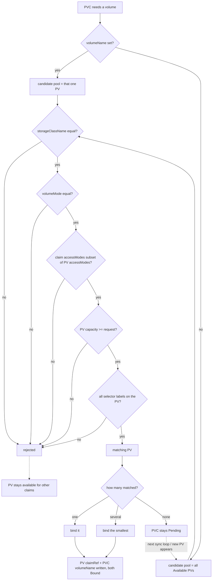

# T4.15 Manage persistent volumes and persistent volume claims

> Competency: "Manage persistent volumes and persistent volume claims" (CKA-1.3) | Domain/weight: CKA, Storage (10%) | Est. time: 2 h | Prerequisites: T4.14

Shell setup used in every command below (from the guide conventions):

```bash
alias k=kubectl
export do="--dry-run=client -o yaml"
export now="--force --grace-period=0"
source <(kubectl completion bash); complete -o default -F __start_kubectl k
```

Prerequisite: PV fields (volume sources, access modes, reclaim policies, volumeMode) are taught in [T4.14](../part4-cka/T4.14-configure-volume-types-access-modes-and.md). This lesson builds on them: how a claim finds its volume, how to aim a claim at one specific volume, how to grow a claim, and why claims and volumes refuse to disappear while something still uses them.

## 1. Why this matters

Binding claims to volumes, resizing them and cleaning them up are the storage tasks you will do most often as an administrator. A claim that stays `Pending` blocks every Pod that mounts it, a claim without a selector can grab a volume meant for another application, and a claim that refuses to delete usually means a Pod is still holding it — none of these are hard to fix once you know the matching rules and the protection mechanism. The CKA tests exactly this: static provisioning done by hand, and claims that will not bind until you find the mismatching field. Every task is short; the speed comes from knowing which of the six fields to compare first.

## 2. Concepts

### 2.1 Static provisioning: who does what

Static provisioning means no controller creates storage for you. Two people do two jobs:

1. **Administrator** creates a `PersistentVolume` (PV). It is cluster-scoped and points at real storage: a `hostPath` directory, a `local` disk, an `nfs` export, or a `csi` handle (sources in [T4.14](../part4-cka/T4.14-configure-volume-types-access-modes-and.md)).
2. **User** creates a `PersistentVolumeClaim` (PVC). It is namespaced and describes what is needed: size, access modes, class, optionally a selector or a specific PV name.

A controller inside `kube-controller-manager` (the PV controller) watches both sides and binds a claim to a volume when the volume satisfies every rule. The claim then works like a ticket: any Pod in the same namespace can mount it by name.

**The six matching rules.** A PVC binds a PV only when all of these hold:

| # | Rule | Where it lives | Details |
|---|------|----------------|---------|
| 1 | `storageClassName` equal | both `spec`s | Compared as strings. `""` only matches `""`. See 2.2 for the three states of the claim field. |
| 2 | `volumeMode` equal | both `spec`s | `Filesystem` (default) or `Block`. One `Filesystem` and one `Block` never bind. |
| 3 | Access modes: claim's list is a subset of the PV's list | both `spec`s | A claim for `ReadWriteMany` cannot bind a PV that lists only `ReadWriteOnce`. |
| 4 | PV capacity ≥ claim request | `spec.capacity.storage` vs `spec.resources.requests.storage` | The claim gets the whole PV; a 500Mi claim on a 5Gi PV wastes 4.5Gi for everyone else. |
| 5 | Claim `selector` labels all present on the PV | claim `spec.selector`, PV `metadata.labels` | No selector = no label filtering. See 2.3. |
| 6 | PV `claimRef` empty (or already pointing at this claim) | PV `spec.claimRef` | `Bound` and `Released` PVs are out of the game. See 2.3 for `volumeName`. |

If more than one `Available` PV satisfies all six rules, the controller prefers the **smallest sufficient** PV. If two candidates are still equal, you cannot predict which wins — that is why selectors and `volumeName` exist.

What you can still edit after creation matters when fixing a mismatch, and the rules differ sharply between claim and volume:

- **Bound claim:** only `spec.resources.requests.storage` (grow — or lower it to a value still above `status.capacity` to cancel a failed expansion, see 2.5) and `spec.volumeAttributesClassName` may change. Everything else is locked, so a wrong claim is deleted and recreated.
- **Pending claim:** the whole spec is immutable — any edit is refused with `The PersistentVolumeClaim "x" is invalid: spec: Forbidden: spec is immutable after creation except resources.requests and volumeAttributesClassName for bound claims` — with one exception: `spec.volumeName` may be set once while it is still empty. That is how you pin a stuck claim to a PV without recreating it.
- **Unbound PV:** labels, `storageClassName`, `accessModes`, `capacity`, the reclaim policy and even `claimRef` are patchable (the `Released`-PV rescue in 4.3 removes `claimRef`; during expansion the resizer itself writes a bigger `capacity` on the bound PV). Immutable: the volume source and `volumeMode`; `nodeAffinity` is set-once — add it while absent, never change it afterwards. A field you cannot patch means a new object, not a cleverer patch.

### 2.2 storageClassName: `""` vs omitted vs a name

The claim's `spec.storageClassName` has three states, and they are not the same:

| Claim field | Meaning | What happens on kind / a cluster with a default class |
|---|---|---|
| `storageClassName: ""` | "No class. Static binding only." | Binds only PVs that also carry `""` (or no field). Never triggers dynamic provisioning. |
| field omitted entirely | "Use whatever is default." | The admission controller fills in the **default StorageClass** name (kind: `standard`, provisioner `rancher.io/local-path`) and the claim dynamically provisions a brand-new PV — immediately for an `Immediate` class, only once a Pod consumes it for a `WaitForFirstConsumer` one (kind's `standard` is the latter). It will **not** bind your hand-made PVs. |
| `storageClassName: manual` | "This class." | If a StorageClass object named `manual` exists, its provisioner is used when no static PV matches. If no such object exists, `manual` is just a label — the claim binds only static PVs carrying `manual`, and stays `Pending` otherwise. |

The default StorageClass is the one annotated `storageclass.kubernetes.io/is-default-class: "true"`. See it with `k get sc` (default classes show `(default)` next to the name).

**The classic trap:** you create a perfect static PV, then write the claim and forget `storageClassName`. Admission injects the default class, the provisioner happily creates a *new* volume, and your claim binds the wrong storage — or the PV you prepared sits `Available` forever while you wonder why. For static claims always write the field: `""` for classless PVs, or the PV's class string. On the PV side the field is also just a string: `storageClassName: manual` on a PV does not require a StorageClass object called `manual` to exist.

A PV with no `storageClassName` field at all is treated as class `""` and matches only `""` claims.

### 2.3 Aiming a claim: selector and volumeName

When several PVs could satisfy a claim, use one of two targeting tools.

**`spec.selector`** on the claim filters candidate PVs by label. It supports `matchLabels` (exact key/value, all must be present on the PV) and `matchExpressions` (operators like `In`, `Exists`). The selector is an AND on top of the other five rules — it narrows the pool, it does not replace the other checks.

```yaml
spec:
  storageClassName: ""
  selector:
    matchLabels:
      tier: fast          # only PVs labeled tier=fast are candidates
    matchExpressions:
      - { key: zone, operator: In, values: ["a", "b"] }
```

**`spec.volumeName`** on the claim is stronger: it pre-binds the claim to exactly one PV. The named PV must still exist, be `Available` and satisfy the claim's access modes and size; a claim requesting 3Gi will not grab a 1Gi PV even when named. `volumeName` is the right tool when a task says "claim X must use PV Y", or when two same-size PVs make the result nondeterministic.

**Related but different.** A `selector` narrows; `volumeName` names. Use a selector when several interchangeable PVs exist ("any fast disk"), `volumeName` for an exact pin. Neither can be *changed* on the claim afterwards — `volumeName` may only be set once, while it is still empty (2.1).

**The wrong-PV mistake.** Without either tool, a 500Mi claim picks the smallest sufficient PV — which is usually fine — but a claim can also bind a *bigger* volume another team prepared for themselves, or an old volume you forgot about. If a task says a claim must land on a specific PV, always add the selector or `volumeName`; "it worked" once is not proof it was deterministic.

### 2.4 Claims in Pods, Deployments and StatefulSets

A Pod mounts a claim through `spec.volumes[].persistentVolumeClaim.claimName`. The claim must live in the **same namespace** as the Pod — there is no way to mount a claim from another namespace.

```yaml
  volumes:
  - name: data
    persistentVolumeClaim:
      claimName: data        # PVC "data" in the Pod's own namespace
      readOnly: false        # optional; mount read-only without changing the claim
```

**Deployment.** A Deployment's Pod template can reference one claim — but then *every replica mounts the same claim*. That is exactly what you want for shared `ReadWriteMany` storage (NFS, a file-share CSI driver). For `ReadWriteOnce` it is a trap: RWO means one *node* at a time, so two replicas on different nodes produce a Multi-Attach style failure on the second (exact wording depends on the driver). With an RWO claim either keep `replicas: 1`, use `strategy: Recreate` so only one Pod exists during updates, or pin Pods to one node. On hostPath-backed volumes the attach check may not even fire — then both Pods "work" but read and write different node-local directories, which is worse than failing.

```yaml
apiVersion: apps/v1
kind: Deployment
metadata:
  name: shared
  namespace: lab-t415
spec:
  replicas: 2                       # all replicas mount the SAME claim — needs RWX, or RWO on one node
  strategy:
    type: Recreate                  # for RWO: never run old+new Pods at once during a rollout
  selector:
    matchLabels: {app: shared}
  template:
    metadata:
      labels: {app: shared}
    spec:
      containers:
      - name: c
        image: busybox:1.36
        command: ["sleep", "3600"]
        volumeMounts:
        - {name: data, mountPath: /data}
      volumes:
      - name: data
        persistentVolumeClaim:
          claimName: data
```

**StatefulSet.** When each replica needs its own storage, use `volumeClaimTemplates` in the StatefulSet spec. The controller creates one PVC per Pod, named `<template-name>-<sts-name>-<ordinal>`:

```yaml
apiVersion: apps/v1
kind: StatefulSet
metadata:
  name: db
  namespace: lab-t415
spec:
  serviceName: db
  replicas: 2
  selector:
    matchLabels:
      app: db
  template:
    metadata:
      labels:
        app: db
    spec:
      containers:
      - name: c
        image: busybox:1.36
        command: ["sleep", "3600"]
        volumeMounts:
        - name: data
          mountPath: /data
  volumeClaimTemplates:              # a claim template, not a claim reference
  - metadata:
      name: data                     # claims will be data-db-0, data-db-1
    spec:
      storageClassName: standard     # a class that can provision (dynamic)
      accessModes: [ReadWriteOnce]
      resources:
        requests:
          storage: 1Gi
```

Two facts to remember: each Pod gets its own `Bound` claim (`data-db-0`, `data-db-1`), and **deleting the StatefulSet or scaling it down does not delete the claims** — you remove leftover `data-db-*` PVCs by hand. That is deliberate: StatefulSet data is assumed precious. If the default is wrong for your workload, `spec.persistentVolumeClaimRetentionPolicy` on the StatefulSet (GA since v1.32) changes it: `whenDeleted` applies to claims when the StatefulSet is deleted, `whenScaled` to claims whose Pods are scaled away, and each accepts `Retain` (the default) or `Delete`. Set `whenScaled: Delete` on elastic caches where per-replica data is disposable; leave `Retain` wherever it is not.

**One PVC per Pod for RWO** is the rule of thumb that falls out of this: identical Pods that each need exclusive write access to a volume need identical *claims*, one per Pod — which is precisely what `volumeClaimTemplates` generates.

### 2.5 Expanding a PVC

You can grow a claim in place — never shrink it. Three preconditions must all hold:

1. The claim is **dynamically provisioned** (it was created through a StorageClass with a provisioner). A claim bound to a hand-made PV cannot be resized this way.
2. The StorageClass has `allowVolumeExpansion: true`. Check it with `k get sc <name> -o jsonpath='{.allowVolumeExpansion}'`. If the flag is missing or `false`, the API server rejects the edit with `persistentvolumeclaims "<name>" is forbidden: only dynamically provisioned pvc can be resized and the storageclass that provisions the pvc must support resize`. `allowVolumeExpansion` is one of the few StorageClass fields you can patch in place: `k patch sc <name> -p '{"allowVolumeExpansion":true}'`. Patching the class does not restart anything; it only unlocks future edits.
3. The provisioner actually supports resize. CSI drivers for real disks do. A "provisioner" that only makes directories may not — on kind's local-path provisioner, verify what happens in your cluster (lab 7.2 and section 11).

The operation itself is one field:

```bash
k edit pvc data -n lab-t415          # change spec.resources.requests.storage: 1Gi -> 2Gi
# or without an editor:
k patch pvc data -n lab-t415 -p '{"spec":{"resources":{"requests":{"storage":"2Gi"}}}}'
```

What happens next is two steps, and the claim's `status.conditions` and events show where you are:

| Step | Who does it | What you see |
|---|---|---|
| Resize the backend volume | The resizer: an in-tree controller for in-tree plugins, the driver's external-resizer sidecar for CSI | Events like `ExternalExpanding`/`Resizing`; `status.allocatedResourceStatuses.storage` moves through `ControllerResizeInProgress` to `NodeResizePending` |
| Grow the filesystem | The kubelet on the node where the volume is mounted | Claim condition `FileSystemResizePending` while it waits for a mount, then event `FileSystemResizeSuccessful` |

**`FileSystemResizePending`** means "the disk grew, the filesystem has not". Most CSI drivers expand online while the Pod runs; if the driver needs an offline resize, the condition stays until a Pod mounts the volume — **delete and recreate the Pod** to finish. When everything is done `status.capacity.storage` catches up to your request and the conditions clear.

**Shrinking is forbidden.** Lowering `spec.resources.requests.storage` below `status.capacity` is rejected (`field can not be less than ...`, exact wording in section 11). To go smaller you make a new claim and copy the data.

**Recovery from a failed expansion (GA since v1.34 — awareness).** Before this feature, a terminal resize failure (for example the backend refused a 10Gi request) wedged the claim: the request could not go through and could not be taken back. Since v1.34 the API lets you *lower* `spec.resources.requests.storage` to a value that is still **above** `status.capacity`, cancelling the failed attempt so you can retry a smaller growth. Two status fields support this: `status.allocatedResources` (the size actually allocated to the backing volume, which is what quota counts) and `status.allocatedResourceStatuses.storage`, which reports resize states such as `ControllerResizeInProgress`, `ControllerResizeFailed`, `NodeResizePending`, `NodeResizeInProgress` and `NodeResizeFailed`. Exam relevance: know the fields exist and that a failed expansion is recoverable without recreating the claim.

### 2.6 Protection finalizers: why deletions hang

Every PVC gets finalizer `kubernetes.io/pvc-protection`; every PV gets `kubernetes.io/pv-protection`. A finalizer is a marker that says "do not really delete this object until the named controller says so". The storage protection controller in `kube-controller-manager` manages both:

- **pvc-protection** is removed only when **no non-terminal Pod references the claim** — not only running Pods: a `Pending` Pod counts too, because it *will* use the claim. Deleting an in-use PVC sets `deletionTimestamp` and the object sits at `Terminating` until the last referencing Pod is gone.
- **pv-protection** is removed only when the PV is **not Bound** to a claim. Deleting a `Bound` PV hangs the same way until its claim is deleted.

See them with:

```bash
k get pvc data -n lab-t415 -o jsonpath='{.metadata.finalizers}{"\n"}'
# [kubernetes.io/pvc-protection]
k get pvc data -n lab-t415 -o jsonpath='{.metadata.deletionTimestamp}{"\n"}'
# a timestamp means "Terminating", waiting on the finalizer
```

The right reaction to a stuck delete is **find and delete the Pods using the claim** (2.7 shows how), never strip the finalizer: removing `kubernetes.io/pvc-protection` by hand orphans the bound PV with a stale `claimRef`, and removing `pv-protection` can make the controller lose track of storage it still needs to reclaim.

### 2.7 Inspecting claims and volumes

The daily-driver commands:

```bash
k get pvc,pv -A                     # claims (namespaced) and volumes (cluster-scoped) together
k describe pvc data -n lab-t415     # Events explain Pending; Conditions show resize/Unused state
```

Reading `k get pvc` output: `VOLUME` is the bound PV name, `CAPACITY` is the **PV's** capacity (a 500Mi claim on a 1Gi PV shows `1Gi`), `STORAGECLASS` prints an empty column for classless claims, and `VOLUMEATTRIBUTESCLASS` shows `<unset>` unless a VolumeAttributesClass is attached ([T4.14](../part4-cka/T4.14-configure-volume-types-access-modes-and.md) covers VAC). `k get pv` adds `CLAIM` (`ns/name` of the claim), `RECLAIM POLICY` and `REASON`.

`k describe pvc <name>` is the diagnostic hub. Bottom-up: **Events** tell you why a claim is `Pending` (`no persistent volumes available for this claim and no storage class is set`, `storageclass.storage.k8s.io "<class>" not found`, `WaitForFirstConsumer`); **Conditions** show resize state (`Resizing`, `FileSystemResizePending`) and the `Unused` condition (2.8); **Used By** lists the Pods in this namespace that use the claim (the field was called `Mounted By` in older kubectl versions — v1.37 prints `Used By`).

**Which Pod uses a PVC, cluster-wide.** `Used By` only covers the claim's namespace and only when run on the claim — to search everywhere:

```bash
# with jq (present on most admin machines — NOT guaranteed on exam hosts, see below)
k get pods -A -o json | jq -r '.items[]|select(.spec.volumes[]?.persistentVolumeClaim.claimName=="data")|.metadata.name'
# variant that also prints the namespace: ...|.metadata.namespace+"/"+.metadata.name

# kubectl only (works anywhere kubectl works)
k get pods -A -o jsonpath='{range .items[*]}{.metadata.namespace}{"/"}{.metadata.name}{" -> "}{.spec.volumes[*].persistentVolumeClaim.claimName}{"\n"}{end}' | grep -w data
```

Exam hosts guarantee only kubectl, yq, curl, wget and man (https://docs.linuxfoundation.org/tc-docs/certification/tips-cka-and-ckad) — learn the jsonpath version, treat the jq version as the daily-driver shortcut.

### 2.8 PVC last-used tracking (beta in v1.37 — awareness)

Old claims outlive the apps that created them and keep paying for storage. v1.37 promotes feature gate `PersistentVolumeClaimUnusedSinceTime` to **Beta (enabled by default)**; it was alpha in v1.36. The PVC protection controller — the same one that manages the finalizer — now also maintains an `Unused` condition on each claim:

| Condition state | Reason | Meaning |
|---|---|---|
| `Unused: True` | `NoPodsUsingPVC` | No non-terminal Pod references the claim. `lastTransitionTime` = when it became unused. |
| `Unused: False` | `PodUsingPVC` | At least one non-terminal Pod references it. |

Terminal Pods (`Succeeded`/`Failed`) do not count; `Pending` Pods do. The `lastTransitionTime` doubles as an "unused since" timestamp, so you can find claims idle for 30 days without guessing. The condition is not updated while `deletionTimestamp` is set, and nothing is deleted automatically — it is a signal for admins and cleanup tooling. Read it with `k get pvc data -o yaml | grep -A4 'type: Unused'` or in `k describe pvc` under Conditions. Source: the PV docs page and https://kubernetes.io/blog/2026/09/21/kubernetes-v1-37-pvc-last-used-time/ (blog is allowed exam documentation).

### 2.9 Volume snapshots (awareness)

Snapshots are the CSI-era way to copy a volume's contents at a point in time. Three objects (`snapshot.storage.k8s.io/v1`): **`VolumeSnapshotClass`** (cluster-scoped, like a StorageClass for snapshots — names the CSI driver and deletion policy), **`VolumeSnapshot`** (namespaced request, points at a source PVC), **`VolumeSnapshotContent`** (cluster-scoped actual snapshot, bound to the VolumeSnapshot). Requirements: a CSI driver that implements snapshots **and** the snapshot controller running in the cluster — kind's local-path provisioner does not provide them, so this is recognise-and-recite rather than lab work here. A snapshot becomes storage again through a PVC's `dataSource`:

```yaml
spec:
  dataSource:
    name: snap-2026            # VolumeSnapshot in this namespace
    kind: VolumeSnapshot
    apiGroup: snapshot.storage.k8s.io
  accessModes: [ReadWriteOnce]
  resources:
    requests:
      storage: 1Gi
```

Docs: https://kubernetes.io/docs/concepts/storage/volume-snapshots/.

### 2.10 Under the hood

- **Binding loop.** The PV controller repeatedly lists unbound claims. For each, it filters `Available` PVs by the six rules in 2.1 (class string equality, volumeMode equality, mode subset, capacity ≥ request, selector match, free `claimRef`), keeps the smallest sufficient candidate, then writes `claimRef` on the PV and `spec.volumeName` on the claim and marks both `Bound`. A claim with `spec.volumeName` short-circuits the filter to that one PV. A claim with a class that has a real provisioner is handed to the provisioner, which creates a PV and binds it.
- **Dynamic provisioning.** The provisioner (in-tree plugin or a CSI driver's external-provisioner sidecar) creates backing storage, creates the PV object already pointing at the claim (`claimRef` pre-filled), and the normal bind completes.
- **Resize.** After the API accepts a bigger `requests.storage`, the resizer grows the backend volume and updates PV capacity; the kubelet's volume manager grows the filesystem at mount time (or online). `allocatedResourceStatuses` is the scoreboard between the two.
- **Protection and Unused.** One controller in `kube-controller-manager` watches Pod↔PVC references: it keeps `pvc-protection` until the last non-terminal Pod drops, keeps `pv-protection` until unbind, and (beta, v1.37) flips the `Unused` condition on the same signal.

## 3. How it works (diagram)

The binding decision for one claim, as a flowchart:



Walkthrough:

1. `volumeName` collapses the candidate pool to one PV; otherwise every `Available` PV competes.
2. The five field checks run as AND gates — any mismatch ejects that PV, and the claim never learns which field failed (you compare them yourself; that is section 6).
3. Survivors are ranked and the smallest sufficient PV wins; `Bound` writes `claimRef`/`volumeName` on both objects.
4. No survivor means `Pending` — the loop retries on the next sync, so fixing a PV field or adding a PV binds the claim without touching it.
5. If the claim's class has a real provisioner, the parallel path (not drawn) creates a fresh PV instead of waiting for a static match.

## 4. Commands and YAML you must produce fast

### 4.1 Imperative shortcuts

There is no `k create pv` / `k create pvc` — you write the YAML. These are the commands around it:

```bash
k get pvc,pv -A
```
One-screen inventory: every claim's status/bound volume and every PV's phase/claim. Run it first on any storage task.

```bash
k describe pvc data -n lab-t415
```
Events explain `Pending`; Conditions show resize progress and `Unused`; `Used By` names the consuming Pods.

```bash
k edit pvc data -n lab-t415
```
The resize move: bump `spec.resources.requests.storage`. Patch form when an editor is inconvenient: `k patch pvc data -n lab-t415 -p '{"spec":{"resources":{"requests":{"storage":"2Gi"}}}}'`.

```bash
k get sc -o custom-columns=NAME:.metadata.name,PROVISIONER:.provisioner,EXPAND:.allowVolumeExpansion,BIND:.volumeBindingMode
```
Which classes exist, who provisions, who may expand, who binds immediately.

```bash
k patch sc standard -p '{"allowVolumeExpansion":true}'
```
Unlock expansion on a class (idempotent; reversible with `--type=json -p '[{"op":"remove","path":"/allowVolumeExpansion"}]'`).

```bash
k get pods -A -o json | jq -r '.items[]|select(.spec.volumes[]?.persistentVolumeClaim.claimName=="data")|.metadata.namespace+"/"+.metadata.name'
```
Find every Pod using claim `data`. jq may not exist on exam hosts; the kubectl-only equivalent is in 2.7.

```bash
k get pvc data -n lab-t415 -o jsonpath='{.metadata.finalizers}{"\n"}{.status.conditions}'
```
Finalizers (why a delete hangs) plus conditions (`Unused`, resize states) in one shot.

### 4.2 Declarative YAML

The deliverable from the spec: a PV and PVC that bind statically through a selector and `storageClassName: ""`, plus a Pod on the claim.

```yaml
apiVersion: v1
kind: PersistentVolume
metadata:
  name: pv-fast                       # PVs are cluster-scoped: no namespace
  labels:
    tier: fast                        # what the claim's selector will look for
spec:
  capacity:
    storage: 1Gi                      # offer; claim request must be <= this
  volumeMode: Filesystem              # default; must equal the claim's volumeMode
  accessModes: [ReadWriteOnce]        # claim's modes must be a subset of this list
  persistentVolumeReclaimPolicy: Retain  # keep data when the claim goes away
  storageClassName: ""                # classless: only claims with "" can bind it
  hostPath:
    path: /mnt/data/pv-fast
    type: DirectoryOrCreate
---
apiVersion: v1
kind: PersistentVolumeClaim
metadata:
  name: data
  namespace: lab-t415                 # claims are namespaced
spec:
  storageClassName: ""                # "" = static only; omitting the field would grab the default class!
  selector:
    matchLabels:
      tier: fast                      # narrows candidates to labeled PVs
  # volumeName: pv-fast               # stronger alternative: pin this exact PV by name; the selector is then unnecessary
  accessModes: [ReadWriteOnce]
  resources:
    requests:
      storage: 512Mi                  # <= PV capacity; the claim still gets all 1Gi
---
apiVersion: v1
kind: Pod
metadata:
  name: app
  namespace: lab-t415
spec:
  containers:
  - name: c
    image: busybox:1.36
    command: ["sh", "-c", "date > /data/started.txt; sleep 3600"]
    volumeMounts:
    - name: data
      mountPath: /data
  volumes:
  - name: data
    persistentVolumeClaim:
      claimName: data                 # must be in the Pod's namespace
```

Contrast pair worth memorising — same claim, one field differs:

```yaml
spec:
  storageClassName: ""        # static binding only; binds pv-fast above
# vs
spec:
  # storageClassName omitted  # admission injects the default class (kind: standard);
                              # a NEW PV is provisioned once a Pod uses the claim; pv-fast is ignored
```

### 4.3 Speed drill

Targets are exam pace (~6 min/task average; these are smaller). Setup: `k create ns lab-t415 && mkdir -p ~/lab/t415`. The drill uses objects prefixed `d-`; answers are collapsed; the cleanup at the end removes everything it creates.

1. (3 min) Create PV `d-pv`: hostPath `/mnt/data/d1`, 1Gi, RWO, Retain, class `""`, label `disk=fast`.
2. (3 min) Create claim `d-claim` in `lab-t415`: 512Mi, RWO, class `""`, selector `disk=fast`; and Pod `d-pod` (`busybox:1.36`, `sleep 3600`) mounting it at `/data`. Confirm `Bound` and `Running`.
3. (1 min) With kubectl only (no jq), list Pods across all namespaces that use claim `d-claim`.
4. (1 min) Create claim `d-def` (100Mi, RWO) with **no** `storageClassName` field. State which class it gets and which kind of PV it binds.
5. (1 min) Print the finalizers and all status conditions of `d-claim` in one command.
6. (3 min) Create StorageClass `d-exp` (provisioner `rancher.io/local-path`, `allowVolumeExpansion: true`, `volumeBindingMode: WaitForFirstConsumer`), claim `d-grow` (100Mi, RWO) on it, and Pod `d-growpod` (`busybox:1.36`, `sleep 3600`) mounting the claim at `/data`. Confirm the claim is `Pending` until the Pod schedules, then `Bound`.
7. (1 min) Grow `d-grow` to 200Mi without an editor. Confirm the request changed.
8. (1 min) Delete `d-claim`, observe the PV's phase, and make `d-pv` `Available` again.

<details><summary>Answers</summary>

```bash
# 1
cat <<'EOF' | k apply -f -
apiVersion: v1
kind: PersistentVolume
metadata:
  name: d-pv
  labels: {disk: fast}
spec:
  capacity: {storage: 1Gi}
  accessModes: [ReadWriteOnce]
  persistentVolumeReclaimPolicy: Retain
  storageClassName: ""
  hostPath: {path: /mnt/data/d1, type: DirectoryOrCreate}
EOF

# 2
cat <<'EOF' | k apply -f -
apiVersion: v1
kind: PersistentVolumeClaim
metadata:
  name: d-claim
  namespace: lab-t415
spec:
  storageClassName: ""
  selector: {matchLabels: {disk: fast}}
  accessModes: [ReadWriteOnce]
  resources: {requests: {storage: 512Mi}}
---
apiVersion: v1
kind: Pod
metadata: {name: d-pod, namespace: lab-t415}
spec:
  containers:
  - {name: c, image: busybox:1.36, command: ["sleep","3600"],
     volumeMounts: [{name: data, mountPath: /data}]}
  volumes:
  - {name: data, persistentVolumeClaim: {claimName: d-claim}}
EOF
k wait --for=jsonpath='{.status.phase}'=Bound pvc/d-claim -n lab-t415 --timeout=60s
k wait --for=condition=Ready pod/d-pod -n lab-t415 --timeout=90s
k get pv d-pv pvc/d-claim -n lab-t415    # PV Bound + claim Bound; d-pod Running

# 3
k get pods -A -o jsonpath='{range .items[*]}{.metadata.namespace}{"/"}{.metadata.name}{" -> "}{.spec.volumes[*].persistentVolumeClaim.claimName}{"\n"}{end}' | grep -w d-claim

# 4
cat <<'EOF' | k apply -f -
apiVersion: v1
kind: PersistentVolumeClaim
metadata:
  name: d-def
  namespace: lab-t415
spec:
  accessModes: [ReadWriteOnce]
  resources: {requests: {storage: 100Mi}}
EOF
k get pvc d-def -n lab-t415 -o jsonpath='{.spec.storageClassName}{" -> "}{.spec.volumeName}{"\n"}'
# admission sets the default class (kind: standard) — it will bind a freshly
# provisioned pvc-<uid> PV once a Pod consumes the claim (standard is
# WaitForFirstConsumer) — never d-pv. Delete it: k delete pvc d-def -n lab-t415

# 5
k get pvc d-claim -n lab-t415 -o jsonpath='{.metadata.finalizers}{"\n"}{.status.conditions}'

# 6
cat <<'EOF' | k apply -f -
apiVersion: storage.k8s.io/v1
kind: StorageClass
metadata:
  name: d-exp
provisioner: rancher.io/local-path        # only supports WaitForFirstConsumer:
                                          # Immediate claims would never provision
allowVolumeExpansion: true
volumeBindingMode: WaitForFirstConsumer
---
apiVersion: v1
kind: PersistentVolumeClaim
metadata:
  name: d-grow
  namespace: lab-t415
spec:
  storageClassName: d-exp
  accessModes: [ReadWriteOnce]
  resources: {requests: {storage: 100Mi}}
---
apiVersion: v1
kind: Pod
metadata: {name: d-growpod, namespace: lab-t415}
spec:
  containers:
  - {name: c, image: busybox:1.36, command: ["sleep","3600"],
     volumeMounts: [{name: data, mountPath: /data}]}
  volumes:
  - {name: data, persistentVolumeClaim: {claimName: d-grow}}
EOF
k get pvc d-grow -n lab-t415     # Pending first: WFC waits for a Pod to pick a node
k wait --for=jsonpath='{.status.phase}'=Bound pvc/d-grow -n lab-t415 --timeout=90s

# 7
k patch pvc d-grow -n lab-t415 -p '{"spec":{"resources":{"requests":{"storage":"200Mi"}}}}'
k get pvc d-grow -n lab-t415 -o jsonpath='{.spec.resources.requests.storage}{"\n"}'   # 200Mi

# 8
k delete pod d-pod -n lab-t415   # free the claim first — pvc-protection holds the
                                 # PVC while any Pod still references it
k delete pvc d-claim -n lab-t415
k get pv d-pv        # Released
k patch pv d-pv --type=json -p '[{"op":"remove","path":"/spec/claimRef"}]'
k get pv d-pv        # Available
```

Cleanup:

```bash
k delete pod d-pod d-growpod -n lab-t415 --ignore-not-found   # free in-use claims first
k delete pvc d-claim d-def d-grow -n lab-t415 --ignore-not-found
k delete pv d-pv --ignore-not-found
k delete sc d-exp --ignore-not-found
k delete ns lab-t415 --ignore-not-found
rm -rf ~/lab/t415
for n in lab-control-plane lab-worker lab-worker2; do docker exec $n rm -rf /mnt/data/d1; done   # kind only
```
</details>

## 5. Worked example

Environment: **kind** (cluster `lab`, context `kind-lab`, nodes `lab-control-plane`, `lab-worker`, `lab-worker2`). Goal: watch static binding decisions (smallest-PV, selector, `volumeName`), the omitted-class trap, and deletion protection — one continuous session. The output blocks in this section were captured on kind v0.33.0 / v1.37.0.

Setup — namespace and three PVs, all class `""`:

```bash
mkdir -p ~/lab/t415 && cd ~/lab/t415
k config use-context kind-lab
k create ns lab-t415
cat <<'EOF' | k apply -f -
apiVersion: v1
kind: PersistentVolume
metadata:
  name: w-small
  labels: {tier: slow}
spec:
  capacity: {storage: 1Gi}
  accessModes: [ReadWriteOnce]
  persistentVolumeReclaimPolicy: Retain
  storageClassName: ""
  hostPath: {path: /mnt/data/w-small, type: DirectoryOrCreate}
---
apiVersion: v1
kind: PersistentVolume
metadata:
  name: w-big1
  labels: {tier: fast}
spec:
  capacity: {storage: 5Gi}
  accessModes: [ReadWriteOnce]
  persistentVolumeReclaimPolicy: Retain
  storageClassName: ""
  hostPath: {path: /mnt/data/w-big1, type: DirectoryOrCreate}
---
apiVersion: v1
kind: PersistentVolume
metadata:
  name: w-big2
  labels: {tier: fast}
spec:
  capacity: {storage: 5Gi}
  accessModes: [ReadWriteOnce]
  persistentVolumeReclaimPolicy: Retain
  storageClassName: ""
  hostPath: {path: /mnt/data/w-big2, type: DirectoryOrCreate}
EOF
k get pv
```

REAL OUTPUT (kind v0.33.0, v1.37.0)
```
NAME      CAPACITY   ACCESS MODES   RECLAIM POLICY   STATUS      CLAIM   STORAGECLASS   VOLUMEATTRIBUTESCLASS   REASON   AGE
w-big1    5Gi        RWO            Retain           Available                          <unset>                          0s
w-big2    5Gi        RWO            Retain           Available                          <unset>                          0s
w-small   1Gi        RWO            Retain           Available                          <unset>                          0s
```

Step 1 — smallest sufficient PV wins. Claim `w-any` asks 1Gi with no selector:

```bash
cat <<'EOF' | k apply -f -
apiVersion: v1
kind: PersistentVolumeClaim
metadata:
  name: w-any
  namespace: lab-t415
spec:
  storageClassName: ""
  accessModes: [ReadWriteOnce]
  resources: {requests: {storage: 1Gi}}
EOF
k get pvc w-any -n lab-t415
```

REAL OUTPUT (kind v0.33.0, v1.37.0)
```
NAME    STATUS   VOLUME    CAPACITY   ACCESS MODES   STORAGECLASS   VOLUMEATTRIBUTESCLASS   AGE
w-any   Bound    w-small   1Gi        RWO                           <unset>                 4s
```

All three PVs match on class/mode/size; the controller picked `w-small` (1Gi), the smallest sufficient one. Had `w-small` not existed, `w-any` would have grabbed a 5Gi PV — the "wrong (bigger) PV" mistake.

Step 2 — selector steers. Claim `w-fast` wants only `tier=fast` volumes:

```bash
cat <<'EOF' | k apply -f -
apiVersion: v1
kind: PersistentVolumeClaim
metadata:
  name: w-fast
  namespace: lab-t415
spec:
  storageClassName: ""
  selector: {matchLabels: {tier: fast}}
  accessModes: [ReadWriteOnce]
  resources: {requests: {storage: 1Gi}}
EOF
k get pvc w-fast -n lab-t415 -o jsonpath='{.spec.volumeName}{"\n"}'
```

REAL OUTPUT (kind v0.33.0, v1.37.0)
```
w-big1
```

`w-small` was rejected on labels. Two `tier=fast` PVs of equal size remained and the controller picked one of them — you cannot predict which. If the task had said "the claim must land on `w-big2`", `spec.volumeName: w-big2` would have removed the coin flip.

Step 3 — the omitted-class trap. Claim `w-ghost` has **no** `storageClassName` field:

```bash
cat <<'EOF' | k apply -f -
apiVersion: v1
kind: PersistentVolumeClaim
metadata:
  name: w-ghost
  namespace: lab-t415
spec:
  accessModes: [ReadWriteOnce]
  resources: {requests: {storage: 1Gi}}
EOF
sleep 3
k get pvc w-ghost -n lab-t415
k get pvc w-ghost -n lab-t415 -o jsonpath='{.spec.storageClassName}{"\n"}'
k describe pvc w-ghost -n lab-t415 | grep WaitForFirstConsumer
```

REAL OUTPUT (kind v0.33.0, v1.37.0)
```
NAME      STATUS    VOLUME   CAPACITY   ACCESS MODES   STORAGECLASS   VOLUMEATTRIBUTESCLASS   AGE
w-ghost   Pending                                      standard       <unset>                 3s
standard
  Normal  WaitForFirstConsumer  3s    persistentvolume-controller  waiting for first consumer to be created before binding
```

Two surprises, both instructive. `STORAGECLASS` shows `standard`: admission injected the default class, so the class-`""` static volumes were never consulted. And the claim is `Pending` with reason `WaitForFirstConsumer` — kind's `standard` class defers provisioning until a Pod picks a node, because local-path storage is node-local and the provisioner must know which node's disk to use. A `Pending` claim with this event is *normal*, not a bug (section 6 says the same). Give it a consumer:

```bash
cat <<'EOF' | k apply -f -
apiVersion: v1
kind: Pod
metadata: {name: w-ghostpod, namespace: lab-t415}
spec:
  containers:
  - {name: c, image: busybox:1.36, command: ["sleep","3600"],
     volumeMounts: [{name: data, mountPath: /data}]}
  volumes:
  - {name: data, persistentVolumeClaim: {claimName: w-ghost}}
EOF
k wait --for=condition=Ready pod/w-ghostpod -n lab-t415 --timeout=90s
k get pvc w-ghost -n lab-t415
k get pv | grep -E 'NAME|pvc-'
```

REAL OUTPUT (kind v0.33.0, v1.37.0)
```
NAME      STATUS   VOLUME                                     CAPACITY   ACCESS MODES   STORAGECLASS   VOLUMEATTRIBUTESCLASS   AGE
w-ghost   Bound    pvc-299e335c-a755-4390-9e77-aa638b3c7b2d   1Gi        RWO            standard       <unset>                 4m36s
NAME                                       CAPACITY   ACCESS MODES   RECLAIM POLICY   STATUS   CLAIM              STORAGECLASS   VOLUMEATTRIBUTESCLASS   REASON   AGE
pvc-299e335c-a755-4390-9e77-aa638b3c7b2d   1Gi        RWO            Delete           Bound    lab-t415/w-ghost   standard       <unset>                          43s
```

Only when the Pod appeared did the provisioner create a *new* PV on that Pod's node — `w-big1`/`w-big2` were never considered, even though two of them were free and bigger than needed. This is the single most common static-provisioning bug: a claim you meant to be static quietly provisions dynamic storage instead.

Step 4 — mount it and prove persistence. Pod `w-pod` uses `w-fast`, writes a file, dies, restarts as `w-pod2`:

```bash
cat <<'EOF' | k apply -f -
apiVersion: v1
kind: Pod
metadata: {name: w-pod, namespace: lab-t415}
spec:
  nodeSelector: {kubernetes.io/hostname: lab-worker}   # hostPath is node-local: stay on the node holding the data
  containers:
  - {name: c, image: busybox:1.36, command: ["sh","-c","echo hello-$(hostname) > /data/note.txt; sleep 3600"], volumeMounts: [{name: data, mountPath: /data}]}
  volumes:
  - {name: data, persistentVolumeClaim: {claimName: w-fast}}
EOF
k wait --for=condition=Ready pod/w-pod -n lab-t415 --timeout=90s
k delete pod w-pod -n lab-t415 $now
cat <<'EOF' | k apply -f -
apiVersion: v1
kind: Pod
metadata: {name: w-pod2, namespace: lab-t415}
spec:
  nodeSelector: {kubernetes.io/hostname: lab-worker}   # same node as w-pod, or note.txt is not there
  containers:
  - {name: c, image: busybox:1.36, command: ["sh","-c","cat /data/note.txt; sleep 3600"], volumeMounts: [{name: data, mountPath: /data}]}
  volumes:
  - {name: data, persistentVolumeClaim: {claimName: w-fast}}
EOF
k wait --for=condition=Ready pod/w-pod2 -n lab-t415 --timeout=90s
k logs w-pod2 -n lab-t415
```

REAL OUTPUT (kind v0.33.0, v1.37.0)
```
hello-w-pod
```

The `nodeSelector` is load-bearing, not decoration: a `hostPath` PV mounts a directory on *whichever node runs the Pod*, so without pinning, `w-pod2` could schedule to the other worker where `/mnt/data/w-big1` is empty — the file would look "lost" even though the volume behaved perfectly. The production way to express this constraint is `spec.nodeAffinity` on the PV itself (mandatory for `local` volumes, covered in T4.14); the Pod `nodeSelector` is the lab shortcut.

Step 5 — deletion protection. Try to delete the claim while `w-pod2` uses it:

```bash
k delete pvc w-fast -n lab-t415 &        # background it: it will hang
sleep 3
k get pvc w-fast -n lab-t415
k get pvc w-fast -n lab-t415 -o jsonpath='{.metadata.deletionTimestamp}{" | "}{.metadata.finalizers}{"\n"}'
```

REAL OUTPUT (kind v0.33.0, v1.37.0)
```
NAME     STATUS        VOLUME   CAPACITY   ACCESS MODES   STORAGECLASS   VOLUMEATTRIBUTESCLASS   AGE
w-fast   Terminating   w-big1   5Gi        RWO                           <unset>                 5m13s
2026-11-16T06:09:09Z | ["kubernetes.io/pvc-protection"]
```

The claim is `Terminating`, not gone: `pvc-protection` waits for the last referencing Pod. Which Pod is that? Note the field name changed: kubectl v1.37 prints `Used By` in `describe pvc`, not `Mounted By` — `grep 'Mounted By'` returns nothing.

```bash
k describe pvc w-fast -n lab-t415 | grep -E 'Used By|Mounted By'
k get pods -A -o jsonpath='{range .items[*]}{.metadata.namespace}{"/"}{.metadata.name}{" -> "}{.spec.volumes[*].persistentVolumeClaim.claimName}{"\n"}{end}' | grep -w w-fast
```

REAL OUTPUT (kind v0.33.0, v1.37.0)
```
Used By:       w-pod2
lab-t415/w-pod2 -> w-fast
```

Delete the Pod and the claim completes deletion on its own; the PV falls to `Released` (Retain) with the stale `claimRef` — T4.14's clean-then-clear-`claimRef` drill applies:

```bash
k delete pod w-pod2 -n lab-t415 $now
sleep 3
k get pvc w-fast -n lab-t415 2>&1; k get pv w-big1
```

REAL OUTPUT (kind v0.33.0, v1.37.0)
```
Error from server (NotFound): persistentvolumeclaims "w-fast" not found
NAME     CAPACITY   ACCESS MODES   RECLAIM POLICY   STATUS     CLAIM             STORAGECLASS   VOLUMEATTRIBUTESCLASS   REASON   AGE
w-big1   5Gi        RWO            Retain           Released   lab-t415/w-fast                  <unset>                          5m42s
```

Cleanup for this section:

```bash
k delete pod w-ghostpod -n lab-t415 --ignore-not-found $now   # frees w-ghost (pvc-protection)
k delete pvc w-any w-ghost -n lab-t415 --ignore-not-found
k delete ns lab-t415 --ignore-not-found
k delete pv w-small w-big1 w-big2 --ignore-not-found
rm -rf ~/lab/t415
for n in lab-control-plane lab-worker lab-worker2; do docker exec $n rm -rf /mnt/data; done   # kind only
```

## 6. Common mistakes and how to fix them

Diagnosis path for any claim that will not bind (in order):

1. `k get pvc -n <ns>` — `Pending`? Which column is empty (`VOLUME`)?
2. `k describe pvc <name> -n <ns>` — read the last Events. They point at the layer (no PV at all, class not found, waiting for consumer) but rarely name the failing field.
3. `k get pv` — is there an `Available` PV? `Bound`/`Released`/`Failed` are out of the game.
4. Compare the six fields from 2.1 on both objects: `k get pvc <c> -n <ns> -o yaml` vs `k get pv <p> -o yaml`.
5. Fix the editable side: PV labels/class/modes/capacity/policy/`claimRef` are patchable while unbound; the claim's spec is locked except a one-time `volumeName` pin while `Pending` — delete and recreate it if the claim is wrong.

| Symptom | What you will see | Cause | Fix |
|---|---|---|---|
| PVC `Pending`, nothing to bind to | Event: `no persistent volumes available for this claim and no storage class is set` (classless or unset claim with no default SC); or `storageclass.storage.k8s.io "<class>" not found` when the claim names a class with no object | One of the six rules fails: class string differs, mode not subset, PV too small, volumeMode differs, selector matches nothing, or no PV exists | Compare fields per step 4; patch the unbound PV (`k patch pv p -p '{"spec":{"storageClassName":"manual"}}'` etc.) or create a matching PV; if the claim is wrong, recreate it |
| PVC binds the wrong (bigger/foreign) PV | `k get pvc` `VOLUME` shows a PV you didn't mean; the intended PV stays `Available` | No `selector`/`volumeName`: controller picked the smallest sufficient — or a coincidentally-matching — PV | Recreate the claim with `selector.matchLabels` or `volumeName`; label the intended PV first if needed (`k label pv p tier=fast`) |
| Claim binds a `pvc-<uid>` dynamic PV instead of your static PV | Claim's `STORAGECLASS` shows the default class (e.g. `standard`); your PV is `Available` | `storageClassName` omitted → admission injected the default class | Recreate the claim with `storageClassName: ""` (classless PVs) or the PV's class string |
| PVC deletion stuck `Terminating` | `k get pvc`: `STATUS Terminating` for minutes; `deletionTimestamp` set; finalizers list `kubernetes.io/pvc-protection` | A Pod still references the claim (even a Pending one) | Find it: `Used By` in `k describe pvc` (pre-v1.37 kubectl: `Mounted By`), or the jsonpath/jq search in 2.7. `k delete pod <pod>`; the PVC then deletes itself. Never strip the finalizer |
| PV deletion stuck `Terminating` | PV shows `deletionTimestamp`, finalizer `kubernetes.io/pv-protection` | PV is still `Bound` to a claim | Delete the claim (then whatever Pods hold it) |
| Resize rejected | `persistentvolumeclaims "x" is forbidden: only dynamically provisioned pvc can be resized and the storageclass that provisions the pvc must support resize` | Claim is static (no provisioner) or its SC lacks `allowVolumeExpansion: true` | `k get sc <c> -o jsonpath='{.allowVolumeExpansion}'`; enable with `k patch sc <c> -p '{"allowVolumeExpansion":true}'` and retry — or move the data to a claim on an expandable class |
| Claim edited but capacity unchanged / stuck mid-resize | Condition `FileSystemResizePending`; `status.capacity` below the request | Filesystem resize waits for the volume to be (re)mounted by kubelet | Delete/recreate the Pod mounting the claim; watch `k describe pvc` for `FileSystemResizeSuccessful` |
| Failed expansion blocks a retry | `allocatedResourceStatuses.storage` = `ControllerResizeFailed`/`NodeResizeFailed`; new edits rejected | Terminal resize failure | Since v1.34: lower `spec.resources.requests.storage` to a value still **above** `status.capacity` to cancel the failed attempt, then retry smaller (2.5) |
| Pod `Pending` next to a `Pending` claim | Pod event `pod has unbound immediate PersistentVolumeClaims` | Symptom, not cause — the claim is the broken object | Work the claim per steps 1-5. If the claim event says `WaitForFirstConsumer`, it is normal: create the Pod (a different Pod must mount it) |
| Second replica can't use an RWO claim | Pod `Pending`/`ContainerCreating`; Multi-Attach style event (driver-dependent wording) | RWO = one node; replicas landed on different nodes | One replica, `strategy: Recreate`, same-node affinity — or `volumeClaimTemplates` on a StatefulSet so each Pod gets its own claim |

## 7. Labs

Run the labs in any order; each ends at the baseline. Environment for all three: **kind** (cluster `lab`, context `kind-lab`; nodes `lab-control-plane`, `lab-worker`, `lab-worker2`). Land on the right cluster first — `k config use-context kind-lab` — exactly the context check you will do on every exam task. Files go to `~/lab/t415/`. On kubeadm VMs instead, replace `docker exec lab-worker <cmd>` with `ssh <node>` + `sudo -i` + `<cmd>`, and use your node names.

Lab outputs were captured on kind v0.33.0 / v1.37.0 where shown; verification blocks were run as written and all lines printed.

### 7.1 Easy: static PV/PVC bind and use

**Setup.**

```bash
mkdir -p ~/lab/t415 && cd ~/lab/t415
k config use-context kind-lab
k create ns lab-t415
cat <<'EOF' | k apply -f -
apiVersion: v1
kind: PersistentVolume
metadata:
  name: e-db
  labels: {app: db}
spec:
  capacity: {storage: 1Gi}
  accessModes: [ReadWriteOnce]
  persistentVolumeReclaimPolicy: Retain
  storageClassName: ""
  hostPath: {path: /mnt/data/e-db, type: DirectoryOrCreate}
---
apiVersion: v1
kind: PersistentVolume
metadata:
  name: e-spare
  labels: {app: spare}
spec:
  capacity: {storage: 2Gi}
  accessModes: [ReadWriteOnce]
  persistentVolumeReclaimPolicy: Retain
  storageClassName: ""
  hostPath: {path: /mnt/data/e-spare, type: DirectoryOrCreate}
EOF
```

**Task.** In namespace `lab-t415`: (a) create claim `data` — 512Mi, RWO, class `""` — that binds specifically to PV `e-db`, and Pod `writer` (`busybox:1.36`) that appends the date to `/data/log.txt` every 30 seconds; (b) save the claim's bound volume name to `~/lab/t415/bound.txt`; (c) delete `writer`, create `reader` (`busybox:1.36`, `sleep 3600`, same claim at `/data`), and prove `log.txt` survived by copying it to `~/lab/t415/log-copy.txt` (`k exec reader -- cat ...`). Run **both** Pods on node `lab-worker` (`nodeSelector` on `kubernetes.io/hostname`) — hostPath data lives on one node, and an unpinned `reader` can land where `/mnt/data/e-db` is empty. `e-spare` must remain `Available` and untouched.

<details><summary>Hint 1</summary>

Both PVs are class `""` and satisfy the request — `e-db` would win anyway as the smallest sufficient PV, but that is luck, not intent; resize or relabel `e-spare` and the outcome changes. The task says "specifically", so pin it.
</details>
<details><summary>Hint 2</summary>

`spec.volumeName` on the claim, or a `selector` matching `app: db`, both work. Only one is needed; know both.
</details>
<details><summary>Hint 3</summary>

`k exec reader -n lab-t415 -- cat /data/log.txt > ~/lab/t415/log-copy.txt`.
</details>

<details><summary>Solution</summary>

```bash
cd ~/lab/t415
cat <<'EOF' | k apply -f -
apiVersion: v1
kind: PersistentVolumeClaim
metadata:
  name: data
  namespace: lab-t415
spec:
  storageClassName: ""
  volumeName: e-db                 # pre-bind to exactly this PV
  # alternative: selector: {matchLabels: {app: db}}
  accessModes: [ReadWriteOnce]
  resources: {requests: {storage: 512Mi}}
---
apiVersion: v1
kind: Pod
metadata: {name: writer, namespace: lab-t415}
spec:
  nodeSelector: {kubernetes.io/hostname: lab-worker}
  containers:
  - {name: c, image: busybox:1.36,
     command: ["sh","-c","while true; do date >> /data/log.txt; sleep 30; done"],
     volumeMounts: [{name: data, mountPath: /data}]}
  volumes:
  - {name: data, persistentVolumeClaim: {claimName: data}}
EOF
k wait --for=condition=Ready pod/writer -n lab-t415 --timeout=90s
k get pvc data -n lab-t415 -o jsonpath='{.spec.volumeName}' > bound.txt
cat bound.txt                       # e-db

k delete pod writer -n lab-t415 $now
cat <<'EOF' | k apply -f -
apiVersion: v1
kind: Pod
metadata: {name: reader, namespace: lab-t415}
spec:
  nodeSelector: {kubernetes.io/hostname: lab-worker}
  containers:
  - {name: c, image: busybox:1.36, command: ["sleep","3600"],
     volumeMounts: [{name: data, mountPath: /data}]}
  volumes:
  - {name: data, persistentVolumeClaim: {claimName: data}}
EOF
k wait --for=condition=Ready pod/reader -n lab-t415 --timeout=90s
k exec reader -n lab-t415 -- cat /data/log.txt > log-copy.txt
wc -l log-copy.txt                  # >= 1 line of dates
```

Why each step: `volumeName` makes the bind deterministic between two same-class PVs (the selector variant works the same way). The claim is `Bound` before any Pod exists because static claims bind immediately. Deleting `writer` frees the claim (RWO allows the next Pod only after the first is gone from the node's mounts — the short wait is normal), and `reader` proves the data outlived the Pod because the PV's life is independent. Both Pods carry `nodeSelector: kubernetes.io/hostname=lab-worker` because hostPath storage is node-local: `/mnt/data/e-db` exists on one node's disk, and without pinning `reader` could land on the other worker where that directory is empty — the data would look "lost" even though binding, mounting and persistence all worked. The declarative alternative is `spec.nodeAffinity` on the PV (required for `local` volumes), which forces every consumer onto the listed node; the Pod `nodeSelector` is the simpler lab pin.
</details>

**Verification.**

```bash
test "$(cat ~/lab/t415/bound.txt)" = e-db && echo OK1
test "$(k get pvc data -n lab-t415 -o jsonpath='{.status.phase}')" = Bound && echo OK2
test "$(k get pv e-spare -o jsonpath='{.status.phase}')" = Available && echo OK3
test -s ~/lab/t415/log-copy.txt && grep -qE '[0-9]{2}:[0-9]{2}:[0-9]{2}' ~/lab/t415/log-copy.txt && echo OK4
test "$(k get pod reader -n lab-t415 -o jsonpath='{.status.phase}')" = Running && echo OK5
```

All five lines must print.

**Cleanup.**

```bash
k delete ns lab-t415
k delete pv e-db e-spare --ignore-not-found
rm -rf ~/lab/t415
for n in lab-control-plane lab-worker lab-worker2; do docker exec $n rm -rf /mnt/data; done   # kind only
```

### 7.2 Medium: resize a PVC on an expandable class

**Setup.**

```bash
mkdir -p ~/lab/t415 && cd ~/lab/t415
k config use-context kind-lab
k create ns lab-t415
cat <<'EOF' | k apply -f -
apiVersion: storage.k8s.io/v1
kind: StorageClass
metadata:
  name: expandable
provisioner: rancher.io/local-path           # kind's provisioner; on the VM lab the class may already exist
volumeBindingMode: WaitForFirstConsumer      # local-path only provisions once a Pod picks a node
allowVolumeExpansion: true
reclaimPolicy: Delete
---
apiVersion: v1
kind: PersistentVolumeClaim
metadata:
  name: grow
  namespace: lab-t415
spec:
  storageClassName: expandable
  accessModes: [ReadWriteOnce]
  resources: {requests: {storage: 1Gi}}
---
apiVersion: v1
kind: Pod
metadata: {name: grow-pod, namespace: lab-t415}
spec:
  containers:
  - {name: c, image: busybox:1.36, command: ["sh","-c","echo seed > /data/f.txt; sleep 3600"],
     volumeMounts: [{name: data, mountPath: /data}]}
  volumes:
  - {name: data, persistentVolumeClaim: {claimName: grow}}
---
apiVersion: v1
kind: PersistentVolume
metadata:
  name: fixed-pv                     # static volume for task (d): lets claim
                                     # "fixed" reach Bound, so the resize
                                     # rejection is the real resize check
spec:
  capacity: {storage: 512Mi}
  accessModes: [ReadWriteOnce]
  persistentVolumeReclaimPolicy: Retain
  storageClassName: ""
  hostPath: {path: /mnt/data/fixed-pv, type: DirectoryOrCreate}
EOF
k wait --for=condition=Ready pod/grow-pod -n lab-t415 --timeout=120s
```

The `grow` claim sits `Pending` until `grow-pod` schedules — that is `WaitForFirstConsumer` doing its job, not an error — and `fixed-pv` waits unused until task (d).

**Task.** In namespace `lab-t415`: (a) record the claim's current `spec.resources.requests.storage` and `status.capacity.storage` into `~/lab/t415/before.txt`; (b) grow claim `grow` to `2Gi` **without deleting the Pod or the claim**; (c) record the claim's `status.conditions` and the last three events to `~/lab/t415/resize-evidence.txt`; (d) create a second claim `fixed` (512Mi, RWO, `storageClassName: ""`), let it bind the setup's static PV `fixed-pv`, and try to grow it to 1Gi — capture the rejection message into `~/lab/t415/rejected.txt`; (e) check whether kind's own `standard` StorageClass allows expansion and write the answer (`true`/`false`/empty) to `~/lab/t415/standard-expansion.txt`.

<details><summary>Hint 1</summary>

`k edit pvc grow -n lab-t415` is the canonical resize, but the patch form is faster and scriptable. Only `spec.resources.requests.storage` may change upward.
</details>
<details><summary>Hint 2</summary>

`k get pvc grow -n lab-t415 -o jsonpath='{.status.conditions}'` and `k describe pvc grow -n lab-t415 | tail -8` between them capture everything for the evidence file.
</details>
<details><summary>Hint 3</summary>

`k get sc standard -o jsonpath='{.allowVolumeExpansion}'` — an empty answer means the field is not set (expansion disabled). kind v0.33.0 builds its own `standard` class and it does not carry the flag (verified: empty). Note the `local-path` class shipped by the Rancher v0.0.37 manifest does not carry the flag either — `k get sc` shows `false` for both.
</details>

<details><summary>Solution</summary>

```bash
cd ~/lab/t415
# (a) before
{ k get pvc grow -n lab-t415 -o jsonpath='REQUEST={.spec.resources.requests.storage}'; echo;
  k get pvc grow -n lab-t415 -o jsonpath='CAPACITY={.status.capacity.storage}'; echo; } | tee before.txt

# (b) grow the claim — the Pod stays put
k patch pvc grow -n lab-t415 -p '{"spec":{"resources":{"requests":{"storage":"2Gi"}}}}'
sleep 10
# (c) evidence
{ k get pvc grow -n lab-t415 -o jsonpath='{.status.conditions}'; echo;
  k get pvc grow -n lab-t415 -o jsonpath='{.status.allocatedResourceStatuses}'; echo;
  k describe pvc grow -n lab-t415 | tail -8; } > resize-evidence.txt
cat resize-evidence.txt

# (d) the static claim must be refused — but only a Bound claim reaches the
# resize check; a Pending one is rejected earlier, on spec immutability
cat <<'EOF' | k apply -f -
apiVersion: v1
kind: PersistentVolumeClaim
metadata: {name: fixed, namespace: lab-t415}
spec:
  storageClassName: ""
  accessModes: [ReadWriteOnce]
  resources: {requests: {storage: 512Mi}}
EOF
k wait --for=jsonpath='{.status.phase}'=Bound pvc/fixed -n lab-t415 --timeout=30s
k patch pvc fixed -n lab-t415 -p '{"spec":{"resources":{"requests":{"storage":"1Gi"}}}}' 2>&1 | tee rejected.txt

# (e)
k get sc standard -o jsonpath='{.allowVolumeExpansion}' | tee standard-expansion.txt; echo
```

REAL OUTPUT (kind v0.33.0, v1.37.0) for `rejected.txt`:
```
Error from server (Forbidden): persistentvolumeclaims "fixed" is forbidden: only dynamically provisioned pvc can be resized and the storageclass that provisions the pvc must support resize
```

Why the `k wait` matters in (d): the message in `rejected.txt` (`only dynamically provisioned pvc can be resized...`) comes from the *resize* validator, which only runs on a `Bound` claim. Had `fixed` still been `Pending` when patched, the same command would have failed earlier with `spec is immutable after creation except resources.requests and volumeAttributesClassName for bound claims` — two different validators, two different messages, and `fixed-pv` is what exposes the resize one.

What to look for in `resize-evidence.txt`: on a CSI driver you would see `Resizing` then `FileSystemResizePending` conditions, `allocatedResourceStatuses` walking through `NodeResizePending`, and a `FileSystemResizeSuccessful` event once kubelet finishes. The lab provisioner (`rancher.io/local-path`) backs volumes with plain directories and enforces no quota, so there is nothing real to resize. Observed on kind v0.33.0 / v1.37.0 with local-path-provisioner v0.0.37: the patch is **accepted**, the event `ExternalExpanding — waiting for an external controller to expand this PVC` (from `volume_expand`) appears, but no `Resizing`/`FileSystemResizePending` condition ever shows, `status.allocatedResourceStatuses` stays empty, and `status.capacity` remains `1Gi` — a silent no-op expansion. **Record which behaviour your provisioner shows** — that is the point of the lab, and it is why the exam-style check is the SC flag plus the accepted request, not the finished filesystem. On the kubeadm VMs the pinned provisioner is local-path v0.0.37 (its bundled `local-path` class does **not** ship `allowVolumeExpansion` on the v0.0.37 manifest — `k get sc` shows `false`; the lab's `expandable` class carries the flag itself).
</details>

**Verification.**

```bash
test "$(k get sc expandable -o jsonpath='{.allowVolumeExpansion}')" = true && echo OK1
test "$(k get pvc grow -n lab-t415 -o jsonpath='{.spec.resources.requests.storage}')" = 2Gi && echo OK2
test "$(k get pod grow-pod -n lab-t415 -o jsonpath='{.status.phase}')" = Running && echo OK3
test "$(k exec grow-pod -n lab-t415 -- cat /data/f.txt)" = seed && echo OK4
grep -q 'only dynamically provisioned pvc can be resized' ~/lab/t415/rejected.txt && echo OK5
test "$(k get pvc grow -n lab-t415 -o jsonpath='{.status.phase}')" = Bound && echo OK6
```

All six lines must print. Separately confirm your observation: `k get pvc grow -n lab-t415 -o jsonpath='{.status.capacity.storage}'` — note the value and which resize conditions/events appeared, for section 11.

**Cleanup.**

```bash
k delete ns lab-t415
k delete sc expandable --ignore-not-found
k delete pv fixed-pv --ignore-not-found
rm -rf ~/lab/t415
for n in lab-control-plane lab-worker lab-worker2; do docker exec $n rm -rf /mnt/data; done   # kind only
```

### 7.3 Break-fix: three claims that will not bind

**Setup.** Save the script as `break.sh` and run it.

```bash
mkdir -p ~/lab/t415 && cd ~/lab/t415
k config use-context kind-lab
cat > break.sh <<'EOS'
#!/bin/bash
kubectl create ns lab-t415 --dry-run=client -o yaml | kubectl apply -f -
cat <<'EOF' | kubectl apply -f -
apiVersion: v1
kind: PersistentVolume
metadata:
  name: bf-a
  labels: {vol: a}
spec:
  capacity: {storage: 1Gi}
  accessModes: [ReadWriteOnce]
  persistentVolumeReclaimPolicy: Retain
  storageClassName: manul
  hostPath: {path: /mnt/data/bf-a, type: DirectoryOrCreate}
---
apiVersion: v1
kind: PersistentVolume
metadata:
  name: bf-b
  labels: {vol: cache}
spec:
  capacity: {storage: 1Gi}
  accessModes: [ReadWriteOnce]
  persistentVolumeReclaimPolicy: Retain
  storageClassName: manual
  hostPath: {path: /mnt/data/bf-b, type: DirectoryOrCreate}
---
apiVersion: v1
kind: PersistentVolume
metadata:
  name: bf-c
  labels: {vol: c}
spec:
  capacity: {storage: 1Gi}
  accessModes: [ReadWriteOnce]
  persistentVolumeReclaimPolicy: Retain
  storageClassName: manual
  hostPath: {path: /mnt/data/bf-c, type: DirectoryOrCreate}
---
apiVersion: v1
kind: PersistentVolumeClaim
metadata:
  name: claim-a
  namespace: lab-t415
spec:
  storageClassName: manual
  selector: {matchLabels: {vol: a}}
  accessModes: [ReadWriteOnce]
  resources: {requests: {storage: 1Gi}}
---
apiVersion: v1
kind: PersistentVolumeClaim
metadata:
  name: claim-b
  namespace: lab-t415
spec:
  storageClassName: manual
  selector: {matchLabels: {vol: db}}
  accessModes: [ReadWriteOnce]
  resources: {requests: {storage: 1Gi}}
---
apiVersion: v1
kind: PersistentVolumeClaim
metadata:
  name: claim-c
  namespace: lab-t415
spec:
  storageClassName: manual
  selector: {matchLabels: {vol: c}}
  accessModes: [ReadWriteOnce]
  resources: {requests: {storage: 3Gi}}
---
apiVersion: v1
kind: Pod
metadata: {name: bf-app, namespace: lab-t415}
spec:
  containers:
  - {name: c, image: busybox:1.36, command: ["sh","-c","echo ok > /data/ok.txt; sleep 3600"],
     volumeMounts: [{name: data, mountPath: /data}]}
  volumes:
  - {name: data, persistentVolumeClaim: {claimName: claim-a}}
EOF
EOS
bash break.sh
```

**Task.** In namespace `lab-t415` all three claims are `Pending` and Pod `bf-app` cannot start. The claims belong to the application team: do not edit, delete or recreate them, and do not change their selectors, classes, modes or sizes. Make all three `Bound` — each claim to the PV intended for it (`claim-a`→`bf-a`, `claim-b`→`bf-b`, `claim-c`→a volume of at least 3Gi labelled `vol: c`). `bf-app` must reach `Running`. All PVs keep `Retain`.

<details><summary>Hint 1</summary>

`k describe pvc claim-a -n lab-t415` for each claim, then `k get pv bf-a bf-b bf-c -o yaml`. Build the six-field comparison table from 2.1 for each pair. There are three *different* reasons.
</details>
<details><summary>Hint 2</summary>

Two fixes are one-liners on the PVs — `k patch pv` for a spec field, `k label pv` for metadata. The third also accepts a one-line patch (`capacity` IS mutable on a PV) — but bumping `bf-c` from 1Gi to 3Gi only inflates the *declared* size; the directory behind it did not grow, so the PV would lie about its backing storage. On real storage (LVM, a cloud disk) that lie corrupts data at the first write past the old size. When the cluster lacks matching storage, the honest admin move is to provision a new volume. Think like the administrator, not the claimant.
</details>
<details><summary>Hint 3</summary>

For the third claim the cluster is simply out of matching storage. What does static provisioning make the admin do in that situation?
</details>

<details><summary>Solution</summary>

Diagnosis first — same event family, three different fields:

```bash
k get pvc -n lab-t415                       # all three Pending
for c in claim-a claim-b claim-c; do echo "=== $c"; k describe pvc $c -n lab-t415 | tail -3; done
k get pv bf-a bf-b bf-c -o custom-columns=NAME:.metadata.name,CLASS:.spec.storageClassName,LABELS:.metadata.labels,SIZE:.spec.capacity.storage,STATUS:.status.phase
```

Comparison:

| Claim asks | PV offers | Failing rule | Fix on the PV side |
|---|---|---|---|
| `claim-a`: class `manual`, selector `vol=a`, 1Gi | `bf-a`: class `manul`, label `vol=a`, 1Gi | class string differs | `k patch pv bf-a -p '{"spec":{"storageClassName":"manual"}}'` |
| `claim-b`: class `manual`, selector `vol=db`, 1Gi | `bf-b`: class `manual`, label `vol=cache`, 1Gi | selector label absent on the PV | `k label pv bf-b vol=db --overwrite` |
| `claim-c`: class `manual`, selector `vol=c`, 3Gi | `bf-c`: class `manual`, label `vol=c`, **1Gi** | PV smaller than the request (a `capacity` patch would pass the API but lie about real backing storage) | create a new PV ≥3Gi with label `vol=c`, class `manual` |

Apply:

```bash
k patch pv bf-a -p '{"spec":{"storageClassName":"manual"}}'
k label pv bf-b vol=db --overwrite
cat <<'EOF' | k apply -f -
apiVersion: v1
kind: PersistentVolume
metadata:
  name: bf-c2
  labels: {vol: c}
spec:
  capacity: {storage: 4Gi}
  accessModes: [ReadWriteOnce]
  persistentVolumeReclaimPolicy: Retain
  storageClassName: manual
  hostPath: {path: /mnt/data/bf-c2, type: DirectoryOrCreate}
EOF
k wait --for=jsonpath='{.status.phase}'=Bound pvc/claim-a pvc/claim-b pvc/claim-c -n lab-t415 --timeout=60s
k wait --for=condition=Ready pod/bf-app -n lab-t415 --timeout=90s
```

Why: the claims cannot be touched, so every fix happens on volumes or by adding a volume — that is the static-provisioning division of labour. `claim-a` and `claim-b` bind within seconds of their patches (the binding loop retries continuously). `claim-c` was not misconfigured at all: there was simply no matching storage, so the fix is to provision more — `bf-c` stays `Available` for some future 1Gi-class claim. (Patching `bf-c`'s `spec.capacity` to 3Gi would also bind `claim-c` — the API allows it and verification accepts it — but the PV would then claim storage its backing directory never gained. On real volumes that is how silent corruption starts; provisioning `bf-c2` is the honest fix.) Note `bf-c2` is deliberately 4Gi: the claim still binds (capacity ≥ request) and the selector keeps it aimed away from other claims.
</details>

**Verification.**

```bash
test "$(k get pvc claim-a -n lab-t415 -o jsonpath='{.status.phase}')" = Bound && echo OK1
test "$(k get pvc claim-a -n lab-t415 -o jsonpath='{.spec.volumeName}')" = bf-a && echo OK2
test "$(k get pvc claim-b -n lab-t415 -o jsonpath='{.spec.volumeName}')" = bf-b && echo OK3
test "$(k get pvc claim-c -n lab-t415 -o jsonpath='{.status.phase}')" = Bound && echo OK4
test "$(k get pv "$(k get pvc claim-c -n lab-t415 -o jsonpath='{.spec.volumeName}')" -o jsonpath='{.spec.capacity.storage}')" != 1Gi && echo OK5
test "$(k get pod bf-app -n lab-t415 -o jsonpath='{.status.phase}')" = Running && echo OK6
test "$(k exec bf-app -n lab-t415 -- cat /data/ok.txt)" = ok && echo OK7
```

All seven lines must print.

**Cleanup.**

```bash
k delete ns lab-t415
k delete pv bf-a bf-b bf-c bf-c2 --ignore-not-found
rm -rf ~/lab/t415
for n in lab-control-plane lab-worker lab-worker2; do docker exec $n rm -rf /mnt/data; done   # kind only
```

## 8. Exam tips

- Open the PV page before you type YAML: https://kubernetes.io/docs/concepts/storage/persistent-volumes/ — and for the claim+Pod pair copy the tutorial at https://kubernetes.io/docs/tutorials/configuration/configure-persistent-volume-storage/. Editing the example beats memory.
- Static claim? Write `storageClassName: ""` (or the PV's class) every single time. Omitting the field is the number-one way a "why is there a `pvc-...` volume?" bug is born. Check `k get pvc` — a `VOLUME` starting with `pvc-` and a default `STORAGECLASS` means admission took over.
- Resize task = two checks before `k edit pvc`: the claim must be dynamically provisioned, and `k get sc <name> -o jsonpath='{.allowVolumeExpansion}'` must print `true`. Patch the class if needed; retry the edit. The expansion anchor on the PV page is https://kubernetes.io/docs/concepts/storage/persistent-volumes/#expanding-persistent-volumes-claims.
- A `Terminating` claim or PV is almost never broken — it is protected. Find the Pods (`Used By` in `describe` — `Mounted By` on older kubectl — or the jsonpath search), delete them, watch the delete finish. Never remove the protection finalizers.
- jq is NOT guaranteed on exam hosts (only kubectl, yq, curl, wget, man: https://docs.linuxfoundation.org/tc-docs/certification/tips-cka-and-ckad). Know the kubectl-jsonpath way to find Pods by claim name (2.7).
- After any storage task, the 10-second proof: `k get pvc,pv -A` (everything `Bound` on the right names) plus the Pod `Running`. Also confirm no stray `Pending` claim you did not create.
- Pace: 15-20 tasks in 2 hours (https://docs.linuxfoundation.org/tc-docs/certification/faq-cka-ckad-cks). A PV+PVC+Pod task is worth a few minutes at most — drill section 4.3 until it is reflex.

## 9. Quick review

1. A static claim must not trigger dynamic provisioning. What do you write, and what happens if you leave the field out entirely?
2. Which six conditions must a PV satisfy to bind a claim, and which of them can you still change on the claim after creation?
3. What is the difference between `spec.selector` and `spec.volumeName` on a claim, and when do you pick each?
4. Your `k delete pvc data` has sat at `Terminating` for three minutes. What is happening, what do you check, and what is the fix?
5. `k patch pvc data` to a larger size is rejected with `only dynamically provisioned pvc can be resized...`. Name the two possible causes and the check for each.
6. After a successful `k edit pvc`, `status.capacity` has not grown and a `FileSystemResizePending` condition appears. What does it mean and what unblocks it?
7. Since which version can you lower a claim's request after a failed expansion, and what is the lower bound?
8. Which command lists every Pod (cluster-wide) that mounts claim `data`, without jq?
9. In a StatefulSet, what creates `data-db-0`/`data-db-1`, and what happens to those claims when the StatefulSet is deleted?
10. What does the `Unused` condition on a PVC mean in v1.37, which reasons can it carry, and which controller maintains it?

<details><summary>Answers</summary>

1. `storageClassName: ""`. If omitted and a default StorageClass exists, admission injects it and the claim dynamically provisions a new PV — your static PVs are ignored. With no default SC, an omitted field behaves like `""`.
2. Class equal, volumeMode equal, claim modes ⊆ PV modes, PV capacity ≥ request, selector labels present, `claimRef` free (or `volumeName` pin). On a Bound claim only `resources.requests.storage` (grow, or lower-above-`status.capacity` to cancel a failed expansion) and `volumeAttributesClassName` change; on a Pending claim nothing does, except `spec.volumeName` may be set once.
3. `selector` filters candidate PVs by labels (ANDed with the other rules); `volumeName` pins one exact PV. Selector for "any volume from this pool", `volumeName` for "this one".
4. `pvc-protection` is holding it because a Pod still references the claim. Check `.metadata.deletionTimestamp`, `Used By` in `k describe pvc` (`Mounted By` before kubectl v1.37), or the cluster-wide Pod search. Delete the Pod(s); the claim deletes itself. Do not remove the finalizer.
5. The claim is statically provisioned (no provisioner) or its StorageClass lacks `allowVolumeExpansion: true`. Check `k get pvc data -o jsonpath='{.spec.storageClassName}'` then `k get sc <name> -o jsonpath='{.allowVolumeExpansion}'`; fix with `k patch sc <name> -p '{"allowVolumeExpansion":true}'` or migrate to an expandable class.
6. The backend volume grew but the filesystem waits for kubelet on a node where the volume is mounted. Most CSI drivers finish online; otherwise delete/recreate the Pod to complete the resize.
7. v1.34 (GA). The new request must stay strictly above `status.capacity` — you can retreat from a failed request, never shrink below what is allocated. Tracked via `status.allocatedResources`/`allocatedResourceStatuses`.
8. `k get pods -A -o jsonpath='{range .items[*]}{.metadata.namespace}{"/"}{.metadata.name}{" -> "}{.spec.volumes[*].persistentVolumeClaim.claimName}{"\n"}{end}' | grep -w data`.
9. `volumeClaimTemplates` in the StatefulSet spec — one claim per ordinal. They survive the StatefulSet and Pod deletion; admins delete `data-db-*` PVCs by hand, unless `spec.persistentVolumeClaimRetentionPolicy` (`whenDeleted`/`whenScaled`) is set to `Delete`.
10. Beta since v1.37 (`PersistentVolumeClaimUnusedSinceTime`, default on): `Unused=True`/`NoPodsUsingPVC` means no non-terminal Pod uses the claim, `Unused=False`/`PodUsingPVC` means one does; `lastTransitionTime` is the "unused since" timestamp. Maintained by the PVC protection controller; nothing is auto-deleted.
</details>

## 10. References

- https://kubernetes.io/docs/concepts/storage/persistent-volumes/
- https://kubernetes.io/docs/tutorials/configuration/configure-persistent-volume-storage/
- https://kubernetes.io/docs/concepts/storage/persistent-volumes/#expanding-persistent-volumes-claims
- https://kubernetes.io/docs/concepts/storage/volume-snapshots/
- https://kubernetes.io/blog/2026/09/21/kubernetes-v1-37-pvc-last-used-time/ (Unused condition; blog is allowed exam docs)
- Study resources for coverage (not to copy): https://github.com/bmuschko/cka-study-guide (ch 16), https://github.com/bmuschko/cka-crash-course, https://github.com/chadmcrowell/CKA-Exercises
- Exam facts used: https://docs.linuxfoundation.org/tc-docs/certification/tips-cka-and-ckad (task count, host tools), https://docs.linuxfoundation.org/tc-docs/certification/faq-cka-ckad-cks (duration), https://docs.linuxfoundation.org/tc-docs/certification/certification-resources-allowed (allowed docs)
- Related lessons: [T4.14](../part4-cka/T4.14-configure-volume-types-access-modes-and.md)

## 11. To verify

**Verified on kind v0.33.0 / v1.37.0** (cluster `lab`, 3 nodes, Calico v3.33.0, local-path-provisioner v0.0.37, kubectl v1.37.2 client). All of section 5 and labs 7.1–7.3 were run as written: every output block in section 5 and `rejected.txt` in 7.2 is now `REAL OUTPUT`; all three lab verification blocks printed every OK line (5/5, 6/6, 7/7). Confirmed: smallest-sufficient-PV binding, selector steering, `volumeName` pre-binding (`data`→`e-db` while `e-spare` stayed `Available`), the omitted-class trap (admission injects `standard`; event `waiting for first consumer to be created before binding`, verbatim), dynamic PV creation only after `w-ghostpod` scheduled, hostPath persistence (`hello-w-pod`), `pvc-protection` (claim `Terminating` until the Pod died; PV fell to `Released`; `claimRef` removal made it `Available` again), the resize rejection text verbatim, and the `Unused` condition (2.8) — it appears on statically bound claims too (`Unused: False`, reason `PodUsingPVC`, message `A pod is currently referencing this PVC`, `lastTransitionTime` set). Patchability confirmed: PV `spec.storageClassName`, PV labels, `spec.claimRef` removal, StorageClass `allowVolumeExpansion` in place — and patching `standard` unlocked a resize on an already-bound `standard` claim. `k wait --for=jsonpath=...Bound` across three claims at once works, as does the kubectl-only Pod-search jsonpath with `grep -w` (Pods without PVC volumes print `ns/name -> ` and are filtered correctly).

**Still to verify** (items read from docs or written from knowledge, not exercised):

1. Real **CSI-driver** resize behavior: `Resizing`/`FileSystemResizePending`/`FileSystemResizeSuccessful` conditions/events, `FileSystemResizeSuccessful` event text, and the `allocatedResourceStatuses.storage` value list (`ControllerResizeInProgress`, `ControllerResizeFailed`, `NodeResizePending`, `NodeResizeInProgress`, `NodeResizeFailed`, possibly `ControllerResizeInfeasible`). On local-path v0.0.37 none of these appear — the observed resize is a silent no-op: request accepted, one `ExternalExpanding` event (`waiting for an external controller to expand this PVC`, from `volume_expand`), `status.allocatedResourceStatuses` empty, `status.capacity` stays at the old size. kind's `standard` and the bundled `local-path` class both ship **without** `allowVolumeExpansion` (`k get sc` shows `false`/empty).
2. The shrink rejection text (`field can not be less than ...`) — not exercised.
3. Does `spec.volumeName` pre-binding still enforce the `storageClassName` match in v1.37? Verified only that same-class pin binds; a mismatched-class pin was not tried.
4. Patchability not exercised: PV `spec.capacity` patch on an unbound PV (the "dishonest" `bf-c` shortcut in 7.3 — the honest `bf-c2` path was used instead), one-time `spec.volumeName` set on a `Pending` claim (2.1), `volumeAttributesClassName` patch on a `Bound` claim, and `nodeAffinity` add-once-when-absent on a PV.
5. `rancher.io/local-path` only supports `WaitForFirstConsumer` — an `Immediate`-mode class was not created; WFC classes (`standard`, `expandable`) behaved identically for binding.
6. The `jq` variant of the cluster-wide Pod search (2.7) — the kubectl-jsonpath variant was verified.
7. Section 4.3 speed drill was not run end-to-end as a drill (its commands overlap the verified worked example and labs).
8. On kind, `describe pvc` on a `Terminating` claim showed `Used By` (renamed from `Mounted By`) and a `Status: Terminating (lasts 11s)` line; `k get pvc`/`k get pv` column layout (`VOLUMEATTRIBUTESCLASS` position, `<unset>` rendering) is as shown in the captured blocks.

## Self-check

- [x] Every subtopic bullet from the entry appears in section 2 or 4 (static provisioning+matching 2.1; `""` vs omitted 2.2; selector/volumeName 2.3; Pod/Deployment/StatefulSet+RWO-per-Pod 2.4; expansion+FileSystemResizePending 2.5; recovery GA v1.34 2.5; protection finalizers 2.6; inspecting incl. which-Pod 2.7; last-used beta 2.8; snapshots 2.9)
- [x] Every "Common mistake" from the entry appears in section 6 (Pending no-PV message, wrong bigger PV, stuck Terminating, resize rejected) plus adjacent modes
- [x] All 3 labs have setup, task, hints, collapsed solution, verification, cleanup
- [x] All YAML is complete and valid for v1.37; no :latest images (not applied on a live cluster; see section 11)
- [x] Every "Done criteria" item: real Pending/Bound outputs [x] MET — all section-5 blocks captured on kind v0.33.0 / v1.37.0; lab notes which provisioner supports resize [x] (7.2 solution callout); every lab has setup, task, hints, collapsed solution, verification command and cleanup [x]
- [x] No exam fact without a source URL; unknowns marked UNVERIFIED/listed in section 11
- [x] Output blocks are real, or labelled "EXPECTED OUTPUT (not captured)"
