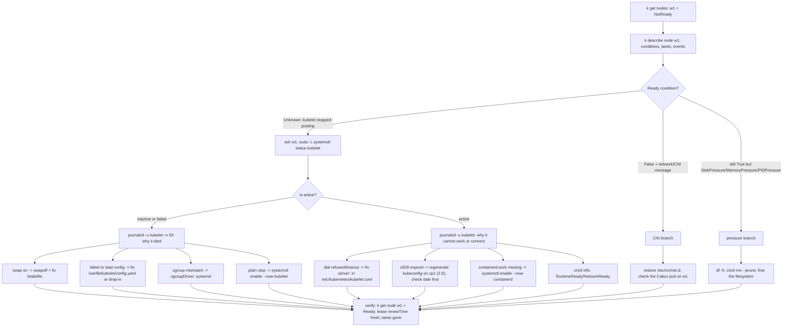

# T4.26 Troubleshoot clusters and nodes

> Competency: "Troubleshoot clusters and nodes" (CKA-2.1) | Domain/weight: CKA — Troubleshooting (30%) | Est. time: 4 h | Prerequisites: T4.25, T1.06, T1.11, T1.12

Set up your shell first. Most `kubectl` commands run on `cp1` as root (`ssh cp1`, then `sudo -i`; summary E7/E8, source: https://docs.linuxfoundation.org/tc-docs/certification/tips-cka-and-ckad). Node work happens on the node itself, also as root after `sudo -i`.

```bash
alias k=kubectl
export do="--dry-run=client -o yaml"
export now="--force --grace-period=0"
source <(kubectl completion bash); complete -o default -F __start_kubectl k
export KUBECONFIG=/etc/kubernetes/admin.conf   # root on cp1 only; whether the exam node already has a kubeconfig for root: UNVERIFIED
```

Where this lesson builds on others:

- Control-plane faults (static Pods, `crictl`, `/readyz`, leader leases): [T4.25](../part4-cka/T4.25-troubleshoot-cluster-components.md). That lesson fixes `cp1`; this one fixes `w1` and `w2`.
- `systemctl` and `journalctl`: [T1.06](../part1-linux/T1.06-systemd-and-journalctl.md).
- containerd, `crictl`, OCI basics: [T1.11](../part1-linux/T1.11-containers-images-registries-and-runtimes-oci.md).
- TLS, certificates and `openssl`: [T1.12](../part1-linux/T1.12-tls-pki-and-openssl-for-kubernetes.md).
- How nodes join a cluster (`kubeadm join`, `kubeadm reset`): [T4.02](../part4-cka/T4.02-create-and-manage-kubernetes-clusters-using.md).
- `drain`/`cordon` during upgrades, PodDisruptionBudgets: [T4.04](../part4-cka/T4.04-manage-the-lifecycle-of-kubernetes-clusters.md).

## 1. Why this matters

A worker that goes `NotReady` is the most common node problem in real clusters, and the classic repair task in the Troubleshooting domain (30% of the CKA). Your Pods keep running for a while, but nothing new lands on the node, and after a few minutes its Pods are evicted and pile onto the survivors. A typical node-troubleshooting task hands you a `NotReady` node and a working `kubectl` on a different host; the fix is almost never in `kubectl`. It is on the node: the kubelet service, the container runtime, the CNI configuration, or the certificates. If you do not know the order to check those in, you will burn your 6 minutes guessing.

## 2. Concepts

### 2.1 Under the hood: how a node stays `Ready`

A **Node** is an API object. Nobody pings the machine. Instead the **kubelet** (the node agent, a systemd service) reports in:

1. Every ~10 seconds the kubelet updates `node.status` (field `nodeStatusUpdateFrequency`, default 10 s) and renews a small **Lease** object named after the node in the `kube-node-lease` namespace. A **Lease** is a `coordination.k8s.io/v1` object with a holder name and a `renewTime` timestamp, used exactly for heartbeats (docs: https://kubernetes.io/docs/concepts/architecture/leases/).
2. Inside `node.status.conditions` the kubelet writes what it observes: memory, disk, PID, network, and its own health.
3. The **node-lifecycle-controller** (a controller inside `kube-controller-manager`) watches those heartbeats. If none arrive for its monitor grace period (default 40 s, flag `--node-monitor-grace-period`), it marks the `Ready` condition `Unknown` and adds taints. After the Pod toleration window (300 s, added automatically to every Pod) it evicts the Pods.

So `kubectl get nodes` is reading a self-report that is at most ~10 s old, plus a controller's opinion about how stale that report is. Three consequences for troubleshooting:

- `STATUS` `NotReady` does not tell you *why*. It tells you the kubelet either stopped reporting or reported a problem. `describe` tells you which.
- The node can be "down" while its containers still run. The kubelet being stopped does not kill anything: containerd keeps the containers alive. That is why Pods on a dead node look `Running` for minutes, then get evicted by the control plane.
- Everything you check on the node is about answering: *is the kubelet running, can it do its job, and can it reach the API server?*

### 2.2 Reading node status

```bash
k get nodes -o wide
```

```
NAME   STATUS     ROLES           AGE   VERSION   INTERNAL-IP     EXTERNAL-IP   OS-IMAGE             KERNEL-VERSION     CONTAINER-RUNTIME
cp1    Ready      control-plane   3d    v1.37.1   192.168.64.10   <none>        Ubuntu 24.04.3 LTS   6.8.0-...-generic  containerd://2.4.2
w1     NotReady   <none>          3d    v1.37.1   192.168.64.11   <none>        Ubuntu 24.04.3 LTS   6.8.0-...-generic  containerd://2.4.2
w2     Ready      <none>          3d    v1.37.1   192.168.64.12   <none>        Ubuntu 24.04.3 LTS   6.8.0-...-generic  containerd://2.4.2
```

EXPECTED OUTPUT (not captured). `STATUS` values you will see: `Ready`, `NotReady` (the umbrella for both a `False` and an `Unknown` `Ready` condition — `describe` shows which), and `Ready,SchedulingDisabled` (cordoned, section 2.9). `VERSION` is the kubelet version, which matters for skew (2.7). `ROLES` is `<none>` on workers — that is normal, not a fault.

The detail is in `describe`:

```bash
k describe node w1
```

The blocks to read, in order:

| Block | What to look for |
|---|---|
| `Conditions` | The five conditions below. This is the single most important block. |
| `Addresses` | `InternalIP` — a wrong or missing address hints at a broken cloud/host config. |
| `Capacity` / `Allocatable` | Sudden tiny values can mean the kubelet could not measure the machine (cgroup problems). |
| `System Info` | OS, kernel, `containerRuntimeVersion`, `kubeletVersion`. Compare kubelet versions across nodes for skew. |
| `Non-terminated Pods` | What the node thinks it runs. |
| `Taints` (top of the output) | Automatic taints reveal the cause category (2.8). |
| `Events` | `NodeNotReady`, `NodeHasDiskPressure`, eviction notices. Written by the node-lifecycle-controller and the kubelet. |

The five standard **conditions** (in `node.status.conditions`; `describe` prints them as a table):

| Type | `True` means | Normal value | If it flips |
|---|---|---|---|
| `Ready` | The kubelet is healthy and posting status | `True` | `False` = the kubelet reports a problem (its `Message` says which). `Unknown` = no heartbeat for ~40 s |
| `MemoryPressure` | Node memory is under pressure; the kubelet is evicting Pods or refusing new ones | `False` | `True` = find the memory hog; Pods get evicted |
| `DiskPressure` | The kubelet's filesystems are nearly full | `False` | `True` = clean disk; `NoSchedule` taint added; Pods can be evicted |
| `PIDPressure` | Too many processes on the node | `False` | `True` = rare; a fork bomb or a process leak |
| `NetworkUnavailable` | The node's network is not configured (CNI) | absent or `False` | `True` = CNI config/plugin problem |

Note the polarity: for `Ready`, `True` is good. For the four pressure/network conditions, `True` is the problem.

When the kubelet stops reporting entirely, the conditions block looks like this after ~40 s:

```
Conditions:
  Type             Status    Reason              Message
  ----             ------    ------              -------
  MemoryPressure   Unknown   NodeStatusUnknown   Kubelet stopped posting node status.
  DiskPressure     Unknown   NodeStatusUnknown   Kubelet stopped posting node status.
  PIDPressure      Unknown   NodeStatusUnknown   Kubelet stopped posting node status.
  Ready            Unknown   NodeStatusUnknown   Kubelet stopped posting node status.
```

EXPECTED OUTPUT (not captured). `Ready` `Unknown` with reason `NodeStatusUnknown` means the control plane lost the heartbeat; the kubelet is dead, wedged, or cannot reach the API server. `Ready` `False` (with a reason like `KubeletNotReady` and a message such as `container runtime network not ready...`) means the kubelet IS reporting, and it is telling you what is wrong — read the message.

**Check the heartbeat itself.** The Lease is the freshest signal:

```bash
k -n kube-node-lease get lease w1 \
  -o custom-columns=NAME:.metadata.name,NODE:.spec.holderIdentity,RENEWED:.spec.renewTime
date -u +%T    # compare: RENEWED should be within ~10-15 s
```

A `RENEWED` minutes old confirms the kubelet is not reaching the API server, whatever the reason.

**`kubectl describe node` vs `k get node -o yaml`.** Same data. Use `describe` for reading, `-o jsonpath` for checks in scripts:

```bash
k get node w1 -o jsonpath='{.status.conditions[?(@.type=="Ready")].status}{"\n"}'   # True / False / Unknown
k get node w1 -o jsonpath='{.spec.taints}'                                          # automatic + manual taints
```

### 2.3 New in v1.37: node lifecycle conditions and declared features

v1.37 reserves five additional **node lifecycle conditions** (KEP-5683, feature gate `NodeLifecycleConditions`, Alpha in v1.37 and off by default). They describe where a node is in its maintenance life, something that until now you could only infer from taints and events:

| Condition | Meaning when `True` |
|---|---|
| `DrainInProgress` | The node is actively being drained |
| `Drained` | The administrator's drain criteria are met |
| `MaintenancePlanned` | The node is expected to undergo a change later |
| `MaintenanceInProgress` | The node is actively under maintenance |
| `GracefulNodeShutdownInProgress` | A graceful node shutdown is in progress |

Two things to know for v1.37 specifically: the gate is effectively a no-op this release — no core component sets these yet, so on a default cluster you will not see them; and they are meant to be written by admins or maintenance tooling (via the Node `status` subresource) so that future controllers can consume one shared signal. If you meet a cluster where they exist, read them exactly like the pressure conditions: `status` `True`/`False`/`Unknown`, plus a `reason` and `message`. Whether `kubectl drain` sets them in your version, and whether they appear in `describe`, is on the "To verify" list. Docs: https://kubernetes.io/docs/reference/node/node-lifecycle-conditions/ and https://kubernetes.io/blog/2026/09/09/kubernetes-v1-37-node-lifecycle-conditions/.

**Also new in v1.37 and worth a look while troubleshooting:** `node.status.declaredFeatures` (feature `NodeDeclaredFeatures`, Stable in v1.37). The kubelet lists the names of still-graduating features it supports, and the scheduler's `NodeDeclaredFeatures` plugin refuses to place a Pod on a node that does not declare a feature the Pod needs. After a **partial upgrade** (2.7) two kubelets can declare different feature sets, which is a subtle scheduling failure mode: same `Ready`, different capabilities. Check with `k get node w1 -o jsonpath='{.status.declaredFeatures}'`. Docs: https://kubernetes.io/docs/concepts/scheduling-eviction/node-declared-features/.

### 2.4 The six-step NotReady runbook, and the node-side toolbox

This is the skill the lesson builds. Memorise the order; each step eliminates a layer.

1. **`k describe node <n>`** — conditions, taints, events. Splits the world in two: kubelet not reporting (`Ready` `Unknown`) vs kubelet reporting a problem (`Ready` `False`, message names the layer).
2. **`ssh <node>`; `sudo -i`** — get on the node. If `ssh` itself fails or the node is powered off, that IS the cause; check the VM/console, not Kubernetes.
3. **`systemctl status kubelet` (and `containerd`)** — is the kubelet `active`? `inactive (dead)` = step 4 tells you it stopped; `activating`/`failed` in a loop = it cannot start, `journalctl` has why; `active` = it runs but cannot do its job or reach the API server.
4. **`journalctl -u kubelet -n 50 --no-pager`** — the kubelet's own log. This is where almost every NotReady cause names itself: swap, bad config file, x509, dial errors, network-not-ready.
5. **Runtime check** — `systemctl status containerd`, then `crictl info` (`RuntimeReady`, `NetworkReady` conditions) or `crictl ps`. The kubelet cannot run Pods or measure the node without the runtime.
6. **Config and certs** — `/var/lib/kubelet/config.yaml` (the kubelet's settings), `/etc/kubernetes/kubelet.conf` (how it reaches the API server), `/var/lib/kubelet/pki/kubelet-client-current.pem` (its client certificate). Check the `server:` line and the cert dates.

Why this order: it goes from "what the control plane thinks" (free) to "is the agent alive" (one command) to "why not" (journal) to the two things the kubelet depends on (runtime below it, API server + identity above it). Jumping straight to certs before checking `is-active` wastes minutes.

The node-side files you must know by path:

| File | What it is | Breakage looks like |
|---|---|---|
| `/var/lib/kubelet/config.yaml` | The `KubeletConfiguration`: cgroup driver, eviction thresholds, `failSwapOn`, `rotateCertificates`, static Pod path | Missing/invalid → kubelet exits at start: `failed to load kubelet config file` |
| `/etc/kubernetes/kubelet.conf` | The kubeconfig the kubelet uses to reach the API server (`server:`, client cert) | Wrong `server:` → dial errors; expired/foreign cert → `x509`/`Unauthorized` |
| `/var/lib/kubelet/pki/` | Where rotated kubelet certs live; `kubelet-client-current.pem` is a symlink to the newest | Expired client cert → `x509` errors, `Unauthorized`, node goes silent |
| `/etc/systemd/system/kubelet.service.d/10-kubeadm.conf` | The systemd drop-in that passes `--config=/var/lib/kubelet/config.yaml` and `--kubeconfig=/etc/kubernetes/kubelet.conf` | Wrong paths there → the kubelet never reaches step 6's files |
| `/etc/cni/net.d/` | CNI network configs (Calico writes `10-calico.conflist` here) | Empty/missing → `NetworkPluginNotReady`, `Ready` `False` |
| `/etc/containerd/config.toml` | Runtime config; `SystemdCgroup` must be `true` | cgroup driver mismatch → kubelet crash-loops |

### 2.5 The NotReady causes catalogue

Almost every node fault in training and exams is one of these. For each: where the evidence is, then the fix (full commands in sections 4 and 6).

| # | Cause | Node-side evidence | Fix |
|---|---|---|---|
| 1 | **kubelet stopped or disabled** | `systemctl status kubelet` → `inactive (dead)`; journal ends cleanly (a stop, not a crash) | `systemctl enable --now kubelet` |
| 2 | **containerd down** | `systemctl status containerd` → dead; kubelet journal repeats `dial unix /run/containerd/containerd.sock: connect: no such file or directory`; node reports `container runtime is down` | `systemctl enable --now containerd`; the kubelet recovers by itself |
| 3 | **CNI not ready** | `describe` shows `Ready` `False`, message like `container runtime network not ready ... NetworkPluginNotReady ... cni plugin not initialized`. Do not wait for `NetworkUnavailable` `True`: that condition is only managed by cloud route/IPAM controllers, so on kubeadm it sits at `False` or is absent entirely — the `Ready` `False` message is the signal | Restore `/etc/cni/net.d/*` and fix the CNI DaemonSet Pod on that node |
| 4 | **kubelet client cert expired or invalid** | journal `x509: certificate has expired or is not yet valid` or `Unauthorized`; `openssl x509 ... -dates` confirms | Regenerate credentials on a cp node, install on the node, restart kubelet (2.6) |
| 5 | **wrong API server address in `kubelet.conf`** | journal repeats `dial tcp <ip>:<port>: connect: connection refused` or `i/o timeout` | Fix `server:` to the real endpoint, `systemctl restart kubelet` |
| 6 | **swap on** | kubelet fails to start; journal `running with swap on is not supported` (default `failSwapOn: true`) | `swapoff -a`, remove the swap entry/file, `systemctl restart kubelet` |
| 7 | **cgroup driver mismatch** | journal `misconfiguration: kubelet cgroup driver: "cgroupfs" is different from container runtime cgroup driver: "systemd"` | Set `cgroupDriver: systemd` in `config.yaml` (and `SystemdCgroup = true` in containerd) to match |
| 8 | **disk full / DiskPressure** | `describe` shows `DiskPressure` `True` + `node.kubernetes.io/disk-pressure:NoSchedule` taint; `df -h` confirms | Free space (images, logs, the big file); the condition clears on the kubelet's next check |
| 9 | **time skew** | journal `x509: certificate has expired or is not yet valid` — the "not yet valid" half is the tell; `date` disagrees with cp1 | Fix the clock (`timedatectl`, NTP); certs become valid again |
| 10 | **version skew** after partial upgrade | `k get nodes -o wide` VERSION column differs; supported window exceeded (2.7) | Upgrade or downgrade the kubelet package to a supported minor |

A note on **time skew** (cause 9), because it disguises itself as cause 4: certificates have a `notBefore` as well as a `notAfter`. If a node's clock is far in the future or the past, a perfectly good certificate reads as expired or not-yet-valid. Before regenerating anything, run `date` on the broken node and on `cp1` and compare. If they disagree, fix the clock (systemd-timesyncd or chrony) and restart the kubelet — do not reissue certificates. This is exactly why the cause order in the runbook checks the cheap things first.

And a note on **disk full** (cause 8): `DiskPressure` is driven by the kubelet's `evictionHard` thresholds (defaults: `nodefs.available<10%`, `imagefs.available<15%`, `nodefs.inodesFree<5%`; `nodefs` is the filesystem containing `/var/lib/kubelet`). At `DiskPressure` the node stays `Ready` but gains a `NoSchedule` taint and the kubelet starts evicting Pods to reclaim space. Clean with `crictl rmi --prune` (unused images), `journalctl --vacuum-size=`, or by deleting whatever filled the disk.

### 2.6 The kubelet client certificate: rotation, expiry, repair

The kubelet authenticates to the API server as `system:node:<nodename>` (a client certificate, organisation `system:nodes`). kubeadm sets `rotateCertificates: true` in the kubelet config, so the kubelet **rotates its client certificate automatically**: before expiry it submits a `CertificateSigningRequest`, `kube-controller-manager` auto-approves node renewals, and the signed cert lands in `/var/lib/kubelet/pki/kubelet-client-<timestamp>.pem`, with `kubelet-client-current.pem` a symlink to the newest. Signed lifetime: 1 year (the controller-manager's `--cluster-signing-duration`). Details: https://kubernetes.io/docs/tasks/tls/certificate-rotation/ and [T1.12](../part1-linux/T1.12-tls-pki-and-openssl-for-kubernetes.md).

Check the live cert like this:

```bash
openssl x509 -in /var/lib/kubelet/pki/kubelet-client-current.pem -noout -dates -subject
```

```
notBefore=Nov  3 10:12:41 2025 GMT
notAfter=Nov  3 10:12:41 2026 GMT
subject=O = system:nodes, CN = system:node:w1
```

EXPECTED OUTPUT (not captured). Two things to check: `notAfter` is in the future, and `CN` equals `system:node:<this node's name>`. A cert for the wrong node name fails authorization even if it is in date — the Node authorizer binds `CN` to the Node object name.

**Why an expired client cert cannot fix itself.** The renewal request is an API call. If the cert is already expired, the kubelet cannot authenticate, so it cannot request the new cert. That is the one cert in a kubeadm cluster that rotation cannot save, and `kubeadm certs renew` does not cover it (it renews the pki and the `*.conf` kubeconfigs on control-plane nodes only). Symptoms in the journal: `x509: certificate has expired or is not yet valid` or `Unauthorized` on every API call, and the node drifts to `Unknown`.

**The repair (documented by kubeadm, "kubelet client cert"):** on a control-plane node that has `/etc/kubernetes/pki/ca.key`, mint a fresh kubeconfig for the node's identity, install it on the failed node, and let the kubelet write a new rotating cert:

```bash
# on cp1, as root
export NODE=w1
kubeadm kubeconfig user --org system:nodes --client-name system:node:$NODE > /root/kubelet-$NODE.conf
# copy it to the node, then on w1 as root:
cp /etc/kubernetes/kubelet.conf /root/kubelet.conf.bak           # backup first
cp /root/kubelet-w1.conf /etc/kubernetes/kubelet.conf            # adjust server:/cluster name to match the old file if needed
systemctl restart kubelet
# verify the kubelet wrote a fresh rotating cert:
openssl x509 -in /var/lib/kubelet/pki/kubelet-client-current.pem -noout -dates
# final step from the upstream procedure: point the kubeconfig at the rotating file so later rotations apply —
# edit /etc/kubernetes/kubelet.conf and replace client-certificate-data/client-key-data with:
#   client-certificate: /var/lib/kubelet/pki/kubelet-client-current.pem
#   client-key: /var/lib/kubelet/pki/kubelet-client-current.pem
systemctl restart kubelet
```

Whether `kubeadm kubeconfig user` writes to stdout on 1.37, and whether the generated file's `server:`/`name:` fields already match the worker's, is on the "To verify" list — compare it against the backed-up `kubelet.conf` and edit before installing. The heavy alternative for a node you do not mind resetting is a full rejoin (2.9).

### 2.7 Version skew after a partial upgrade

The documented support window (https://kubernetes.io/releases/version-skew-policy/): **kubelet must not be newer than kube-apiserver, and may be up to three minor versions older** (so a `1.34`–`1.37` kubelet can talk to a `1.37` API server; `1.33` cannot). `kubectl` allows ±1 minor. kubeadm upgrades are designed around this: you upgrade the control plane first, then kubelets, and the in-between state is supported.

Where it bites you in troubleshooting:

- A node joined with a **newer** kubelet than the API server (for example `apt` pulled `1.38` while cp1 is still `1.37`) is outside the window — unsupported. It may register and look `Ready`, but nothing about the combination is guaranteed; if a node misbehaves after a package upgrade, compare versions first.
- A kubelet **too old** (more than three minors behind) is equally unsupported.
- Within the window things still differ subtly: `declaredFeatures` (2.3) can diverge, so a Pod needing a feature may schedule on one node and never on another. `k get nodes -o wide` (VERSION column) plus `kubelet --version` on the node are the checks.

### 2.8 Taints the control plane adds by itself

The node-lifecycle-controller converts node conditions into **taints**. This is why a broken node's Pods leave after a delay instead of instantly:

| Taint (all under `node.kubernetes.io/`) | Effect | Added when |
|---|---|---|
| `not-ready` | `NoExecute` | `Ready` = `False` |
| `unreachable` | `NoExecute` | `Ready` = `Unknown` (no heartbeat ~40 s) |
| `memory-pressure` | `NoSchedule` | `MemoryPressure` = `True` |
| `disk-pressure` | `NoSchedule` | `DiskPressure` = `True` |
| `pid-pressure` | `NoSchedule` | `PIDPressure` = `True` |
| `network-unavailable` | `NoSchedule` | `NetworkUnavailable` = `True` — only where a controller manages that condition (cloud route/IPAM controllers); on kubeadm it usually stays `False` or absent |
| `unschedulable` | `NoSchedule` | you run `kubectl cordon` |
| `out-of-disk` | `NoSchedule` | legacy — belonged to the old `OutOfDisk` condition, which a v1.37 kubelet never reports, so this taint effectively never appears; `disk-pressure` above is the live disk-exhaustion signal |

`NoSchedule` = no *new* Pods on the node. `NoExecute` = running Pods without a toleration are evicted. The **DefaultTolerationSeconds** admission plugin silently adds `not-ready` and `unreachable` tolerations with `tolerationSeconds=300` to every Pod that lacks them — which is why Pods on a dead node survive ~5 minutes before eviction, and why fixing the node quickly (under 5 min) avoids the disruption entirely. See them with `k get node w1 -o jsonpath='{.spec.taints}'` or the `Taints:` line of `describe`.

### 2.9 Cordon, drain, uncordon; deleting and rejoining a node

You already know these from upgrades ([T4.04](../part4-cka/T4.04-manage-the-lifecycle-of-kubernetes-clusters.md)); here is the troubleshooting angle:

- **`k cordon w1`** sets `spec.unschedulable: true` + the `unschedulable` taint → `Ready,SchedulingDisabled`. Use it to freeze a flaky node while you investigate, without touching its Pods.
- **`k drain w1 --ignore-daemonsets --delete-emptydir-data`** cordons, then evicts evictable Pods through the eviction API (respects PodDisruptionBudgets). Use it before node maintenance — or when you intend to repair/rejoin. A drain that hangs is usually a PDB (`minAvailable` equal to replicas) — see T4.04.
- **`k uncordon w1`** re-opens scheduling. Nothing moves *back* by itself — Kubernetes never rebalances automatically.
- **Deleting the Node object** (`k delete node w1`) removes the API entry. The Pods that were on it are rescheduled. Do this only when the machine is gone or you are rejoining; the kubelet on a still-running node will just re-register and recreate the Node.
- **Rejoining** (the clean fix for a node whose identity, certs or config are beyond local repair): on the node, `kubeadm reset` (removes `/etc/kubernetes` and `/var/lib/kubelet` — it does not remove `/etc/cni/net.d`, so delete that yourself if the CNI config was the problem, and per the kubeadm docs it does not clean iptables/IPVS rules either: flush them or reboot before rejoining if the node must be pristine); then on `cp1`, `kubeadm token create --print-join-command`; run that `kubeadm join ...` on the node. Details in [T4.02](../part4-cka/T4.02-create-and-manage-kubernetes-clusters-using.md). A rejoin gives a fresh `kubelet.conf`, fresh certs and a fresh `config.yaml`, which is why it also cures cause 4 and 5.

### 2.10 Cluster-level checks

Node faults sometimes ride along with control-plane or cluster-wide problems. Three commands worth 30 seconds before you `ssh` anywhere:

```bash
k cluster-info                          # are the control plane endpoints up at all?
k get nodes                             # one bad node, or all of them? all -> think control plane or CNI DaemonSet, not a single kubelet
k get events -A --sort-by=.lastTimestamp | tail -20     # cluster-wide story: NodeNotReady, evictions, CNI errors
```

`k cluster-info dump` dumps the full cluster state (all objects, all logs) to stdout, or to a directory with `--output-directory=/path` — useful to hand to someone else, overkill for a single NotReady node. The `events -A` line is the practical one: it shows `NodeNotReady` events, `Evicted` events with reasons like `The node was low on resource: ephemeral-storage` (disk pressure evictions name themselves), and `FailedCreatePodSandBox` storms when the CNI is broken cluster-wide. Pattern: **one node bad → think node. All nodes bad → think CNI DaemonSet, containerd version, or control plane ([T4.25](../part4-cka/T4.25-troubleshoot-cluster-components.md)).**

### 2.11 `kubectl debug node` when SSH is not an option

If you cannot `ssh` to the node (no network path, lost keys) but the node is still in the cluster, kubectl can put a debug Pod **on that node** with the host's filesystem mounted at `/host`:

```bash
k debug node/w1 -it --image=busybox:1.36      # creates pod node-debugger-w1-<random> on w1, lands in a shell
# inside the pod:
chroot /host                                 # now you are "on" the node's filesystem
cat /etc/kubernetes/kubelet.conf | grep server:
journalctl --root=/host -u kubelet -n 50 --no-pager   # read the node's journal without ssh
exit
k delete pod node-debugger-w1-<random>       # clean up; it does not remove itself
```

Inside, `chroot /host` gives you the host's binaries and files. `journalctl --root=/host` reads the journal *files* (systemd in the debug container cannot talk to the host's systemd, so plain `journalctl` may fail; `--root=` reads the directory directly). `systemctl` will not work inside — there is no systemd to talk to — so this is for *reading* (logs, configs, certs with `openssl x509`), not for restarting services. The debug Pod lands in your current namespace; always delete it after. Whether the debug profile needs `--profile=sysadmin` for your task (e.g. reading files owned by root inside `chroot` usually works because the debug pod runs as root) is on the "To verify" list.

### 2.12 Related but different

- **`NotReady` vs `Ready,SchedulingDisabled`.** The first is the kubelet or node broken. The second is a healthy node you cordoned on purpose (drain/upgrade). `describe` shows the `unschedulable` taint in the second case and no condition problem.
- **`kubelet.conf` is not `admin.conf`.** On a worker, `export KUBECONFIG=/etc/kubernetes/kubelet.conf; k get secrets` fails with `Forbidden` — the Node authorizer gives `system:node:<name>` only what a kubelet needs: it may list and watch Pods (that is how it learns its work), but secrets, configmaps and volumes only the ones referenced by Pods bound to that node, so a cluster-wide secret list is denied. Do your `kubectl` work on `cp1` with `admin.conf`; use the worker for `systemctl`, `journalctl`, `crictl`, `openssl`, `df`.
- **Pod `Pending` vs node `NotReady`.** A Pending Pod on a healthy node is a scheduling problem (resources, taints, affinity). Check `k get nodes` first; only debug the Pod once all nodes are `Ready`.
- **Stopped kubelet vs crashed containers.** `systemctl stop kubelet` leaves the containers running (containerd owns them). Pods on the node keep serving until the control plane evicts them ~5 min later. Do not assume `NotReady` means the workloads are dead.

## 3. How it works (diagram)



How to read it:

1. `describe` is the fork. `Unknown` sends you to the node (dead or disconnected kubelet); `False` with a network message goes straight to the CNI branch; pressure conditions go to the disk/memory branch — those nodes are still alive and need capacity work, not service restarts.
2. On the node, `systemctl status` splits again: dead or crash-looping kubelet (journal says why it cannot *start*: swap, bad config, cgroup mismatch) vs running kubelet (journal says why it cannot *work*: dial, x509, runtime socket).
3. The runtime check (`crictl info`) sits on the running-kubelet branch because a running kubelet that cannot reach containerd reports it both in its journal and in `crictl`.
4. Every branch ends at the same three proofs: `STATUS` back to `Ready`, the `kube-node-lease` renewTime fresh, and the automatic taints gone (the controller removes them when the condition clears — you do not).
5. Before the x509 branch: run `date` on both nodes. Time skew produces the same error text with half the repair.

## 4. Commands and YAML you must produce fast

### 4.1 Imperative commands

```bash
k get nodes -o wide                                  # statuses, kubelet VERSIONs, IPs — the first look
k describe node w1                                   # conditions + taints + events: the fork of the runbook
k -n kube-node-lease get lease w1 -o custom-columns=NAME:.metadata.name,RENEWED:.spec.renewTime   # heartbeat freshness
k get events -A --sort-by=.lastTimestamp | tail -20  # cluster-wide story in 20 lines
k debug node/w1 -it --image=busybox:1.36             # host shell at /host when ssh is impossible
ssh w1                                               # get on the node (then sudo -i)
sudo -i; systemctl status kubelet containerd         # alive or dead, both layers
systemctl enable --now kubelet                       # the fix for a stopped kubelet (enable too: survive reboots)
journalctl -u kubelet -n 50 --no-pager               # the kubelet's side of the story
journalctl -u kubelet -f                             # follow live while you change things (second terminal)
crictl info | jq .status                             # RuntimeReady / NetworkReady (jq may not exist on exam hosts — use `crictl info | grep -A1 '"type"'`; "type" and "status" print on separate lines)
crictl ps                                            # containers the runtime actually runs
openssl x509 -in /var/lib/kubelet/pki/kubelet-client-current.pem -noout -dates -subject   # cert expiry + CN
date                                                 # on the node AND on cp1: time skew check
df -h /var/lib/kubelet; free -m                      # the pressure-condition checks
k cordon w1 / k drain w1 --ignore-daemonsets --delete-emptydir-data / k uncordon w1
k delete node w1                                     # only when the machine is gone or before a rejoin
```

### 4.2 The runbook as a checklist (produce this from memory)

```
NOTREADY RUNBOOK
[1] k describe node <n>        -> Ready=Unknown (silent kubelet) or False (names the cause) or pressure True
[2] ssh <n>; sudo -i           -> cannot ssh = the node itself is the fault
[3] systemctl status kubelet containerd
                               -> inactive/failed: go to [4] for the reason
                               -> active: go to [4] for what it cannot do
[4] journalctl -u kubelet -n 50 --no-pager
                               -> swap on | failed to load config | x509 | dial tcp | network not ready
[5] systemctl status containerd; crictl info | jq .status
                               -> runtime dead or NetworkReady=false
[6] files: /var/lib/kubelet/config.yaml  (YAML parses? cgroupDriver systemd?)
          /etc/kubernetes/kubelet.conf   (server: correct? cert embedded/linked?)
          openssl x509 -in /var/lib/kubelet/pki/kubelet-client-current.pem -noout -dates
          date                             (clock = cp1's clock?)
FIX the ONE thing found, then:
VERIFY k get node <n>=Ready; lease renewTime fresh; taints cleared; pods schedule again
```

### 4.3 The config files you will be given to read (not to `apply`)

**`/var/lib/kubelet/config.yaml`** — the kubelet's settings file (an excerpt; it is a config file, never `kubectl apply` it):

```yaml
apiVersion: kubelet.config.k8s.io/v1beta1
kind: KubeletConfiguration
cgroupDriver: systemd                  # MUST match containerd (SystemdCgroup=true); mismatch = crash loop
failSwapOn: true                       # default; kubelet refuses to start with swap on
rotateCertificates: true               # kubeadm sets this; auto-renews the client cert
staticPodPath: /etc/kubernetes/manifests   # where static Pods are read from (T4.25)
clusterDNS: [10.96.0.10]               # cluster DNS IP handed to Pods
clusterDomain: cluster.local
evictionHard:                          # thresholds that drive DiskPressure/MemoryPressure
  nodefs.available: "10%"
  imagefs.available: "15%"
  nodefs.inodesFree: "5%"
authentication:
  anonymous: { enabled: false }
  webhook: { enabled: true }
```

The runtime endpoint itself is not in this file on kubeadm clusters: the `10-kubeadm.conf` drop-in passes `--container-runtime-endpoint=unix:///run/containerd/containerd.sock` as a flag (`KUBELET_KUBEADM_ARGS`). If `crictl` cannot talk to the runtime but `config.yaml` looks fine, read the drop-in next.

**`/etc/kubernetes/kubelet.conf`** — the kubeconfig the kubelet uses (excerpt; the `...-data` values are long base64 strings):

```yaml
apiVersion: v1
kind: Config
clusters:
- cluster:
    certificate-authority-data: <base64 CA>
    server: https://192.168.64.10:6443    # wrong IP/port here = dial errors, node goes Unknown
  name: kubernetes
contexts:
- context:
    cluster: kubernetes
    user: system:node:w1
  name: system:node:w1@kubernetes
current-context: system:node:w1@kubernetes
users:
- name: system:node:w1
  user:
    client-certificate-data: <base64 cert>    # on rotated nodes often file paths instead:
    client-key-data: <base64 key>             # client-certificate: /var/lib/kubelet/pki/kubelet-client-current.pem
```

**A Pod that tolerates the disk-pressure taint** — this one DOES apply, and it is how you observe the effect of automatic taints (create it, fill the disk in a lab, watch other Pods refuse to schedule while this one can):

```yaml
apiVersion: v1
kind: Pod
metadata:
  name: tolerant
  namespace: lab-t426
spec:
  tolerations:
  - key: node.kubernetes.io/disk-pressure   # must match the taint key exactly
    operator: Exists                        # Exists = tolerate any value of this key
    effect: NoSchedule                      # must match the taint's effect
  containers:
  - name: pause
    image: busybox:1.36
    command: ["sleep", "3600"]
```

Fields: `tolerations[].key`/`operator`/`effect` must all match the taint; `operator: Exists` ignores the value (taints carry a value you do not usually set yourself). Without the toleration, the Pod stays `Pending` with `0/3 nodes are available: 1 node(s) had untolerated taint` while the pressured node is tainted.

### 4.4 Speed drill

Setup: a healthy three-node `vms` cluster (`cp1`, `w1`, `w2`), `k create ns lab-t426`, and you are root on `cp1` with `KUBECONFIG` set. Drills 3 and 4 are done on the nodes via `ssh` from your local shell (second terminal), not from inside `cp1`; drill 7 is `kubectl debug` from `cp1`. Cleanup at the end.

1. [45 s] From `cp1`, show every node's STATUS and the kubelet VERSION in one table.
2. [60 s] Print only the `Conditions` block of `k describe node w2` (no full YAML).
3. [90 s] On `w1`, print the kubelet client certificate's `notAfter` and its `CN`.
4. [60 s] On `w1`, show whether kubelet and containerd are enabled at boot, one command.
5. [90 s] Cordon `w2`, prove it is `Ready,SchedulingDisabled`, then uncordon it.
6. [60 s] Print `w1`'s lease `renewTime` and the current UTC time side by side.
7. [3 min] Without ssh, print `w2`'s hostname from its own `/etc/hostname` using `kubectl debug`, then delete the debug pod.
8. [60 s] List all non-`Normal` events across all namespaces.

Cleanup: `w2` must be schedulable again and no `node-debugger-*` Pod may remain.

<details><summary>Answers</summary>

```bash
# 1
k get nodes -o wide

# 2
k describe node w2 | sed -n '/^Conditions:/,/^Addresses:/p' | head -8
# (or: k get node w2 -o jsonpath='{range .status.conditions[*]}{.type}{"\t"}{.status}{"\n"}{end}')

# 3  (on w1, as root)
openssl x509 -in /var/lib/kubelet/pki/kubelet-client-current.pem -noout -enddate -subject

# 4  (on w1)
systemctl is-enabled kubelet containerd     # expect: enabled / enabled

# 5  (on cp1)
k cordon w2 && k get node w2 --no-headers | grep SchedulingDisabled
k uncordon w2 && k get node w2

# 6  (on cp1)
k -n kube-node-lease get lease w1 -o jsonpath='{.spec.renewTime}{"\n"}'; date -u +%FT%TZ

# 7  (on cp1)
k debug node/w2 -it --image=busybox:1.36 -- cat /host/etc/hostname
k delete pod $(k get pods -o name | grep node-debugger-w2 | cut -d/ -f2)

# 8
k get events -A --field-selector type!=Normal
```

Notes: in 2, the `sed` prints from the `Conditions:` header to the next block. In 3, `-enddate` alone shows only `notAfter`; add `-subject` for the CN, which must be `system:node:w1`. In 7 the command runs non-interactively (`--` passes a command, no shell needed) — the host's whole filesystem is under `/host`. If `kubectl debug` refuses because the node's kubelet is the broken one, that is expected: it needs a working kubelet to run the Pod, so it is a tool for *reachable* nodes only.

</details>

## 5. Worked example

Goal: `w1` is `NotReady`. Walk the runbook end to end. The injected fault here is a corrupted `/var/lib/kubelet/config.yaml` — cause "kubelet crash-loops on a bad config". Environment: **vms** (`cp1`, `w1`, `w2`). All output below is EXPECTED OUTPUT (not captured) — this machine has no VMs — and commands are written to run as is.

**Step 0. Break it** (standing in for "someone's bad edit"): on `w1` as root —

```bash
cp /var/lib/kubelet/config.yaml /root/config.yaml.bak    # backup, like always
echo "badline" >> /var/lib/kubelet/config.yaml           # a line with no colon: invalid YAML
systemctl restart kubelet
```

**Step 1. Notice and describe.** On `cp1`:

```bash
k get nodes
k describe node w1 | sed -n '/^Conditions:/,/^Addresses:/p'
```

```
NAME   STATUS     ...
cp1    Ready      ...
w1     Ready      ...        # at first it may still show Ready — the stale heartbeat lasts ~40 s
```

```
  Type             Status    Reason              Message
  ----             ------    ------              -------
  ...
  Ready            Unknown   NodeStatusUnknown   Kubelet stopped posting node status.
```

EXPECTED OUTPUT (not captured). After ~40 s the node turns `NotReady` and `Ready` goes `Unknown`: the kubelet is silent — either dead or cut off from the API.

**Step 2. Get on the node.**

```bash
ssh w1
sudo -i
systemctl status kubelet
```

```
     Active: activating (auto-restart) ... (Result: exit-code)
```

EXPECTED OUTPUT (not captured). `activating (auto-restart)` means systemd is restarting it in a loop: the kubelet *starts* and *dies* — a crash loop, not a plain stop. `systemctl` shows a few journal lines at the bottom; get the full reason from the journal.

**Step 3. The journal.**

```bash
journalctl -u kubelet -n 20 --no-pager
```

```
... kubelet[...]: "Failed to load kubelet config file" err="failed to load kubelet config file, error: ... yaml: line ...: could not find expected ':', path: /var/lib/kubelet/config.yaml"
```

EXPECTED OUTPUT (not captured; the exact wording varies — the parts to trust: `Failed to load kubelet config file` and `path: /var/lib/kubelet/config.yaml`). The kubelet cannot even parse its settings. No YAML error in the file name to guess: it says the path directly.

**Step 4. Confirm what systemd is doing** (optional, quick): `systemctl status kubelet` showed `auto-restart` — systemd keeps retrying forever, so it will never look "failed" permanently, it just never stays up.

**Step 5. Fix it.**

```bash
cp /root/config.yaml.bak /var/lib/kubelet/config.yaml    # restore the known-good file
systemctl restart kubelet
sleep 5
systemctl is-active kubelet                            # expect: active
```

Why restore rather than hunt the bad line: under time pressure, `cp` from a backup you made (or from `w2`'s file with the same settings) is faster and safer than line-editing YAML you cannot fully see. If no backup existed, the fix would be: remove the `badline` and verify the file parses — `yq . /var/lib/kubelet/config.yaml > /dev/null` (`yq` is on exam hosts, summary E9).

**Step 6. Prove it from `cp1`.**

```bash
k get node w1                                   # Ready, within ~15-30 s
k -n kube-node-lease get lease w1 -o custom-columns=RENEWED:.spec.renewTime   # fresh
k get node w1 -o jsonpath='{.spec.taints}'      # unreachable taint disappears by itself
```

EXPECTED OUTPUT (not captured): `STATUS` `Ready`, `RENEWED` a few seconds old, and the taints list back to what it was — the node-lifecycle-controller removes `node.kubernetes.io/unreachable` once the heartbeat returns.

**What the example taught.** The fault lived at step "kubelet cannot start", so `describe` could only say `Unknown` and the journal had to name it. Note what did NOT happen: no `x509`, no dial errors, no CNI complaints — the journal line told you exactly which file, which is the signature of cause "bad config". Also note the containerd containers on `w1` kept running the whole time (step 2.12): workloads only leave if you take longer than ~5 minutes.

## 6. Common mistakes and how to fix them

All "What you will see" cells are EXPECTED OUTPUT (not captured). Where I am not sure of the exact wording I wrote only the part I trust, with `...`.

| Symptom | What you will see | Cause | Fix (command) |
|---|---|---|---|
| Node `NotReady`, kubelet `inactive (dead)` | `systemctl status kubelet` → `inactive (dead)`; journal ends with a stop/shutdown line, no error | kubelet stopped (or never enabled) — human, reboot, or a disabled unit | `systemctl enable --now kubelet` on the node; node returns to `Ready` in ~15 s |
| Kubelet `active`, `describe` says network not ready | `Ready` `False`, message `container runtime network not ready: NetworkReady=false reason:NetworkPluginNotReady message:... cni plugin not initialized`; `ls /etc/cni/net.d` empty or missing; `crictl info` shows the `NetworkReady` condition `false` | CNI config removed/broken, or the CNI DaemonSet Pod on that node is down | Restore `/etc/cni/net.d/*` (e.g. `mv /root/net.d.saved /etc/cni/net.d`); check the CNI pod: `k -n kube-system get pods -o wide \| grep w1` |
| `x509` in the kubelet journal | `x509: certificate has expired or is not yet valid`, or `Unauthorized` on every API write | Kubelet client certificate expired/invalid — or the node clock is wrong | First `date` on the node vs `cp1` (time skew!). If the cert is really bad: `openssl x509 -in /var/lib/kubelet/pki/kubelet-client-current.pem -noout -dates`, then the 2.6 repair (`kubeadm kubeconfig user` on `cp1`) |
| Kubelet crash-loops on its config | journal `Failed to load kubelet config file ... path: /var/lib/kubelet/config.yaml` (YAML error, or `no such file`) | `/var/lib/kubelet/config.yaml` missing/invalid, or the `10-kubeadm.conf` drop-in points at the wrong path | Restore/fix `config.yaml` (validate with `yq . file`), or fix the `--config=` line in `/etc/systemd/system/kubelet.service.d/10-kubeadm.conf` + `systemctl daemon-reload` |
| `DiskPressure` taint, Pods evicting | `describe` → `DiskPressure` `True`, taint `node.kubernetes.io/disk-pressure:NoSchedule`; events `Evicted ... The node was low on resource`; `df -h` shows ~100% | Filesystem of `/var/lib/kubelet` (or `imagefs`) full: logs, images, a stray big file | `df -h`; find it (`du -x / \| sort -n \| tail` or `dust`); `rm` the file / `crictl rmi --prune` / `journalctl --vacuum-size=200M`; condition clears on the next kubelet check |
| Kubelet will not start, mentions swap | journal `running with swap on is not supported` (or `failSwapOn`) | A swap file/partition is active; `failSwapOn: true` by default | `swapoff -a`; delete the swapfile / comment the fstab line; `systemctl restart kubelet` |
| Kubelet crash-loops, mentions cgroup | journal `misconfiguration: kubelet cgroup driver: "cgroupfs" is different from container runtime cgroup driver: "systemd"` | `cgroupDriver` in `config.yaml` disagrees with containerd's `SystemdCgroup` | Set `cgroupDriver: systemd` in `/var/lib/kubelet/config.yaml` (and `SystemdCgroup = true` in `/etc/containerd/config.toml`), `systemctl restart containerd kubelet` |
| Kubelet active but `Ready` `Unknown` | journal repeats `dial tcp <ip>:<port>: connect: connection refused` or `i/o timeout` toward the API address | `server:` in `/etc/kubernetes/kubelet.conf` is wrong (bad IP or port) | Fix `server:` to the endpoint in `admin.conf` on `cp1`; `systemctl restart kubelet` |
| `x509 ... not yet valid` specifically | Same as the x509 row, but the "not yet valid" half | Clock skew: node time before the cert's `notBefore` (or far past `notAfter`) | `timedatectl` on the node vs `cp1`; enable/fix `systemd-timesyncd` or chrony; `systemctl restart kubelet`. Do not reissue certs |
| Node `Ready` but Pods will not schedule there after a package upgrade | `k get nodes -o wide` VERSION differs from `cp1`; `FailedScheduling` or a Pod requiring a feature never lands on it | Kubelet version outside the skew window, or `declaredFeatures` mismatch (2.3, 2.7) | `kubelet --version` on the node; install a supported minor (`apt` pins), restart kubelet |
| `k delete node w1` but `w1` reappears | The node is back in `get nodes` a minute later | The kubelet on `w1` is still running and re-registers | Stop the kubelet on `w1` first (or proceed to `kubeadm reset` there if the goal is removal) |
| Debug pod cannot reach the node | `k debug node/w1` → Pod `Pending`, or scheduling errors | `kubectl debug node` needs a *working* kubelet to start the Pod | Use it only on reachable nodes; for a dead kubelet you need ssh or console access |

**Reasoning for the three faults exam-style tasks lean on.**

1. **Silent node (`Ready` `Unknown`).** The control plane cannot tell a dead kubelet from a partitioned one. The tie-break is `ssh`: if you get in and `systemctl status kubelet` shows `active`, the kubelet is alive but cannot reach the API server — go to the journal and look for `dial`/`x509`, then straight to `kubelet.conf`. If it shows `inactive` or `activating`, the journal tells you why it cannot start. Two causes, one command apart.
2. **`Ready` `False` with a message.** The kubelet is talking and telling you the layer: `container runtime network not ready` → CNI (`/etc/cni/net.d` + the Calico Pod on that node + `crictl info` `NetworkReady`); `container runtime is down` → containerd. Fix the named layer, not the kubelet.
3. **Pressure conditions.** `DiskPressure`/`MemoryPressure` are not `NotReady` faults — the node is alive and defending itself. Do not restart the kubelet: free the resource. The taint and the condition clear on their own once usage drops below `evictionHard` for a check cycle.

## 7. Labs

**Lab order.** Easy, then Medium, then Break-fix. Every lab ends by restoring the baseline, so they also work in any order.

**Environment for all labs: vms.** Three Ubuntu LTS VMs (`cp1`, `w1`, `w2` — Multipass v1.17.0 or KVM), kubeadm 1.37.x, containerd 2.x, Calico v3.33.0, prepared with `env/vm-prereqs.sh` and joined per [T4.02](../part4-cka/T4.02-create-and-manage-kubernetes-clusters-using.md). Detection work happens on `cp1` as root (`export KUBECONFIG=/etc/kubernetes/admin.conf`); node work happens on `w1`/`w2` after `ssh` + `sudo -i`. Keep two terminals (or `exit` between nodes): no nested `ssh`. These labs intentionally break workers — **do not run them on a cluster you care about.**

**Common setup (once per session), on `cp1`:**

```bash
ssh cp1
sudo -i
export KUBECONFIG=/etc/kubernetes/admin.conf
alias k=kubectl; export do="--dry-run=client -o yaml"; export now="--force --grace-period=0"
mkdir -p ~/lab/t426
k create ns lab-t426
k -n lab-t426 create deploy web --image=nginx:1.27 --replicas=3
k -n lab-t426 rollout status deploy/web --timeout=120s
k -n lab-t426 get pods -o wide          # note which Pods sit on w1/w2
```

### Lab 1 (Easy): the silent node

**Fault injection** (from your local shell, or `ssh w1` yourself first):

```bash
ssh w1 'sudo systemctl disable --now kubelet'     # one-line fault: stops AND disables; then give it about a minute
ssh cp1                                  # detection happens on cp1
sudo -i
export KUBECONFIG=/etc/kubernetes/admin.conf
```

**Task (exam style).** Worker node `w1` is not healthy. Find the cause and restore the node. When you are done, node `w1` must report `Ready` and the Pods of Deployment `web` in namespace `lab-t426` must all be `Running`. Time target: 5 minutes.

<details><summary>Hints</summary>

1. `k describe node w1` first: is the kubelet silent (`Unknown`) or reporting a problem (`False`)?
2. On `w1`, `systemctl status kubelet` splits "dead" from "alive but unable".
3. The fix must also survive a reboot — `start` alone is not the complete command.

</details>

<details><summary>Solution</summary>

1. `k get nodes` → `w1` `NotReady`. `k describe node w1` → `Ready` `Unknown`, `Kubelet stopped posting node status`, taint `node.kubernetes.io/unreachable:NoExecute`. The kubelet is silent: go to the node.
2. `ssh w1; sudo -i; systemctl status kubelet` → `inactive (dead)`; `systemctl is-enabled kubelet` → `disabled`. The journal's last lines are a clean shutdown, not a crash — someone or something *stopped* it and made sure it stays stopped across reboots.
3. Fix: `systemctl enable --now kubelet` (the `enable` matters: a stopped kubelet that is also disabled comes back after every reboot as the same fault).
4. `systemctl is-active kubelet` → `active`. Back on `cp1`, `k get node w1` → `Ready` within ~15-30 s; the `unreachable` taint disappears by itself.
5. Pods: if you finished inside ~5 min, the `web` Pods on `w1` never got evicted — they were running in containerd the whole time and the kubelet re-adopts them. Slower than the 300 s toleration and they were rescheduled to `w2`; `k -n lab-t426 get pods -o wide` shows them `Running` either way.

</details>

**Verification** (each line can fail; run the `ssh` lines from your local shell or a second terminal):

```bash
test "$(k get node w1 -o jsonpath='{.status.conditions[?(@.type=="Ready")].status}')" = "True" && echo "w1 Ready"
t=$(k -n kube-node-lease get lease w1 -o jsonpath='{.spec.renewTime}')
test $(( $(date +%s) - $(date -d "$t" +%s) )) -lt 60 && echo "lease fresh"
ssh w1 'sudo systemctl is-active kubelet' | grep -q '^active$' && echo "kubelet active"
ssh w1 'sudo systemctl is-enabled kubelet' | grep -q '^enabled$' && echo "kubelet enabled"
test "$(k -n lab-t426 get pods --no-headers | grep -c Running)" = "3" && echo "all pods running"
! k get node w1 -o jsonpath='{.spec.taints}' | grep -q 'unreachable' && echo "taint gone"
```

The `date -d` conversion needs GNU `date` (present on the VMs; the lease timestamp looks like `2026-10-28T12:34:56.789012Z`). Expected pass output is EXPECTED OUTPUT (not captured).

**Cleanup:**

```bash
# nothing to undo once w1 is healthy — the fault was a stopped, disabled service
k -n lab-t426 delete pods --field-selector=status.phase=Failed   # drop Evicted leftovers, if any
k get nodes   # all three Ready before moving on
```

### Lab 2 (Medium): one of five node faults, 10 minutes

**Task (exam style).** A script has injected exactly one fault into `w1`. Restore the node to `Ready` and keep the Deployment `web` healthy, within 10 minutes. Do not read the `case` block below and do not `cat /root/lab/t426/.fault` until you are done.

**Setup.** Create `inject.sh` on `w1` and run it there as root (`ssh w1`, then `sudo -i`):

```bash
mkdir -p ~/lab/t426                     # the common setup made this dir on cp1, not here on w1
cat > ~/lab/t426/inject.sh <<'EOF'
#!/usr/bin/env bash
set -euo pipefail
mkdir -p /root/lab/t426
n=${1:-$(( RANDOM % 5 + 1 ))}
echo "$n" > /root/lab/t426/.fault
case $n in
  1) systemctl stop containerd ;;
  2) mv /etc/cni/net.d /root/net.d.saved ;;
  3) sed -i 's#\(server: https://[^:]*\):6443#\1:6444#' /etc/kubernetes/kubelet.conf && systemctl restart kubelet ;;
  4) AV=$(df -BM --output=avail /var/lib/kubelet | tail -1 | tr -dc '0-9'); TOT=$(df -BM --output=size /var/lib/kubelet | tail -1 | tr -dc '0-9'); fallocate -l "$((AV - TOT/20))M" /root/bigfile ;;
  5) fallocate -l 512M /swaplab && chmod 600 /swaplab && mkswap /swaplab >/dev/null && swapon /swaplab && systemctl restart kubelet || true ;;   # let the script reach the final echo
esac
echo "injected; the clock starts now"
EOF
chmod +x ~/lab/t426/inject.sh
~/lab/t426/inject.sh
exit            # back to your local shell; detection starts on cp1
```

<details><summary>Hints</summary>

1. `k describe node w1` may show `Unknown`, `False` with a message, or a pressure condition — each points at a different branch of the diagram.
2. One fault does not touch the kubelet at all; the kubelet is the messenger. One fault kills it before it can log anything about the real cause — read the *last* journal lines.
3. After your fix, `swapon --show`, `df -h`, `/etc/cni/net.d` and `crictl info` are the proofs, not `systemctl is-active` alone.

</details>

<details><summary>Solution</summary>

Runbook first: `k describe node w1`, `ssh w1`, `systemctl status kubelet containerd`, `journalctl -u kubelet -n 50 --no-pager`, `crictl info`, then the files.

| `.fault` | What you saw | Where the evidence was | Fix |
|---|---|---|---|
| 1 (containerd stopped) | `describe` → `Ready` `False`/`Unknown` (`container runtime is down` in the message); journal repeats `dial unix /run/containerd/containerd.sock: ... no such file or directory`; `crictl ps` fails the same way | `systemctl status containerd` → `inactive` | `systemctl enable --now containerd`. The kubelet recovers alone once the socket returns |
| 2 (CNI config moved) | `describe` → `Ready` `False`, message `container runtime network not ready ... NetworkPluginNotReady`; journal logs `Unable to update cni config: no networks found in /etc/cni/net.d`; `crictl info` shows the `NetworkReady` condition `false` | `ls /etc/cni/net.d` → missing | `mv /root/net.d.saved /etc/cni/net.d`; the kubelet re-syncs its CNI watcher within seconds (if `Ready` stays `False`, `systemctl restart kubelet` forces the re-sync) |
| 3 (wrong API port in kubelet.conf) | `describe` → `Ready` `Unknown`; kubelet `active`; journal repeats `dial tcp <ip>:6444: connect: connection refused` | `grep server: /etc/kubernetes/kubelet.conf` → `:6444` | `sed -i 's#:6444#:6443#' /etc/kubernetes/kubelet.conf && systemctl restart kubelet` |
| 4 (disk full) | `describe` → `DiskPressure` `True` + taint `disk-pressure:NoSchedule`; events `The node was low on resource`; `df -h` → `/var/lib/kubelet`'s fs ~95%+ | `df -h`; `ls -la /root/bigfile` | `rm /root/bigfile`; `DiskPressure` flips back on the kubelet's next check (~10 s) |
| 5 (swap on) | `describe` → `Ready` `Unknown` after the restart; `systemctl status kubelet` → `activating`/dead; journal `running with swap on is not supported` | `swapon --show` → `/swaplab` | `swapoff /swaplab && rm /swaplab && systemctl restart kubelet` |

Note fault 4 is the odd one: the node stays `Ready` in `k get nodes` and only `describe` shows it. That is why "node fault" tasks are not always `NotReady` tasks — read the conditions, not just the STATUS column.

</details>

**Verification** — run on `w1` as root (`ssh w1; sudo -i` again if you already exited; several lines need root). Each line can fail:

```bash
systemctl is-active kubelet containerd | grep -c '^active$' | grep -q 2 && echo "both services active"
test -d /etc/cni/net.d && echo "cni dir present"
grep -q ':6443' /etc/kubernetes/kubelet.conf && echo "server port ok"
test "$(swapon --show --noheadings | wc -l)" = "0" && echo "no swap"
test "$(df --output=pcent /var/lib/kubelet | tail -1 | tr -dc '0-9')" -lt 90 && echo "disk below 90%"
crictl info | grep -A1 '"type": "NetworkReady"' | grep -q '"status": true' && echo "network ready"   # "type"/"status" are on separate lines in the JSON
```

Then on `cp1`:

```bash
test "$(k get node w1 -o jsonpath='{.status.conditions[?(@.type=="Ready")].status}')" = "True" && echo "w1 Ready"
test "$(k get node w1 -o jsonpath='{.status.conditions[?(@.type=="DiskPressure")].status}')" = "False" && echo "no disk pressure"
! k get node w1 -o jsonpath='{.spec.taints}' | grep -q 'node.kubernetes.io' && echo "taints cleared"
test "$(k -n lab-t426 get pods --no-headers | grep -c Running)" = "3" && echo "web healthy"   # count Running: a lingering Evicted pod object must not fail a correct fix
```

Expected pass output is EXPECTED OUTPUT (not captured). If a check fails you have not actually removed the fault — the five per-fault proofs are the six lines on `w1`.

**Cleanup:**

```bash
# on w1 — remove the marker/script and any leftovers of a half-fixed fault
# (restore /etc/cni/net.d from /root/net.d.saved FIRST if you still need it):
rm -f /root/lab/t426/.fault /root/lab/t426/inject.sh
swapoff /swaplab 2>/dev/null; rm -f /swaplab /root/bigfile; rm -rf /root/net.d.saved
# back on cp1 — drop Evicted pod objects left by the outage, then confirm baseline:
k -n lab-t426 delete pods --field-selector=status.phase=Failed
k get nodes     # all Ready
```

### Lab 3 (Break-fix): two broken nodes, 15 minutes

**Task (exam style).** Both workers are broken, each with a different fault. `kubectl` on `cp1` still works. Restore `w1` and `w2` to `Ready` within 15 minutes. Pods of `web` must be `Running` at the end. Do not read `break.sh` before starting.

**Setup** — run from your **local shell** (not inside any node; each `ssh` is a separate connection):

```bash
mkdir -p ~/lab/t426
cat > ~/lab/t426/break.sh <<'EOF'
#!/usr/bin/env bash
set -euo pipefail
ssh w1 'sudo systemctl stop kubelet' && echo "first done"
ssh w2 'sudo bash -c "sed -i \"s#:6443#:6444#\" /etc/kubernetes/kubelet.conf && systemctl restart kubelet"' && echo "second done"
echo "wait about a minute, then start on cp1"
EOF
chmod +x ~/lab/t426/break.sh
~/lab/t426/break.sh
ssh cp1; sudo -i; export KUBECONFIG=/etc/kubernetes/admin.conf; alias k=kubectl
```

<details><summary>Hints</summary>

1. Two nodes, same `NotReady` status, different causes — `describe` each of them; do not assume one cause.
2. One node has a dead kubelet; on the other the kubelet is `active` but cannot be heard. `systemctl status` tells them apart in one command each.
3. Work one node at a time, and `exit` between them — no nested `ssh`.

</details>

<details><summary>Solution</summary>

`k get nodes` → both `NotReady`. `k describe node w1` and `k describe node w2` both show `Ready` `Unknown` (`Kubelet stopped posting node status`) — identical symptoms so far, which is the trap. The difference appears on the nodes.

**w1:**

```bash
ssh w1; sudo -i
systemctl status kubelet        # inactive (dead) — stopped, no crash
systemctl enable --now kubelet
systemctl is-active kubelet     # active
exit
```

**w2:**

```bash
ssh w2; sudo -i
systemctl status kubelet        # active — running, but the node still went silent
journalctl -u kubelet -n 30 --no-pager    # repeated dial tcp <ip>:6444: connect: connection refused
grep server: /etc/kubernetes/kubelet.conf # server: https://<ip>:6444 — wrong port
sed -i 's#:6444#:6443#' /etc/kubernetes/kubelet.conf
systemctl restart kubelet
exit
```

On `w2` the kubelet is alive but talking to a port where nothing listens, so its heartbeats never arrive — same `Unknown` as a dead kubelet from the control plane's point of view. That is the lesson of the lab: `Unknown` only means "no heartbeat received"; `systemctl status` on the node is what separates "cannot start" from "cannot connect".

</details>

**Verification** (on `cp1`, each line can fail):

```bash
test "$(k get nodes --no-headers | grep -c ' Ready ')" = "3" && echo "all nodes Ready"
for n in w1 w2; do
  t=$(k -n kube-node-lease get lease $n -o jsonpath='{.spec.renewTime}')
  test $(( $(date +%s) - $(date -d "$t" +%s) )) -lt 60 && echo "$n lease fresh"
done
! k get nodes -o jsonpath='{range .items[*]}{.spec.taints}{"\n"}{end}' | grep -q 'unreachable' && echo "no unreachable taints"
ssh w1 'sudo systemctl is-active kubelet' | grep -q '^active$' && ssh w2 'sudo systemctl is-active kubelet' | grep -q '^active$' && echo "kubelets active"   # anchored: "inactive" also contains "active"
ssh w2 'sudo grep -c :6443 /etc/kubernetes/kubelet.conf' | grep -q '^1$' && echo "w2 server port ok"
test "$(k -n lab-t426 get pods --no-headers | grep -c Running)" = "3" && echo "web healthy"   # count Running: a lingering Evicted pod object must not fail a correct fix
```

(The two `ssh` lines run from your local shell or a second terminal.) Expected pass output is EXPECTED OUTPUT (not captured).

**Cleanup:**

```bash
rm -rf ~/lab/t426                     # local shell — removes break.sh too
k -n lab-t426 delete pods --field-selector=status.phase=Failed   # drop Evicted leftovers
k -n lab-t426 rollout restart deploy/web   # optional: rebalance Pods across both workers
k get nodes                           # baseline: three Ready
```

**Final cleanup after all labs:** `k delete ns lab-t426` on `cp1` (this also deletes any Evicted leftovers); `rm -rf ~/lab/t426` on `cp1` and on `w1` if anything remains, plus any stray `/root/bigfile`, `/swaplab` or `/root/net.d.saved` on `w1` from a lab left half-fixed.

## 8. Exam tips

- **Describe before you ssh.** `k describe node <n>` costs 2 seconds and sends you down the right branch (silent kubelet vs reported cause vs pressure). Each task is on its own host reached with `ssh <node>` and `sudo -i` (summary E7/E8, source: https://docs.linuxfoundation.org/tc-docs/certification/tips-cka-and-ckad) — ssh only after describe tells you it is a node problem and not a pressure/taint question.
- **`systemctl enable --now`, not just `start`.** Restarting a stopped kubelet without enabling it is the classic half-fix; a reboot reintroduces the fault.
- **Check the clock before the certs.** `x509` in the journal → `date` on the node vs `cp1`. A skewed clock makes a good cert look expired and sends you down the wrong repair.
- **Read the automatic taints.** `not-ready`/`unreachable` = heartbeat or kubelet problem; `disk-pressure`/`memory-pressure`/`pid-pressure` = capacity; `network-unavailable` = CNI; `unschedulable` = someone cordoned it. The taint names the cause category before you leave `kubectl`.
- **`kubectl debug node` is for reachable nodes.** It needs a working kubelet to start the debug Pod — it replaces `ssh` for *reading* a node (logs via `journalctl --root=/host`, files under `/host`), not for reviving one.
- **Docs to open** (allowed: https://kubernetes.io/docs, summary E13, https://docs.linuxfoundation.org/tc-docs/certification/certification-resources-allowed): https://kubernetes.io/docs/tasks/debug/debug-cluster/ (the official checklist this lesson mirrors), https://kubernetes.io/docs/concepts/architecture/nodes/ (conditions and heartbeats), https://kubernetes.io/docs/tasks/tls/certificate-rotation/ (kubelet cert rotation), https://kubernetes.io/docs/concepts/architecture/leases/ (heartbeats), and https://kubernetes.io/docs/setup/production-environment/tools/kubeadm/troubleshooting-kubeadm/ (the kubelet-client-cert repair procedure).
- **Verify like a checker.** Node tasks are verified by scripts: `Ready` condition `True`, taints gone, Pods `Running`. Finish with `k get nodes` and a fresh-lease check, and do not leave a cordon, a debug Pod, or a stray swapfile behind.

## 9. Quick review

1. `k get nodes` shows `w1` `NotReady`. Your first three commands?
   <details><summary>Answer</summary>`k describe node w1` (Unknown vs False vs pressure), then `ssh w1; sudo -i; systemctl status kubelet`, then `journalctl -u kubelet -n 50 --no-pager`.</details>
2. `describe` shows `Ready` `Unknown`. What does that mean exactly, and what flips it?
   <details><summary>Answer</summary>No heartbeat reached the API server for ~40 s. The node-lifecycle-controller sets it when the kubelet stops updating `node.status` and renewing its Lease — cause is a dead/kubelet-side problem or a connection problem.</details>
3. Why do Pods on a dead node keep "running" for about 5 minutes?
   <details><summary>Answer</summary>Two reasons: containers live under containerd, not the kubelet, so nothing kills them; and the `unreachable`/`not-ready` `NoExecute` taints are tolerated for 300 s by every Pod via the DefaultTolerationSeconds admission plugin.</details>
4. Which file and which command checks the kubelet client certificate expiry?
   <details><summary>Answer</summary>`/var/lib/kubelet/pki/kubelet-client-current.pem`; `openssl x509 -in /var/lib/kubelet/pki/kubelet-client-current.pem -noout -dates` (add `-subject` to confirm `CN=system:node:<name>`).</details>
5. Why can an expired kubelet client cert not renew itself, and what is the kubeadm repair?
   <details><summary>Answer</summary>Renewal is an authenticated API call — an expired cert cannot authenticate. Repair: on a cp node `kubeadm kubeconfig user --org system:nodes --client-name system:node:<n> > kubelet.conf`, install it on the node, restart the kubelet, then repoint the kubeconfig at `kubelet-client-current.pem` (or full rejoin with `kubeadm reset` + `kubeadm join`).</details>
6. Journal shows `container runtime network not ready`. Name two places to look.
   <details><summary>Answer</summary>`/etc/cni/net.d/` on the node (the config files themselves) and the CNI DaemonSet's Pod on that node (`k -n kube-system get pods -o wide`); `crictl info` confirms with the `NetworkReady` condition `false`.</details>
7. Who adds the `node.kubernetes.io/unreachable` taint, and who removes it?
   <details><summary>Answer</summary>The node-lifecycle-controller in kube-controller-manager adds it after the heartbeat grace period, and removes it automatically when the node reports `Ready` again. You do not manage it by hand.</details>
8. `k cordon w1` vs `k drain w1`?
   <details><summary>Answer</summary>Cordon only sets `unschedulable` (new Pods stay away, running Pods untouched). Drain additionally evicts Pods via the eviction API, respecting PodDisruptionBudgets; it needs `--ignore-daemonsets` and usually `--delete-emptydir-data`.</details>
9. What does `kubectl debug node/w1` give you, and when will it fail?
   <details><summary>Answer</summary>A Pod on `w1` with the host filesystem at `/host` (`chroot /host`, `journalctl --root=/host`). It fails when the kubelet is too broken to run the Pod — it is for reading reachable nodes, not reviving them.</details>
10. API server is `1.37`. Is a `1.33` kubelet supported? A `1.38` kubelet?
    <details><summary>Answer</summary>Neither: the window is "kubelet may be up to three minors older" → `1.34` is the oldest supported; and kubelet must never be newer than the API server, so `1.38` is out too.</details>

## 10. References

Kubernetes documentation (allowed in the exam):

- https://kubernetes.io/docs/tasks/debug/debug-cluster/
- https://kubernetes.io/docs/concepts/architecture/nodes/
- https://kubernetes.io/docs/tasks/tls/certificate-rotation/
- https://kubernetes.io/docs/concepts/architecture/leases/
- https://kubernetes.io/docs/reference/node/node-lifecycle-conditions/ (v1.37 lifecycle conditions)
- https://kubernetes.io/docs/concepts/scheduling-eviction/node-declared-features/ (declaredFeatures, stable in 1.37)
- https://kubernetes.io/blog/2026/09/09/kubernetes-v1-37-node-lifecycle-conditions/
- https://kubernetes.io/releases/version-skew-policy/
- https://kubernetes.io/docs/setup/production-environment/tools/kubeadm/troubleshooting-kubeadm/ (kubelet client cert repair)
- https://kubernetes.io/docs/tasks/debug/debug-application/debug-running-pod/ (includes `kubectl debug node`)

Exam facts (summary section 2): https://docs.linuxfoundation.org/tc-docs/certification/tips-cka-and-ckad and https://docs.linuxfoundation.org/tc-docs/certification/certification-resources-allowed

Study resources for extra practice (not exam-allowed; coverage only, no text copied):

- R5 bmuschko/cka-study-guide, chapter 22: https://github.com/bmuschko/cka-study-guide
- R10 David-VTUK/CKA-StudyGuide: https://github.com/David-VTUK/CKA-StudyGuide
- R12 kodekloudhub/certified-kubernetes-administrator-course: https://github.com/kodekloudhub/certified-kubernetes-administrator-course
- R4 bmuschko/cka-crash-course: https://github.com/bmuschko/cka-crash-course
- R15 Killer Shell: https://killer.sh/faq , https://killercoda.com/killer-shell-cka , https://killercoda.com/killer-shell-ckad

## 11. To verify

**Known limitation.** This lesson was written on a machine with no `kind` and no `multipass`, and this topic requires VMs (`cp1`, `w1`, `w2` with kubeadm 1.37.x and containerd 2.x). So the done criteria are **not fully met**: "Each fault has the real journal/describe output" is unmet (every output block is labelled **EXPECTED OUTPUT (not captured)**, with placeholders where I do not know the exact text); "Runbook validated against all 5 faults" is unmet (the runbook was written to cover all five Lab-2 faults by design but never executed against them); "Every lab has setup, hints, collapsed solution, cleanup" is met structurally, but no lab was run. To meet them, build the 3-VM cluster (`env/vm-prereqs.sh`, kubeadm 1.37.x, Calico v3.33.0), run section 5 and all three labs, and replace the expected outputs with real ones. No REAL OUTPUT blocks exist in this lesson.

Items to confirm on a live v1.37 cluster:

1. **Exact condition/reason/message text on 1.37** for: dead kubelet (`NodeStatusUnknown`, `Kubelet stopped posting node status.`), network-not-ready (`container runtime network not ready ... cni plugin not initialized` wording under containerd 2.x), `container runtime is down`, and the pressure-condition messages (`KubeletHasSufficientMemory`, `KubeletHasNoDiskPressure`, `KubeletHasSufficientPID`, `KubeletReady`).
2. **v1.37 node lifecycle conditions:** with the `NodeLifecycleConditions` gate off (default), confirm none of `DrainInProgress`/`Drained`/`MaintenancePlanned`/`MaintenanceInProgress`/`GracefulNodeShutdownInProgress` appear in `node.status.conditions`; enable the gate and check whether anything sets them and whether `describe` prints them.
3. **`status.declaredFeatures` contents** on a kubeadm 1.37 node (`k get node w1 -o jsonpath='{.status.declaredFeatures}'`) and whether a Pod using a gated feature fails `Filter` on a node that lacks it.
4. **kubelet cert paths and file shapes on kubeadm 1.37:** that `/var/lib/kubelet/pki/kubelet-client-current.pem` is a symlink to `kubelet-client-<ts>.pem`; whether `/etc/kubernetes/kubelet.conf` embeds `client-certificate-data` or references the file path on a fresh `kubeadm join`; the `openssl ... -subject` output format.
5. **`kubeadm kubeconfig user` on 1.37:** exact flags, whether it writes to stdout or a file, whether `--config` (from `kube-system/kubeadm-config`) is needed for the right `server:`/cluster name, and whether the generated kubeconfig works on a worker unchanged (the upstream "kubelet client cert" procedure steps).
6. **Exact journal texts:** `Failed to load kubelet config file` wording; the swap-on refusal message; the cgroup-driver mismatch message; dial-error text for a wrong `server:` port vs a wrong IP (`connection refused` vs `i/o timeout`); `x509: certificate has expired or is not yet valid` vs plain `Unauthorized`.
7. **Heartbeat timings on 1.37:** `nodeStatusUpdateFrequency` (10 s), `nodeMonitorGracePeriod` (40 s) before `Unknown`, the 300 s `tolerationSeconds` on Pods, and how fast the `unreachable` taint is removed after recovery.
8. **`evictionHard` defaults and the disk-pressure lab:** that filling the `nodefs` filesystem below ~10% free flips `DiskPressure` within one housekeeping cycle, which evictions (if any) fire at that level, and that `fallocate` usage counts against `nodefs.available` on the lab VMs' filesystem.
9. **The swap fault:** that `swapon` on a loop file + `systemctl restart kubelet` produces the refusal on a kubeadm 1.37 node, and whether the kubelet dies at start or during bootstrap.
10. **`crictl info` output shape** on containerd 2.4.x: confirm the conditions print as multi-line objects with `"type": "NetworkReady"` and `"status": true` on separate lines (a single-line regex such as `"NetworkReady".*true` can never match), and that the `grep -A1 '"type": "NetworkReady"'` pattern used in §4.1 and the Lab 2 verification matches the real JSON; also whether `crictl`, `jq`, `watch`, `yq` exist on the exam hosts (UNVERIFIED — only kubectl, yq, curl, wget, man are guaranteed per E9).
11. **`kubectl debug node` on 1.37:** the debug Pod name pattern, the default profile's privileges, whether `chroot /host` + `journalctl --root=/host` reads the node journal without extra flags, and the exact failure when the target kubelet is dead.
12. **Node lease object fields:** that `kube-node-lease` Leases carry `spec.holderIdentity` = node name and `spec.renewTime`, and the column layout of `k -n kube-node-lease get lease`.
13. **`cluster-info` output** on 1.37 (what lines it prints for control plane and CoreDNS) and `cluster-info dump --output-directory` behaviour.
14. **`describe node` layout on 1.37:** the Conditions block order (alphabetical with `Ready` last is assumed from earlier versions), the `Taints` line position, and the `System Info`/`Non-terminated Pods` blocks.
15. **CNI fault specifics:** whether moving `/etc/cni/net.d` away on a Calico node flips `NetworkUnavailable`/`Ready=False` directly or only after a kubelet restart, and the exact `Unable to update cni config` journal text.
16. **`df -BM --output=avail` / `swapon --show` / `fallocate`** availability and column formats on the lab VMs' Ubuntu version (GNU coreutils assumed; the `inject.sh` arithmetic depends on it).
17. **Rejoin behaviour:** whether `kubeadm reset` on 1.37 removes `/etc/cni/net.d` (older versions do not) and whether a rejoined node reuses the same Node object name without a prior `k delete node`.
18. **Version skew numbers** as documented for v1.37 (kubelet n-3, kubectl ±1) — recheck https://kubernetes.io/releases/version-skew-policy/ at study time.
19. **Auto-approval of kubelet client renewals** on kubeadm 1.37 (the `csrapproving`/`selfnodeclient` path) and whether `k get csr` shows them.
20. **`tolerations` Pod in 4.3:** that `effect: NoSchedule` + `operator: Exists` + key `node.kubernetes.io/disk-pressure` actually schedules onto a pressured node.

Self-check (printed again in the reply):

- [x] Every subtopic bullet is in section 2 or 4
- [x] Every common mistake is in section 6
- [x] All three labs have setup, task, hints, collapsed solution, verification, cleanup
- [x] All YAML is complete; config excerpts marked non-applyable; no `:latest`
- [ ] Done criteria met: real journal/describe output per fault (not met — no VMs; all EXPECTED OUTPUT), runbook validated against all 5 faults (not met — designed for them, never executed), labs structurally complete (met)
- [x] No exam fact without a source URL; unknowns marked UNVERIFIED
- [x] Output blocks are real or labelled EXPECTED OUTPUT (not captured)
